# Table of contents
- [Overview](#-overview)
- [Tutorial 6](#-tutorial-6)
- [Part I](#part-i-preparing-multiqc-report)
- [Part II](#part-ii-alter-workflow-to-accommodate-fastqc-module-aliases-and-fix-multiqc-organization)
- [Part III](#part-iii-downloading-running-and-troubleshooting-a-cdc-nextflow-pipeline)
- [Challenge](#challenge-migrating-to-workflow-outputs)
- [Extra resources](#extra-resources)

# 📖 Overview


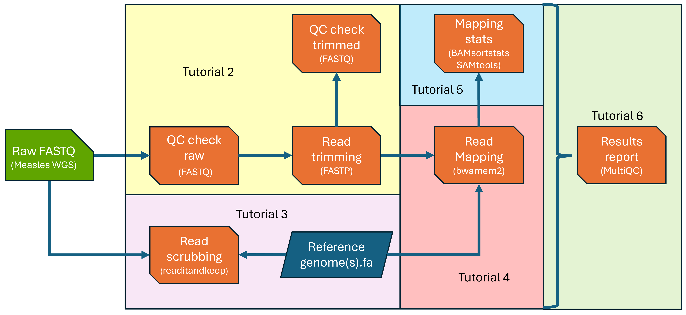

This simple pipeline starts with RAW FASTQ reads obtained from the SRA repository. Specifically, a [measles WGS sequencing sample](https://www.ncbi.nlm.nih.gov/sra?LinkName=biosample_sra&from_uid=61933769) obtained from a broader viral (non-SARS-CoV-2) surveillance effort at Wyoming PHL published under SRA project [PRJNA858824](https://www.ncbi.nlm.nih.gov/bioproject/PRJNA858824)

The pipeline then performs the following steps

1) Read QC on raw FASTQ reads with [FASTQC](https://www.bioinformatics.babraham.ac.uk/projects/fastqc/)
    - What is the quality of our reads off the sequencer?
2) Read trimming with [FASTP](https://github.com/opengene/fastp)
    - Removal of low quality reads and trimmming of low quality bases
3) **Challenge task**: Read QC on trimmed FASTQ reads with [FASTQC](https://www.bioinformatics.babraham.ac.uk/projects/fastqc/)
    - Does the quality of our reads improve post-trimming?
4) Read scrubbing on raw FASTQ reads with [read-it-and-keep](https://github.com/GlobalPathogenAnalysisService/read-it-and-keep)
    - If you anticipated submitting these sequences to a database and wanted to ensure removal of human reads
5) Read alignment with [bwa-mem2](https://github.com/bwa-mem2/bwa-mem2)
    - How well do our trimmed reads align to a reference genome?
6) Read alignment stats with [SAMtools](https://github.com/samtools/samtools)
    - Also converts SAM to BAM if you were to proceed with variant calling
7) Results report generation with [MultiQC](https://github.com/multiqc/multiqc)
    - Aggregates results from our pipeline into a final report

<br>

# 📖 Tutorial 6

The objectives of this tutorial are:
1) Organize results into the MultiQC report
2) Download and launch a CDC-available nextflow pipeline 
3) Understand a recent and significant change made in Nextflow v26.04
4) Optional challenge: Migrating to workflow outputs

<br> 

# Getting started

**Make sure that you are signed-in to your GitHub account.**

Navigate to the GitHub repo for the nextflow tutorial, [here](https://github.com/JLC2141/mdhhs_nextflow_training/tree/tutorial_6).

Select the `branch` icon and select the `tutorial_6` branch.

The webpage will reload. Confirm that the `tutorial_6` branch is loaded. Select the green <> Code icon, the Codespaces tab, and then select `Create codespace on tutorial_6`.

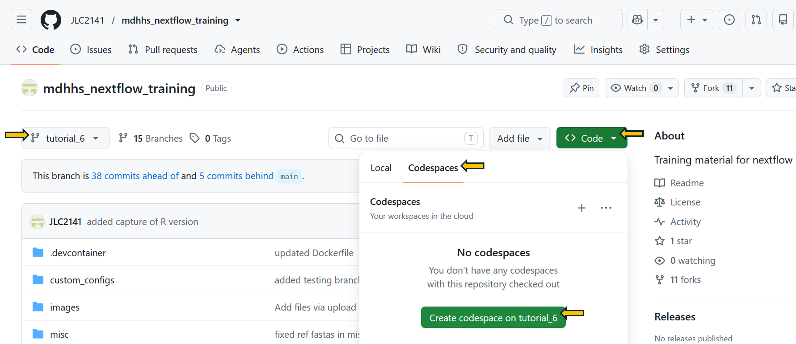

> [!NOTE]
> This will launch a codespace with 2 CPUs, 8 GB RAM, and 32 GB storage capacity <br>
> This is the default minimal virtual machine option for a GitHub codespace <br>

<br>

You will notice that we are at a checkpoint from our progress made up to the end of `tutorial 5`. Our nextflow pipeline is already downloaded along with the incorporation of the `FASTQC` module aliases, `FASTQC_RAW` and `FASTQC_TRIMMED`, the `FASTP` module, the `READITANDKEEP` module, the `BWAMEM2_INDEX`/`BWAMEM2_MEM` and `BOWTIE2_BUILD`/`BOWTIE2_ALIGN` alignment modules, the `BAM_SORT_STATS_SAMTOOS` subworkflow (and accompanying `SAMTOOlS` modules), and the `SAMTOOLS_DEPTH` module. 

<br>

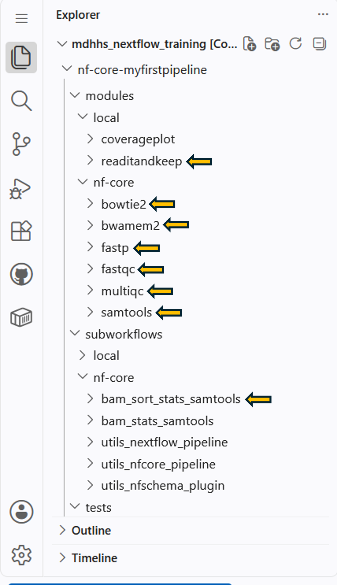

In addition, I've also added the components covered in the `tutorial 5 challenge`, which was incorporating a custom script (via the `bin/` directory) with a custom module (`COVERAGEPLOT`) to create a coverage depth plot. 

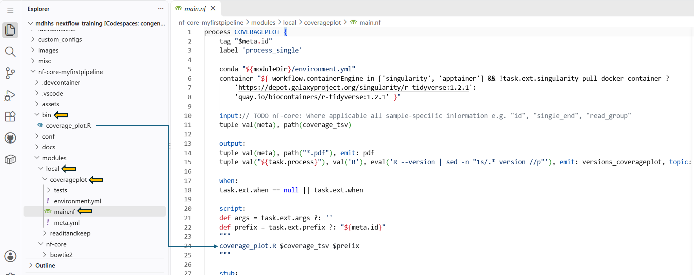

In the workflowflow script (`myfirstpipeline.nf`), the sorted `BAM` file output from the `BAM_SORT_STATS_SAMTOOLS` subworkflow was used as input into the `SAMTOOLS_DEPTH` module. The `SAMTOOLS_DEPTH` module output a `tsv` file with coverage depth stats at each nucleotide site in the `MH356245.1` measles D8 genotype reference genome. This output was used as input into the `COVERAGEPLOT` module:


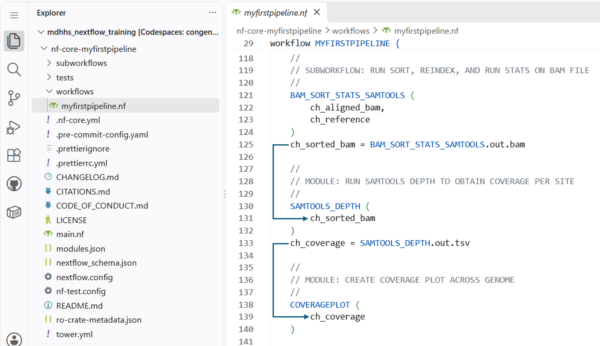


 where a custom `R` script was run to generate a `pdf` file containing a plot of the coverage depth vs nucleotide position:


 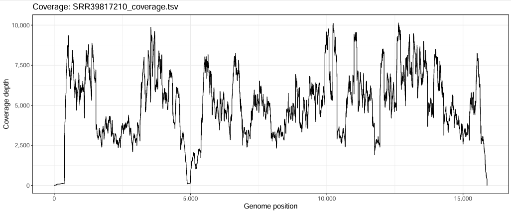


I encourage you to work through the `tutorial_challenge_5` to learn more about the implementation of custom scripts via the nextflow `bin/` directory. Access the branch for `tutorial_5_challenge`, [here](https://github.com/JLC2141/mdhhs_nextflow_training/tree/tutorial_5_challenge), and start the challenge, [here](https://github.com/JLC2141/mdhhs_nextflow_training/tree/tutorial_5#challenge-add-a-custom-module-to-incorporate-a-custom-script-via-the-bin-directory).


# Part I: Preparing MultiQC report

[MultiQC](https://seqera.io/multiqc/) is an open-source tool, pre-built into nextflow pipelines created with the nf-core CLI, for aggregating bioinformatics results into an `HTML` report. Unfortunately, it doesn't support all tools we included into our pipeline. 

But, you can view MultiQC-supported tools, [here](https://docs.seqera.io/multiqc/modules/).

<br>

<details>
<summary> Can you determine which tools within our pipeline are supported by MultiQc? Reveal solution, here</summary>

- FASTQC
- FASTP
- BOWTIE2
- SAMTOOLS

However, we will skip the incorporation of BOWTIE2 because this is redundant with outputs from SAMTOOLS

</details>

<br>


We will incorporate the results from each of these tools (`FASTQC`, `FASTP`, and `SAMTOOLS`) into our `MultiQC` report one-by-one.

### FASTQC MultiQC

Let's start with `FASTQC`

Recall when we first created our nextflow pipeline via the nf-core CLI, the `FASTQC` module was automatically installed for us and incorporated into our `launchDir/nf-core-myfirstpipeline/workflows/myfirstpipeline.nf` script. 

After the module declaration (`FASTQC`): 

 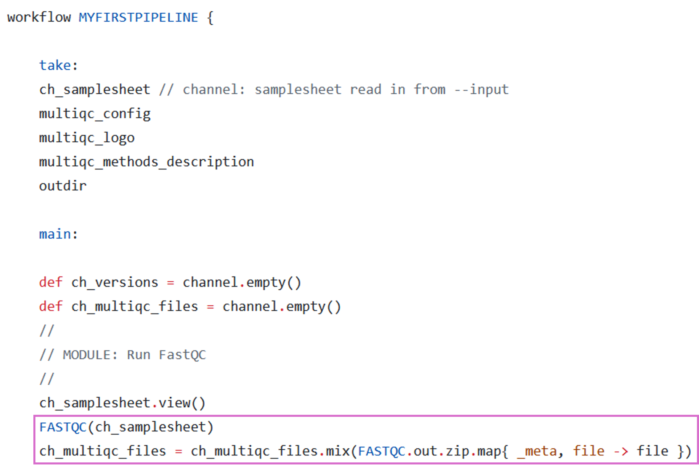

a multiqc channel was written as follows:

`ch_multiqc_files = ch_multiqc_files.mix(FASTQC.out.zip.map{ _meta, file -> file })`


Now, we have since updated this section of the workflow to accommodate the `FASTQC` module aliases:

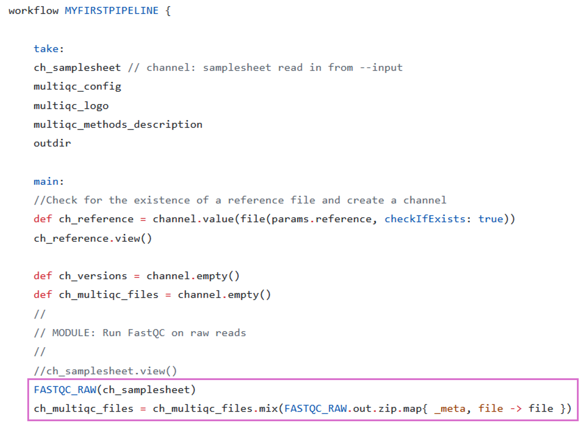

and so the multiqc channel is now written as follows:

`ch_multiqc_files = ch_multiqc_files.mix(FASTQC_RAW.out.zip.map{ _meta, file -> file })`

But the underlying structure still remains. Let's break this down. 

the [mix](https://docs.seqera.io/nextflow/reference/operator#mix) in `ch_multiqc_files.mix` is a nextflow operator that emits items from two or more channels into a single output channel. Basically, we are collecting all compatible MultiQC files into one channel.

Then, we need to determine which files from FASTQC are compatible with the MultiQC report. Check out the MultiQC documentation for [FASTQC](https://docs.seqera.io/multiqc/modules/fastqc)

<details>
<summary> Can you determine which FASTQC result files are compatible with MultiQC? Reveal solution, here</summary>

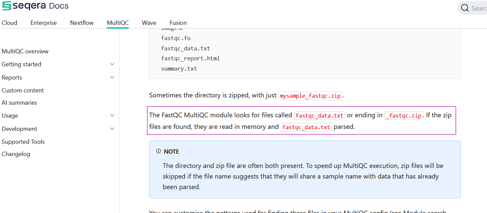

Okay, so the `.txt` or `.zip` files are compatible. 

</details>

<br>

Looking back at the `main.nf` process script for `FASTQC` (`launchDir/nf-core-myfirstpipeline/modules/nf-core/fastqc/main.nf`):

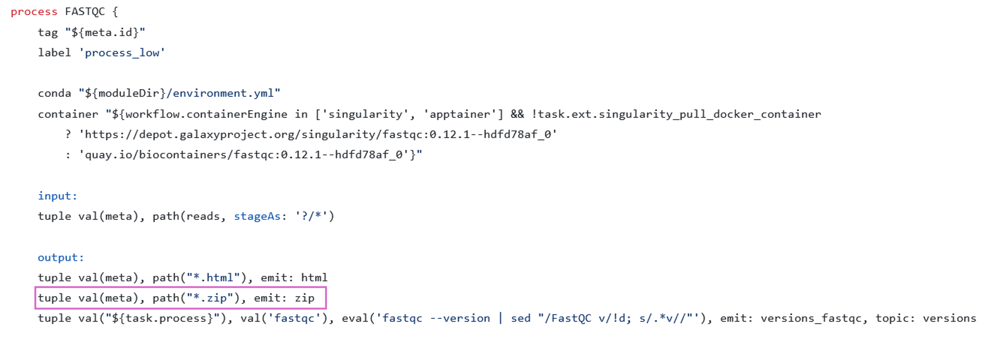

We see that the `zip` file is emitted. That is why `FASTQC_RAW.out.zip` is added after `ch_multiqc_files.mix`

But then why the following: `.map{ _meta, file -> file }`?

The [map](https://docs.seqera.io/nextflow/reference/operator#map) operator allows you to reorganize the structure of a channel. The `FASTQC_RAW.out.zip` channel is a tuple containing the metadata, `val(meta)` and the output file, `path("*.zip")`. 

`.map{ _meta, file -> file }` is accessing this channel and transforming the channel so that we only grab the file output `_meta, file > file`. MultiQC expects only the file, not the metadata. 

Why `_meta` and `file`? Well, it's intuitive, but it's not necessary. We could have used: `.map {x, y > y }` and it would have worked the same. Because `_meta` (or `x`) and `file` (or `y`) are representing the first (`val(meta)`) and second (`path("*.zip")`) elements of the tuple, respectively. 

Lastly `_meta` or `meta` works fine as well, however, underscore (`_`) in front of a variable is Groovy best coding practice and is used as a special identifier to mark intentionally unused variables. 

To put it all together, this:

`ch_multiqc_files = ch_multiqc_files.mix(FASTQC_RAW.out.zip.map{ _meta, file -> file })`

Captures the compatible output file from FASTQC for integration into the MultiQC report. We will capture various other outputs from other modules in a similar manner, taking the general form of:

`ch_multiqc_files = ch_multiqc_files.mix(MODULE.out.emitChannel.map{ _meta, file -> file })`

Recall that we added module aliases for `FASTQC`, `FASTQC_RAW` and `FASTQC_TRIMMED`. We previously updated the `ch_multiqc_files` for the `FASTQC_RAW` module but we still need to capture this file output from the `FASTQC_TRIMMED` channel for our MultiQC report. 

Locate the `FASTQC_TRIMMED` module in our pipeline workflow script (`launchDir/nf-core-myfirstpipeline/workflows/myfirstpipeline.nf`) and add the following line below the module declaration:

```
ch_multiqc_files = ch_multiqc_files.mix(FASTQC_TRIMMED.out.zip.map{ _meta, file -> file })
```

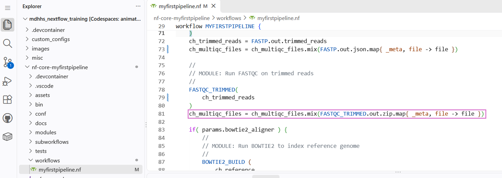

Now the `FASTQC` outputs from the raw and trimmed reads are captured within the `ch_multiqc_files` channel.

### FASTP MultiQC

Check out the MultiQC documentation for [FASTP](https://docs.seqera.io/multiqc/modules/fastp)

<details>
<summary> Can you determine which FASTP result files are compatible with MultiQC? Reveal solution, here</summary>

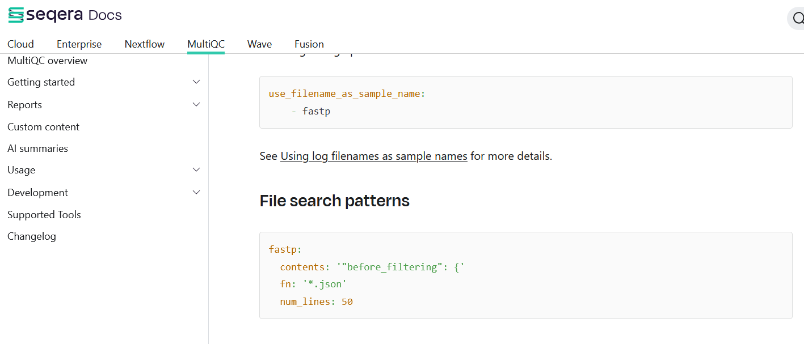

The `.json` file is compatible. 

</details>

<br>

Recall our `main.nf` process script for `FASTP` (`launchDir/nf-core-myfirstpipeline/modules/nf-core/fastp/main.nf`):

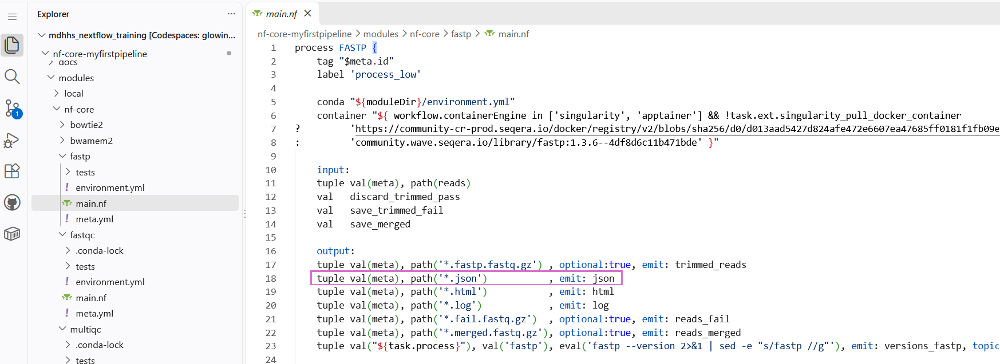

Meaning, the general MultiQC channel:

`ch_multiqc_files = ch_multiqc_files.mix(MODULE.out.emitChannel.map{ _meta, file -> file })`
 
Should take the form of: 

```
ch_multiqc_files = ch_multiqc_files.mix(FASTP.out.json.map{ _meta, file -> file })
```

for the `FASTP` module.

Place this in your `launchDir/nf-core-myfirstpipeline/workflows/myfirstpipeline.nf` script as follows:

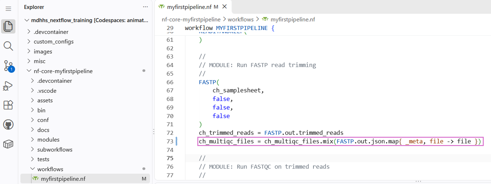


### SAMTOOLS MultiQC

Check out the MultiQC documentation for [SAMTOOLS](https://docs.seqera.io/multiqc/modules/samtools)

<details>
<summary> Can you determine which SAMTOOLS result files are compatible with MultiQC? Reveal solution, here</summary>

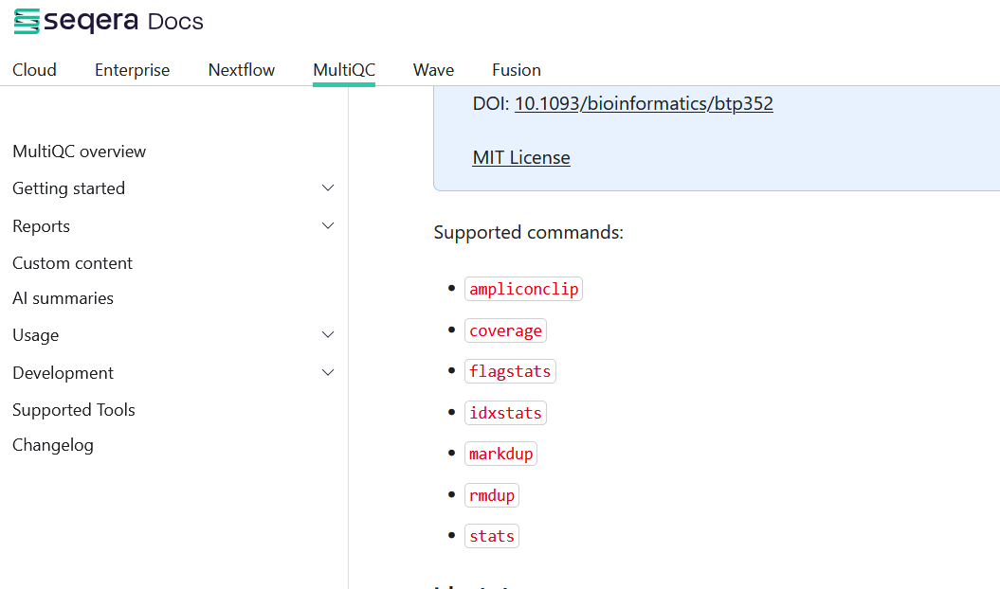

The `stats`, `flagstat`, and `idxstats` files.

</details>

<br>

Recall that our samtools tools are embedded within our `BAM_SORT_STATS_SAMTOOLS` subworkflow (`launchDir/nf-core-myfirstpipeline/subworkflows/nf-core/bam_sort_stats_samtools/main.nf`): 

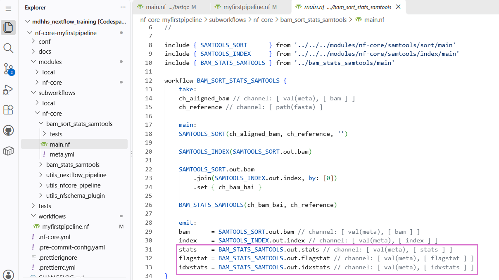

Which the channel outputs were extracted from the`BAM_STATS_SAMTOOLS` subworkflow (`launchDir/nf-core-myfirstpipeline/subworkflows/nf-core/bam_stats_samtools/main.nf`): 

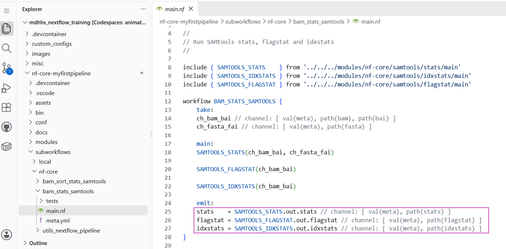

Which were output from the modules of `SAMTOOLS_STATS`:

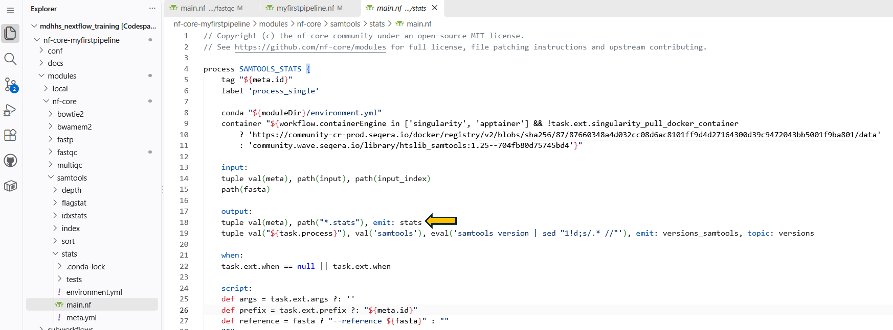

`SAMTOOLS_FLAGSTAT`:

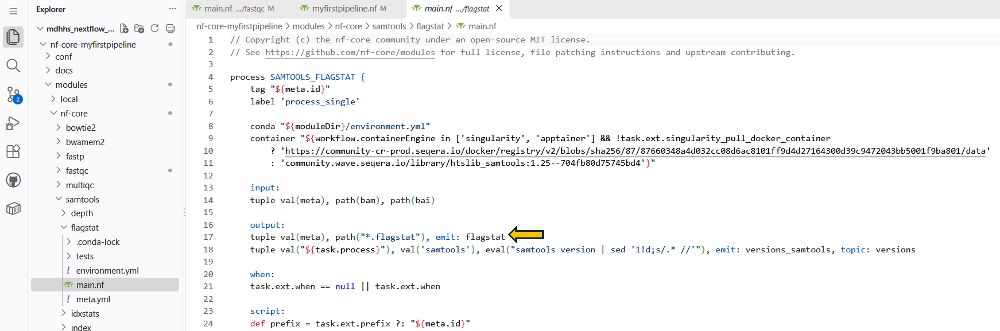

and 

`SAMTOOLS_IDXSTATS`:

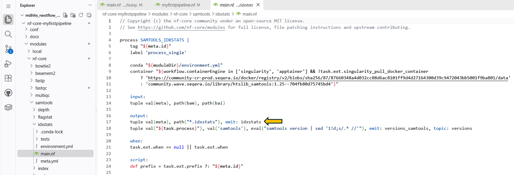


The general MultiQC channel:

`ch_multiqc_files = ch_multiqc_files.mix(MODULE.out.emitChannel.map{ _meta, file -> file })`
 
Should take the form of: 

```
ch_multiqc_files = ch_multiqc_files.mix(BAM_SORT_STATS_SAMTOOLS.out.stats.map{ _meta, file -> file })
ch_multiqc_files = ch_multiqc_files.mix(BAM_SORT_STATS_SAMTOOLS.out.flagstat.map{ _meta, file -> file })
ch_multiqc_files = ch_multiqc_files.mix(BAM_SORT_STATS_SAMTOOLS.out.idxstats.map{ _meta, file -> file })
```
for the aforementioned modules.

Place this in your `launchDir/nf-core-myfirstpipeline/workflows/myfirstpipeline.nf` script, just after the `BAM_SORT_STATS_SAMTOOLS` subworkflow, as follows:

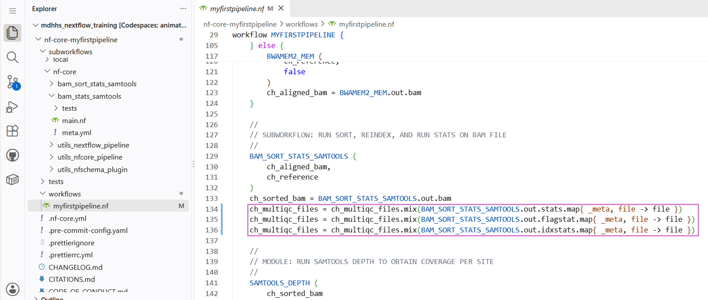

<br>

That's all we need to do (for now)! If you scroll to the end of the workflows pipeline script (`launchDir/nf-core-myfirstpipeline/workflows/myfirstpipeline.nf`), you will see the `MULTIQC` module is already set up and ready to go from when we first created our pipeline via the nf-core CLI: 

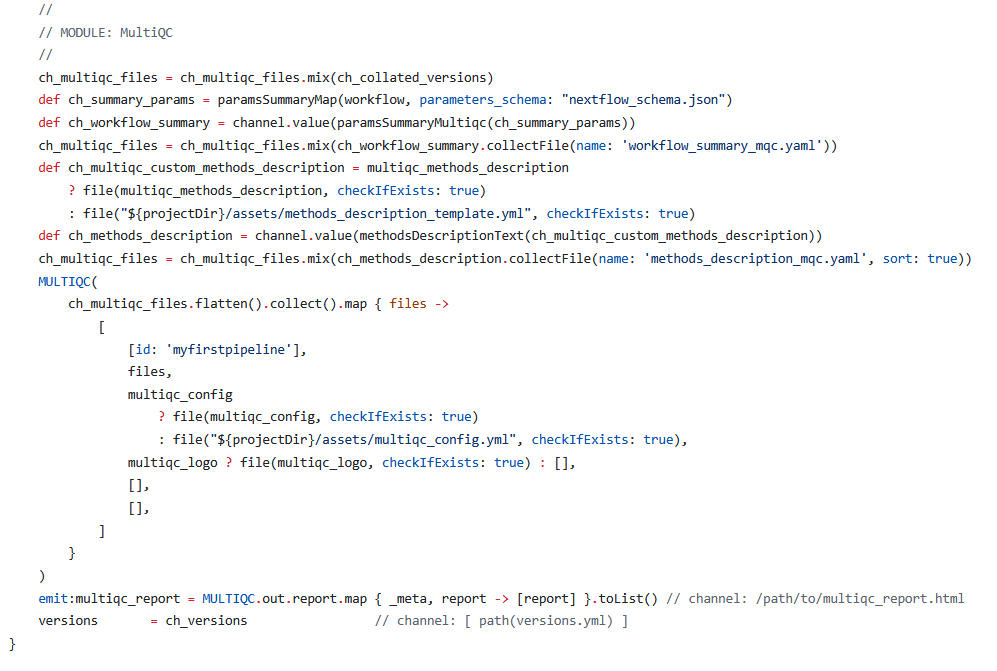

All we needed to do was capture our file outputs into the `ch_multiqc_files` channel. 

Now, test out the pipeline and let's take a look at the MultiQC report:

From the `launchDir`, `/workspaces/mdhhs_nextflow_training/`, download the sample:

```
bash sample_download.sh
```

Create the `samplesheet.csv` file

```
python3 fastq_dir_to_samplesheet.py reads/ samplesheet.csv
```

Run the pipeline:

```
bash run_nextflow_analysis.sh
```

Download the `MULTIQC` report:

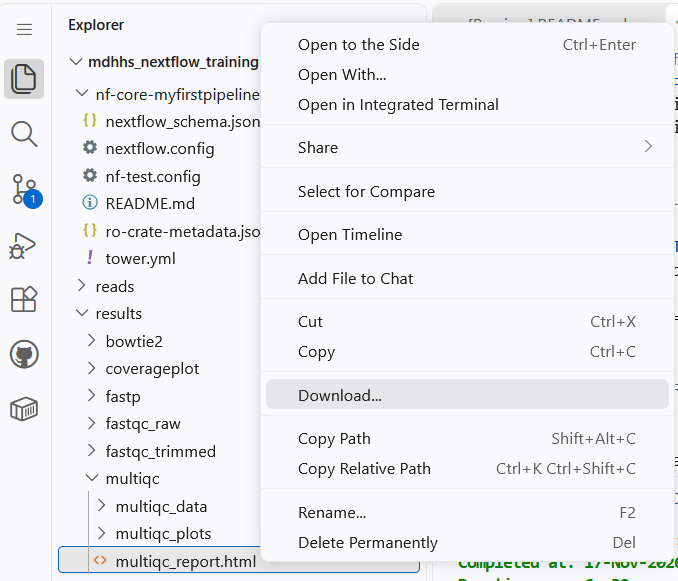


And observe it. There is one issue with the report and one slight issue that is more related to organization. Can you find out what is wrong?

<details>
<summary> Reveal solution, here</summary>

- There are only 2 file outputs from `FASTQC` even though we are expecting 4, 2 from `FASTQC_RAW` and 2 from `FASTQC_TRIMMED`
- The order of the ouputs organized within the report is off-putting. We'd much prefer:
    - FASTQC
    - FASTP
    - SAMTOOLS 

Let's fix these issues in part II.

</details>

<br>


# Part II. Alter workflow to accommodate FASTQC module aliases and fix MULTIQC organization

### Incorporate module aliases from FASTQC into the MULTIQC report

Notice in the FASTQC section of the report:

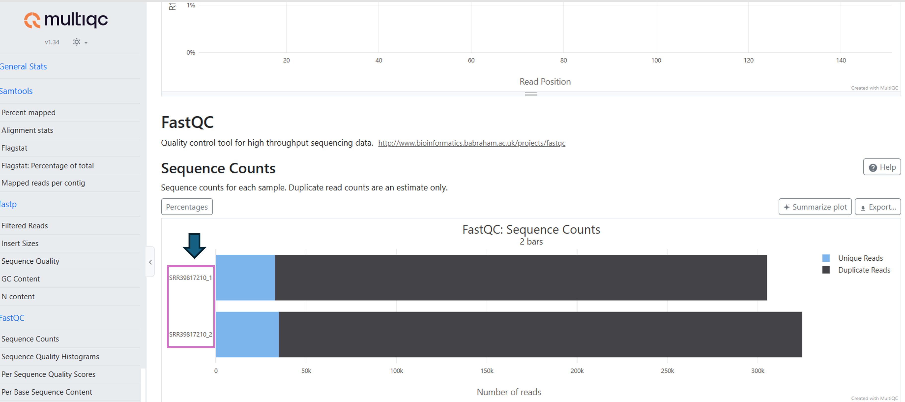

That the current sample names are `SRR39817210_1` and `SRR39817210_2`. This is an issue, because although we separated the `FASTQC` module aliases in separate output directories in our results:

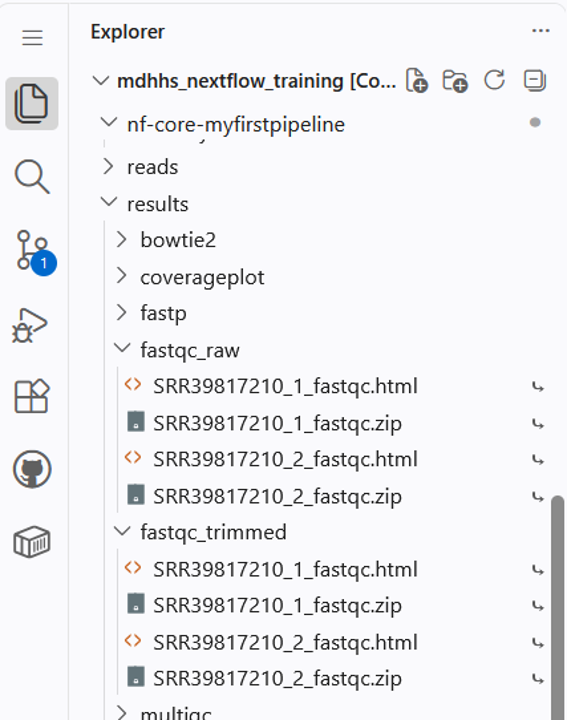

The naming scheme is similar enough that they can't be differentiated within the `MULTIQC` report. Let's remedy this.

Open the `FASTQC` main.nf process script file (`launchDir/nf-core-myfirstpipeline/modules/nf-core/fastqc/main.nf`).

Within the `input:` block, add the following line:

```
val qc_type
```

And within the `script:` block, alter the `def old_new_pairs` argument line as follows:

```
def old_new_pairs = reads instanceof Path || reads.size() == 1 ? [[reads, "${prefix}_${qc_type}.${reads.extension}"]] : reads.withIndex().collect { entry, index -> [entry, "${prefix}_${qc_type}_${index + 1}.${entry.extension}"] }
```

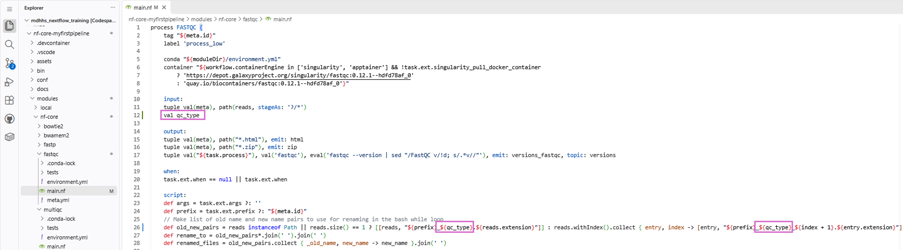


Save the file

```
Ctrl + s
```
<br>

Open the workflows pipeline script (`launchDir/nf-core-myfirstpipeline/workflows/myfirstpipeline.nf`).

Alter the `FASTQC_RAW` module declaration as follows:

```
FASTQC_RAW(
    ch_samplesheet, 
    'raw'
)
```

And alter the `FASTQC_TRIMMED` module declaration as follows:

```
FASTQC_TRIMMED(
    ch_trimmed_reads,
    'trimmed'
)
```

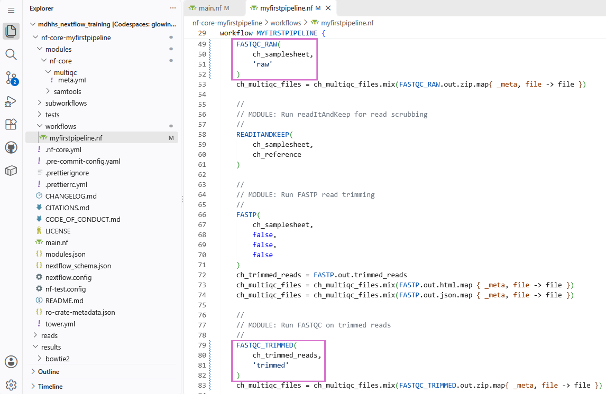

Why quotes around `'raw'` and `'trimmed'`? Because `'raw'` and `'trimmed'` is interpretted as string literal in Nextflow/Groovy.

For example, you're passing the literal text `'raw'` as the second input into your `FASTQC_RAW` module. Inside the `FASTQC_RAW` module, qc_type receives the value "raw", meaning, the nextflow variable `${qc_type}` ouputs `raw` when we run our script. 


Save the file

```
Ctrl + s
```

### Reorganize MULTIQC report

Recall the snapshot of the `MULTIQC` module within the pipeline workflow script from earlier?:

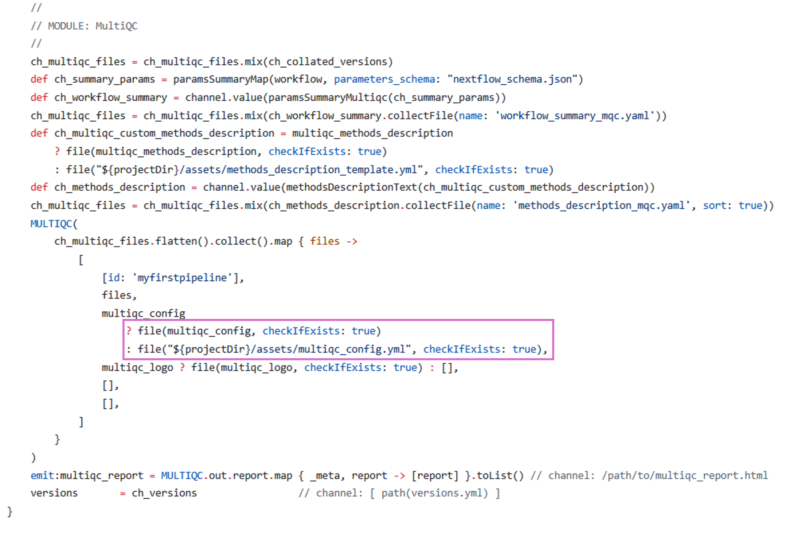

That purple box is showing the addition of a config file. This happens to be present by default as a result of creating our pipeline with nf-core CLI. This file, `multiqc_config.yml`, is located in the `assets/` directory (`launchDir/nf-core-myfirstpipeline/assets/`):

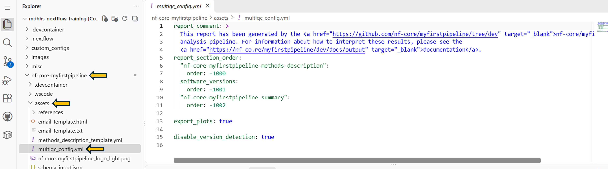

and can be used to reorder the results displayed in our `MULTIQC` report.

Add the following lines to the `multiqc_config.yml` file:

```
module_order:
  - fastqc
  - fastp
  - samtools
```

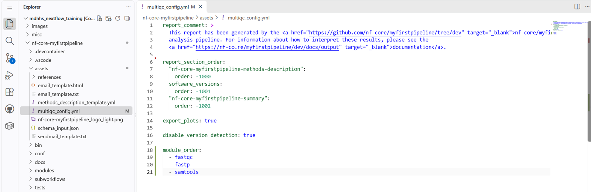

Save the file:

```
Ctrl + s
```

Okay, we should be set! 

### Re-run the pipeline

Delete the `results/` directory to get rid of the former `FASTQC` output files:

```
rm -rf results/
```

And then re-run the pipeline:

```
bash run_nextflow_analysis.sh
```

Notice how the outputs from `FASTQC` have changed according to our new naming scheme:

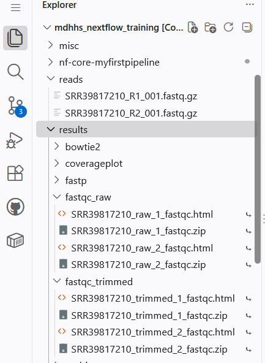

And if we download the `MULTIQC` report again:

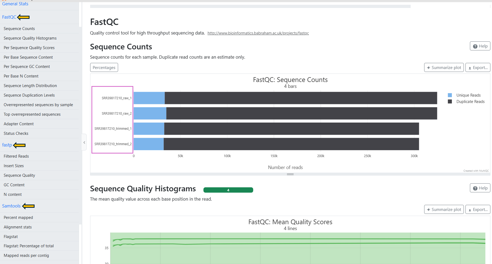

Notice how the order of the report changed and we now see 4 file summaries within the `FASTQC` section of the `MULTIQC` report.

Congratulations! This concludes the building of our pipeline, from pipeline creation with nf-core CLI, to the incorporation of various modules and subworkflows part of a simple bioinformatics workflow, and finally, the aggregation of results into a `MULTIQC` report. 

Recall in `tutorial_1` we obtained a pre-built nf-core nextflow pipeline. Well, continue with `Part III` in this tutorial to learn how to obtain a CDC-built nextflow pipeline from GitHub and troubleshoot an analysis. 

<br>

# Part III: Downloading, Running, and Troubleshooting a CDC Nextflow Pipeline

Only nf-core community-approved pipelines are stored on nf-core. But, you can also obtain nextflow pipelines from GitHub. And they do not have to abide by nf-core standards. For example, the CDC has created plenty of pipelines that are useful to the public health community. 

Let's take [MIRA-NF](https://github.com/CDCgov/MIRA-NF) as an example. This pipeline can be used for influenza, SARS-CoV-2, or RSV analysis and accepts Illumina and ONT data. First, return to the `launchDir` and make a new directory call `mira_test` and change into that directory:

```
cd /workspaces/mdhhs_nextflow_training
mkdir mira_test
cd mira_test
```

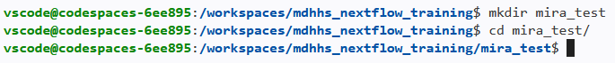

Now, git clone the repository. If you navigate to the MIRA-NF GitHub repository link, above, you can select the following items in order to copy the MIRA-NF URL:

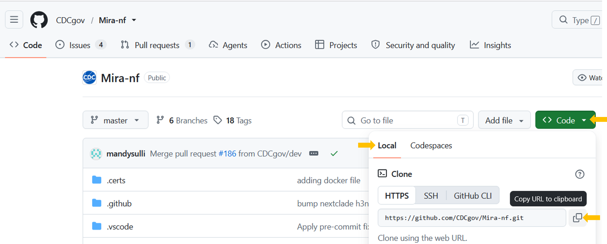

On your codespace terminal, enter the following:

```
git clone -b v2.2.1 https://github.com/CDCgov/Mira-nf.git 
```

Where you can paste the URL you copied from the MIRA-NF GitHub repository after "git clone". I also added the branch flag (`-b`) to specify the release we want to clone. You can find releases on the right panel of the GitHub repository: 

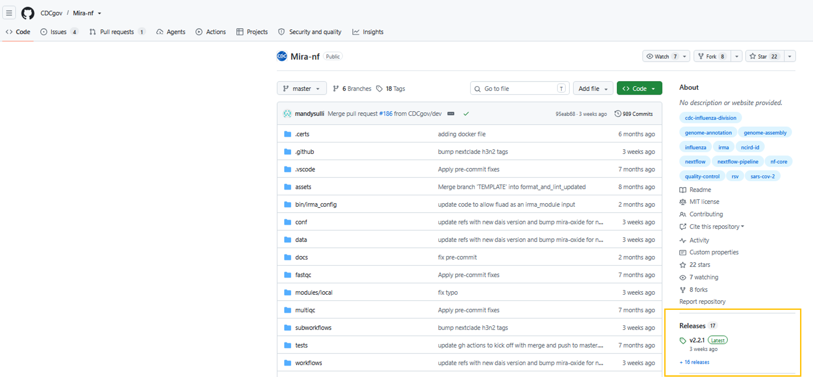

You should see messages indicating that the clone is occurring. And once complete, you should see the repository present on your Codespace VM:

```
ls Mira-nf
```

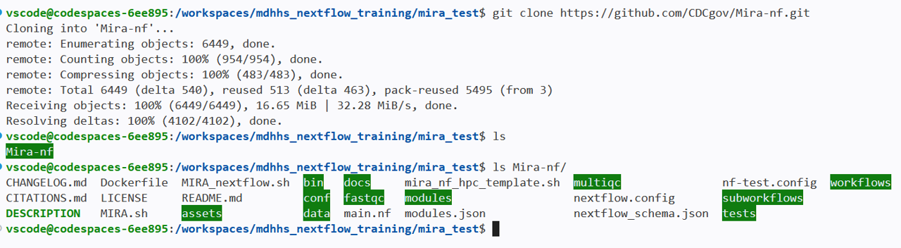


As typical of most nextflow pipelines, you will notice much of the same files and directories in this pipeline as previously encountered. 

Enter the following command to run a built-in test of the pipeline:

```
nextflow run Mira-nf/main.nf \
    -profile docker \
    --e 'Flu-Illumina' \
    --input Mira-nf/tests/test_data/flu_wgs_illumina/samplesheet.csv \
    --outdir results/ \
    --runpath Mira-nf/tests/test_data/flu_wgs_illumina/
```

<br>

> [!NOTE] <br>
> We did not go through and make the sample sheet and obtain FASTQ files because Mira has a built-in test. <br>
> But, do you notice the same main components as mentioned before? <br>
> We see the `nextflow run` command, the path to the `main.nf` file, the `profile` core option, and `input` and `output` parameters <br>
> Plus, a couple of additional inputs that are specific to this pipeline and outlined in the [documentation](https://github.com/CDCgov/MIRA-NF#input-parameters-for-mira-nf-workflows) <br>

<br>

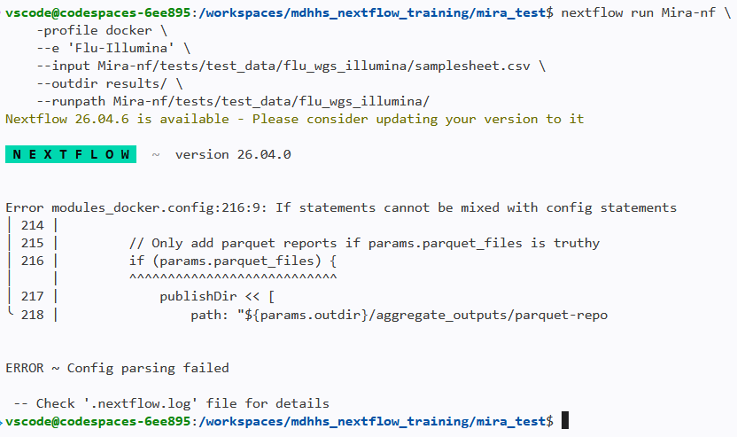

Ooo man, we have an error! This one does not seem as intuitive as other errors we have experienced. <br>

And this is a problem with nextflow, at times, when it comes to error reporting. However, when this occurs, one of this first things I do to troubleshoot the error is to check if someone else has already experienced this error before and reported it as an issue on the GitHub repo. So let's see! <br>

Naviate back to the CDC's Mira [GitHub repo](https://github.com/CDCgov/Mira-nf) and select the `Issues` tab:

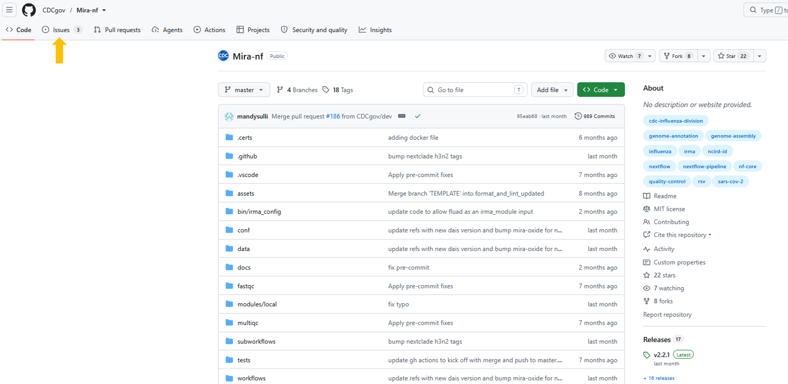

This is where folks document issues they experience when trying to use a pipeline. Discussions on error resolution with the authors of the pipeline can be seen here. In the search bar, search the following error we recieved: <br>

`ERROR ~ Config parsing failed`

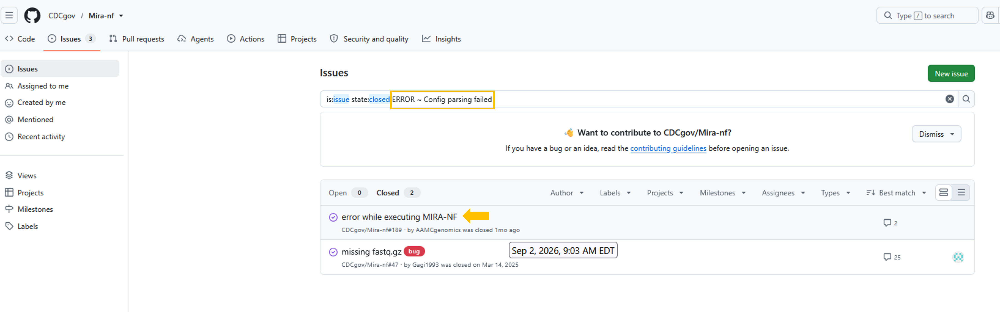

Select on the first option. And if we search and scroll on this particular [issue page](https://github.com/CDCgov/Mira-nf/issues/189):

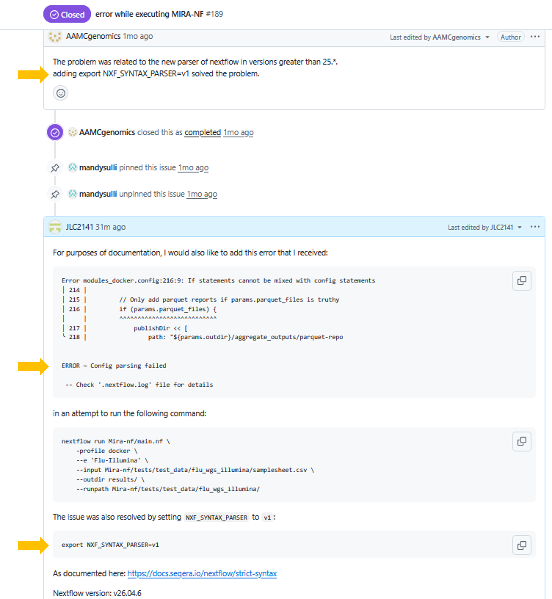

We see that the original issue was resolved with `export NXF_SYNTAX_PARSER=v1` and that the exact error we just encountered was also documented within this issue showing a similar method for issue resolution. <br>

This may be a good time to introduce nextflow's [strict syntax](https://docs.seqera.io/nextflow/strict-syntax). Recall that Nextflow is a programming language built on [Groovy](https://training.nextflow.io/latest/side_quests/essential_scripting_patterns/), a superset of Java. Now, as nextflow transitions from it's legacy parser to the strict parser, the strict parser only allows for a subset of Groovy syntax for building pipelines in nextflow. <br>

The gist of it is that in Nextflow version 26.04 and later, the strict sytax parser (v2) is turned on by default, and has updated rules as to what syntax is allowed when building nextflow pipleines.  

The workaround solution, which is provided in the [strict syntax](https://docs.seqera.io/nextflow/strict-syntax) documentation (and from the GitHub issue resolution) is to enable nextflow's legacy syntax parser as `v1`:

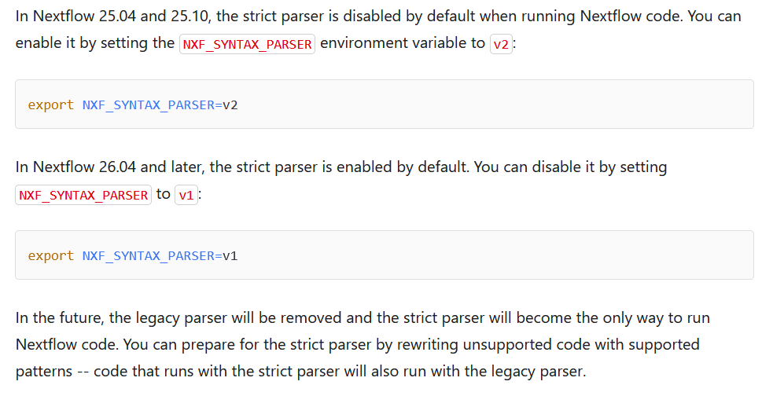

And we can achieve this by exporting this environmental variable (NXF_SYNTAX_PARSER) in our command line:

```
export NXF_SYNTAX_PARSER=v1
```

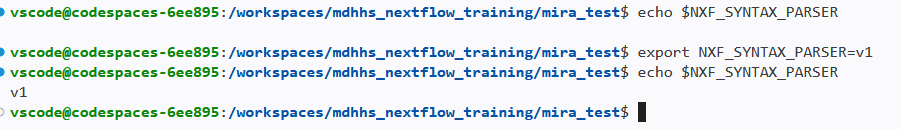

Now, try re-running the pipeline as we did before:

```
nextflow run Mira-nf/main.nf \
    -profile docker \
    --e 'Flu-Illumina' \
    --input Mira-nf/tests/test_data/flu_wgs_illumina/samplesheet.csv \
    --outdir results/ \
    --runpath Mira-nf/tests/test_data/flu_wgs_illumina/
```

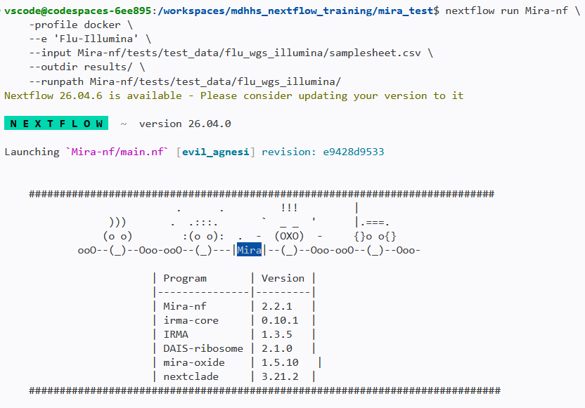


Success!

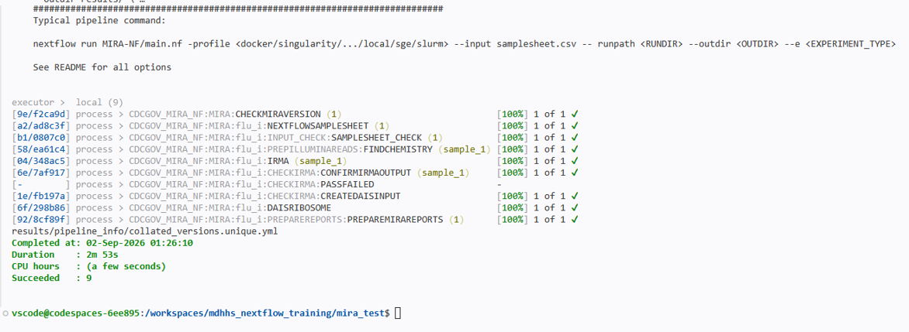

<br>

We will not cover the intricacies of CDC's Mira nextflow pipeline. The point of `Part III` was to:
1. Demonstrate the ease of obtaining (via `git clone`) and starting a freely available nextflow pipeline (from the public health community) that is not from nf-core 
2. Bringing your attention to a very recent syntax change in Nextflow that needs careful evaluation when using nextflow and community pipelines
    - Ask yourself, which nextflow version am I using and does this pipeline abide to strict nextflow syntax?

You may hear terminology such as "refactoring" nextflow pipelines. This means editing current pipelines (typically older pipelines built in Nextflow versions <26.04) so that they stay up-to-date and compatible with updated versions of nextflow, including abiding to strict syntax. Because as you can see from the [strict syntax](https://docs.seqera.io/nextflow/strict-syntax) documentation, eventually the "NXF_SYNTAX_PARSER=v1" option will be phased out in later versions of nextflow. 

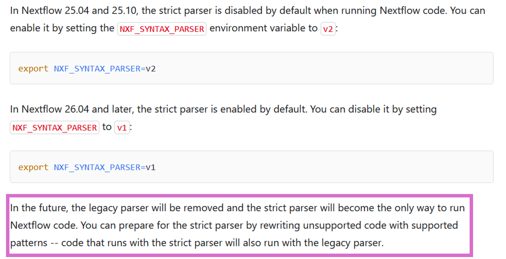

I'm emphazing this because this change is relatively new (Nextflow 26.04 was released in April of 2026). And as your explore nextflow and public health nextflow pipelines, you have to keep this detail in mind.  

To use public health pipelines that aren't refactored yet, your options are:
1) Downgrade your nextflow version where syntax parser is v1 by default
2) export NXF_SYNTAX_PARSER=v1 while it's still available as an option in Nextflow v26.04

# Challenge: Migrating to workflow outputs

Stay tuned...

# Extra resources

- Addtional nextflow trainings
    - https://training.nextflow.io/latest/
    - Created by the developers of Nextflow
- Nextflow youtube channel
    - https://www.youtube.com/@Nextflow
- Nextflow slack channel
    - [Join here](https://www.google.com/url?sa=t&source=web&rct=j&opi=89978449&url=CAESZgHEIkXXLk86TfY8_61USAB-075Cym7xmwxeFApNyr2Tztlf03esPL1T9hhlHmalTdxL2wKzvbXYdFoWJ_E_aX30b6-SnU6ANQm6I4015H_5MFVnCWMSK3hVTlynJgnYf8l8w5eiwg&ved=2ahUKEwj3laSdzo-YAxV0GoAAHfWtLOIQFnoECA8QAQ&uoh=2&usg=AOvVaw2GiPr6_cRn66ImFBo8vEUE)
- Other resources for getting help with Nextflow
    - https://training.nextflow.io/latest/help/
- CDC, SPHL, and nf-core nextflow GitHub repositories
    - CDC
        - [tbvarpipe](https://github.com/amd-ph-core/tbvarpipe)
        - [PHoeNIx](https://github.com/CDCgov/phoenix)
        - [MIRA](https://github.com/CDCgov/MIRA)
    - SPHL
        - [MDHHS](https://github.com/MDHHS-Bioinformatics?view_as=public)
        - [UPHL-BioNGS](https://github.com/UPHL-BioNGS)
        - [NW-PaGe](https://github.com/NW-PaGe)
        - [Florida BPHL-Molecular](https://github.com/BPHL-Molecular)
    - nf-core
        - [viralrecon](https://github.com/nf-core/viralrecon)
- Container repositories
    - [StaPH-B docker hub](https://hub.docker.com/u/staphb)

