# Table of contents
- [Overview](#-overview)
- [Tutorial 5](#-tutorial-5)
- [Part I](#part-i-installing-and-editing-a-subworkflow-from-nf-core-cli)
- [Part II](#part-ii-installing-and-editing-a-module-from-nf-core-cli)
- [Part III](#part-iii-incorporating-new-subworkflows-and-modules-into-the-pipeline)
- [Part IV](#part-iv-testing-the-pipeline)
- [Challenge](#challenge-add-a-custom-module-to-incorporate-a-custom-script-via-the-bin-directory)
- [Recap](#recap)

# 📖 Overview

Here is an overview of the pipeline we are going to build:

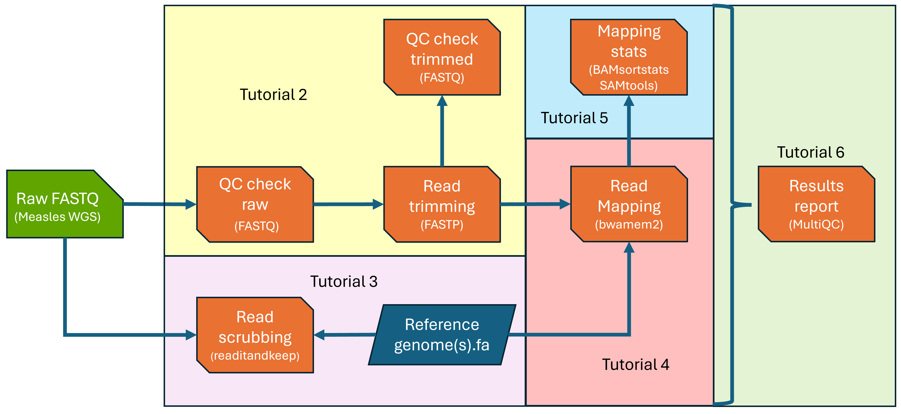

This simple pipeline starts with RAW FASTQ reads obtained from the SRA repository. Specifically, a [measles WGS sequencing sample](https://www.ncbi.nlm.nih.gov/sra?LinkName=biosample_sra&from_uid=61933769) obtained from a broader viral (non-SARS-CoV-2) surveillance effort at Wyoming PHL published under SRA project [PRJNA858824](https://www.ncbi.nlm.nih.gov/bioproject/PRJNA858824)

The pipeline then performs the following steps

1) Read QC on raw FASTQ reads with [FASTQC](https://www.bioinformatics.babraham.ac.uk/projects/fastqc/)
    - What is the quality of our reads off the sequencer?
2) Read trimming with [FASTP](https://github.com/opengene/fastp)
    - Removal of low quality reads and trimmming of low quality bases
3) **Challenge task**: Read QC on trimmed FASTQ reads with [FASTQC](https://www.bioinformatics.babraham.ac.uk/projects/fastqc/)
    - Does the quality of our reads improve post-trimming?
4) Read scrubbing on raw FASTQ reads with [read-it-and-keep](https://github.com/GlobalPathogenAnalysisService/read-it-and-keep)
    - If you anticipated submitting these sequences to a database and wanted to ensure removal of human reads
5) Read alignment with [bwa-mem2](https://github.com/bwa-mem2/bwa-mem2)
    - How well do our trimmed reads align to a reference genome?
6) Read alignment stats with [SAMtools](https://github.com/samtools/samtools)
    - Also converts SAM to BAM if you were to proceed with variant calling
7) Results report generation with [MultiQC](https://github.com/multiqc/multiqc)
    - Aggregates results from our pipeline into a final report

# 📖 Tutorial 5

The objectives of this tutorial are:
1) Use the nf-core command line interface (CLI) to download a a module and a subworkflow
2) Understand required files to edit and nextflow syntax needed to incorporate the SAMTOOLS_DEPTH module and the BAM_SORT_STATS_SAMTOOLS subworkflow into our pipeline
3) Optional challenge: Learn how to incorporate custom scripts via the bin directory

<br> 

# Getting started

**Make sure that you are signed-in to your GitHub account.**

Navigate to the GitHub repo for the nextflow tutorial, [here](https://github.com/JLC2141/mdhhs_nextflow_training/tree/tutorial_5).

Select the `branch` icon and select the `tutorial_5` branch.

The webpage will reload. Confirm that the `tutorial_5` branch is loaded. Select the green <> Code icon, the Codespaces tab, and then select `Create codespace on tutorial_5`.

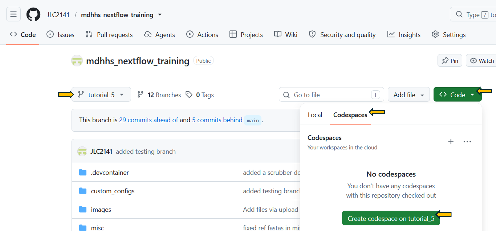

> [!NOTE]
> This will launch a codespace with 2 CPUs, 8 GB RAM, and 32 GB storage capacity <br>
> This is the default minimal virtual machine option for a GitHub codespace <br>

<br>

You will notice that we are at a checkpoint from our progress made up to the end of `tutorial 4`. Our nextflow pipeline is already downloaded along with the incorporation of the `FASTP` module, the `FASTQC` module aliases, `FASTQC_RAW` and `FASTQC_TRIMMED`, the `READITANDKEEP` module, and the `BWAMEM2_INDEX` and `BWAMEM2_MEM` modules. 

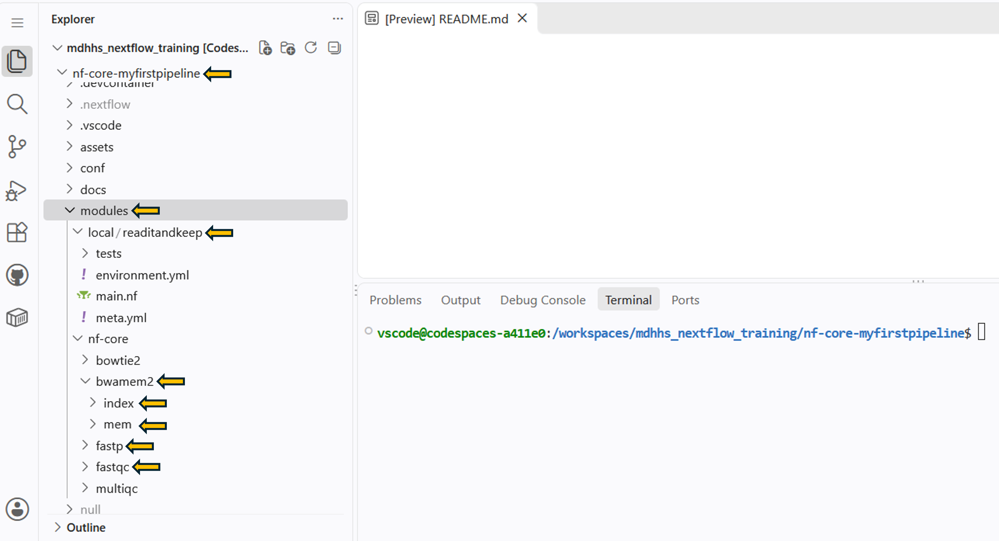

In addition, I've also added the components covered in the `tutorial 4 challenge`, which was incorporating a second read alignment tool (`bowtie2`) and adding a parameter to switch between alignment tool choice. First, the `bowtie2` modules, `BOWTIE2_BUILD` and `BOWTIE2_ALIGN`, were installed for reference indexing and alignment, respectively.  

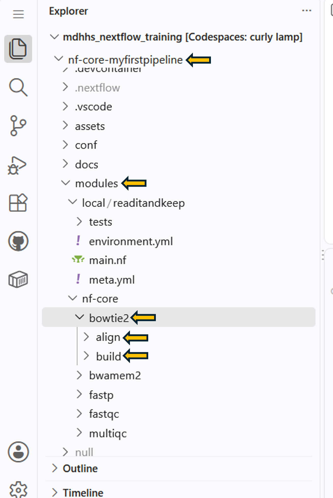

Following module installation, the following files were edited to incorporate `bowtie2`:
- `launchDir/nf-core-myfirstpipeline/modules/nf-core/bowtie2/build/main.nf`
- `launchDir/nf-core-myfirstpipeline/modules/nf-core/bowtie2/align/main.nf`
- `launchDir/nf-core-myfirstpipeline/conf/modules.config`
- `launchDir/nf-core-myfirstpipeline/workflows/myfirstpipeline.nf`
- `launchDir/custom_configs/training.config`

I encourage you to work through the `tutorial_challenge_4` to learn more about the implementation of tool choice via parameterization. Look at the files mentioned above for guidance. Access the branch for `tutorial_4_challenge`, [here](https://github.com/JLC2141/mdhhs_nextflow_training/tree/tutorial_4_challenge), and start the challenge, [here](https://github.com/JLC2141/mdhhs_nextflow_training/tree/tutorial_4_challenge#challenge-add-bowtie2-and-a-parameter-to-choose-between-aligners).

But briefly, the workflow script, `myfirstpipeline.nf` now has an `if-else` statement based on the parameter (`param`), `bowtie2_aligner`:

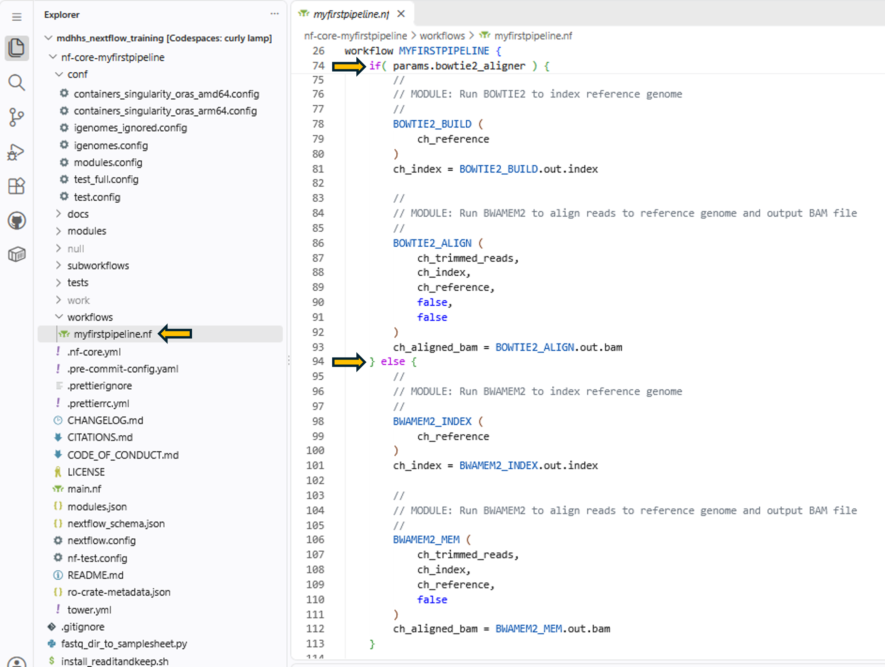

This boolean-specified (`true/false`) parameter was added to our custom config file (`launchDir/custom_configs/training.config`):

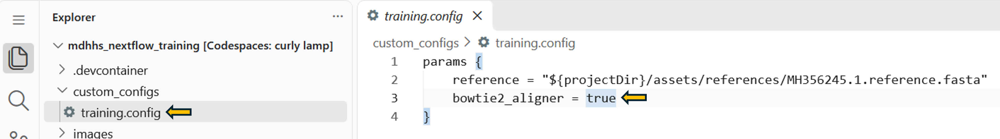

where `true` results in using the `bowtie2` aligner during analysis and `false` would result in using the `bwamem2` during analysis. 

We will now continue our tutorial with adding a common subworkflow to look at basic stats post-alignment and adding a module to prepare for the `tutorial 5 challenege`. 


# Part I: Installing and editing a subworkflow from nf-core CLI 

### Install the `BAM_SORT_STATS_SAMTOOLS` subworkflow 

Remember, nf-core CLI commands are meant to function inside of your pipeline directory. Change into your pipeline directory:

```
cd nf-core-myfirstpipeline
```

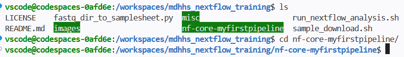

So that we are currently working in the `/workspaces/mdhhs_nextflow_training/nf-core-myfirstpipeline/` directory.

Run the following command:

```
nf-core subworkflows install
```

and then begin typing:

```
bam_sort_stats_samtools
```

Use the `down arrow key` and select it with `Enter`:

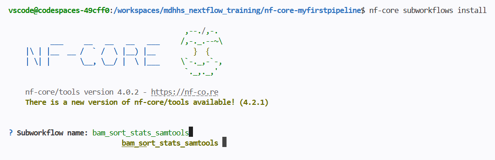

If successfully installed, you will see the following:

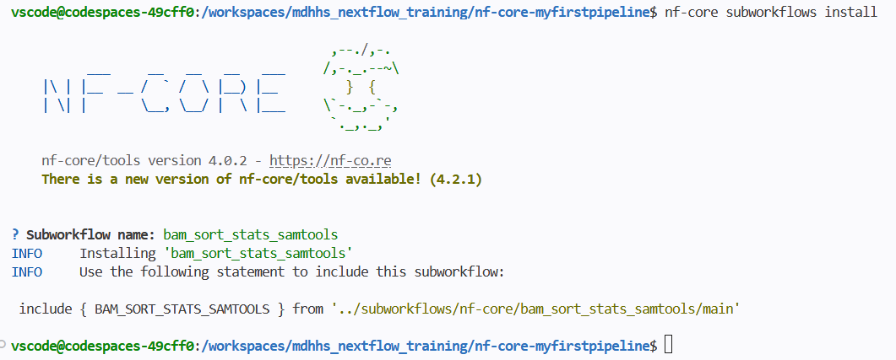

Take note of the `include` line as we'll need this to import our subworkflow into our workflow script. 

What are nextflow subworkflows? Subworkflows are combined tools that make up a "mini-workflow". Ideally, they should combine logical steps in a pipeline used relatively often in bioinformatics pipelines. See more, [here](https://nf-co.re/docs/specifications/components/subworkflows/general). 

In particular, this subworkflow, `BAM_SORT_STATS_SAMTOOLS` will: <br>
- Sort our BAM file and re-index it.
- Run a variety of Samtools modules to provide various alignment stats, a typical series of steps post-alignment.

<br>

> [!Note]
> There a variety of different subworkflows available through the nf-core community. <br>
> You can view all [here](https://nf-co.re/subworkflows/) or run the following command:

```
nf-core subworkflows list remote
```

<br>

### Understand the `BAM_SORT_STATS_SAMTOOLS` subworkflow organization


Once installed, notice how the subworkflow has been installed into the `launchDir/nf-core-myfirstpipeline/subworkflow/nf-core` directory as `bam_sort_stat_samtools`:

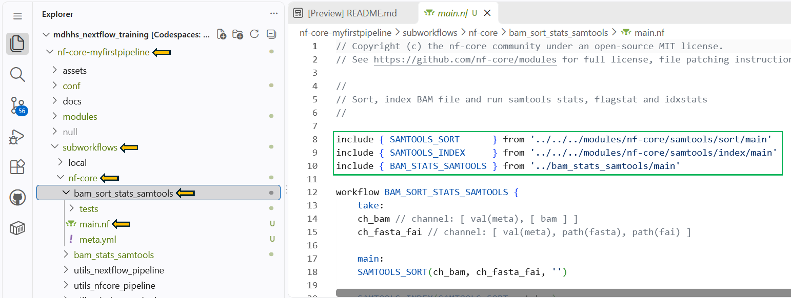


Also notice how the subworkflow is importing other components (green box). Recall that in our workflow script, `launchDir/nf-core-myfirstpipeline/workflows/myfirstpipeline.nf`, the imports look as follows:

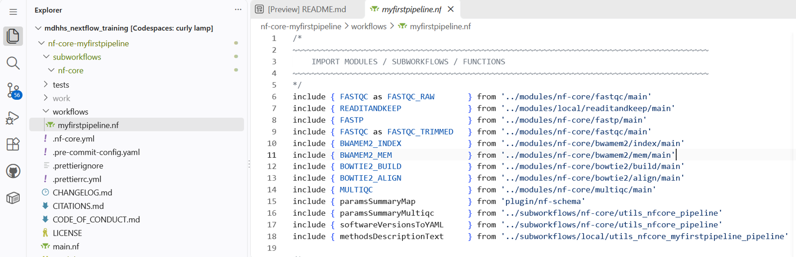

So why do the imports from the workflow script only have `../` at the beginning of the relative paths and the `BAM_SORT_STATS_SAMTOOLS` subworkflow we just installed has both `../` and `../../../` to start as relative paths? What is being imported?

<br>

<details>
<summary>Reveal solution, here</summary>

The imports are starting from the path relative to where the script that is being executed is located. So in `launchDir/nf-core-myfirstpipeline/workflows/myfirstpipeline.nf`, we are currently in `launchDir/nf-core-myfirstpipeline/workflows/` so we import from `modules/` and `subworkflows/` by navigating up one parent directory to `launchDir/nf-core-myfirstpipeline/`

Now, when we import the subworkflow into our pipeline from the workflow script, `myfirstpipeline.nf`, it will look as follows:

`include { BAM_SORT_STATS_SAMTOOLS    } from '../subworkflows/nf-core/bam_sort_stats_samtools/main'`

So the `bam_sort_stats_samtools/main.nf` subworkflow is then being read and trying to import from it's location in `launchDir/nf-core-myfirstpipeline/nf-core/bam_sort_stats_samtools/`

Three parent directories up, `../../../`, gets us back to `launchDir/nf-core-myfirstpipeline/`, from which when can then enter the `modules/` directory and script paths therein. One parent directory up, `../`, gets us back to `launchDir/nf-core-myfirstpipeline/subworkflows/nf-core/`, from which we can then import other subworkflows into our original subworkflow that we downloaded.


</details>

<br>

What's convenient about the nf-core CLI is that when we install a subworkflow, it installs all accompanying modules and subworkflows needed for the subworkflow to function. For example, we didn't install the `SAMTOOLS_SORT` and `SAMTOOLS_INDEX` modules, but it's imported by the `BAM_SORT_STATS_SAMTOOLS` subworkflow so it was automatically downloaded for us: 

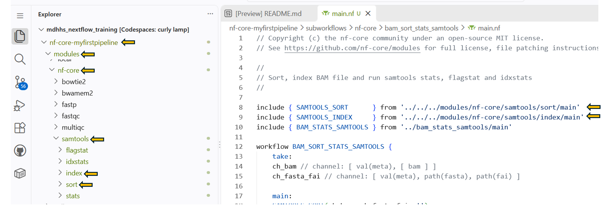

- samtools sort
    - sorts reads by genomic coordinates
- samtools index
    - will be used to re-index our sorted BAM file

<br>

Likewise, we did not install the `BAM_STATS_SAMTOOLS` [subworkflow](https://nf-co.re/subworkflows/bam_stats_samtools/), but it's imported by the `BAM_SORT_STATS_SAMTOOLS` subworkflow so it was also automatically downloaded for us:

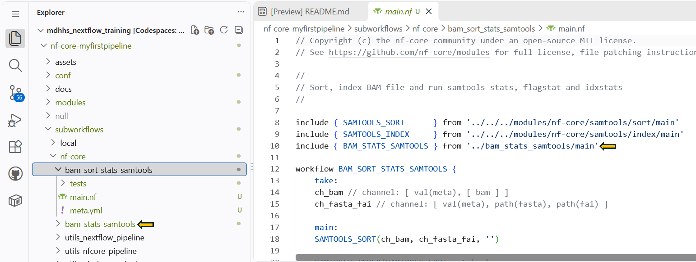

And if we look at the `main.nf` file for this subworkflow (`launchDir/nf-core-myfirstpipeline/subworkflows/nf-core/bam_stats_samtools/main.nf`), we see that this subworkflow imports three additional modules: 

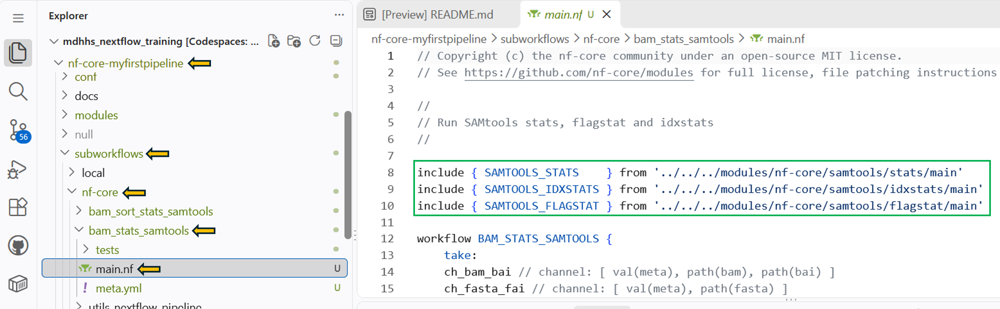

- [samtools stats](https://nf-co.re/modules/samtools_stats/)
    - comprehensive statistics from SAM/CRAM/BAM file
- [samtools idxstats](https://nf-co.re/modules/samtools_idxstats/)
    - alignment summary statistics
- [samtools flagstat](https://nf-co.re/modules/samtools_flagstat/)
    - counts total alignments

And these modules have been automatically installed for us, as well: 

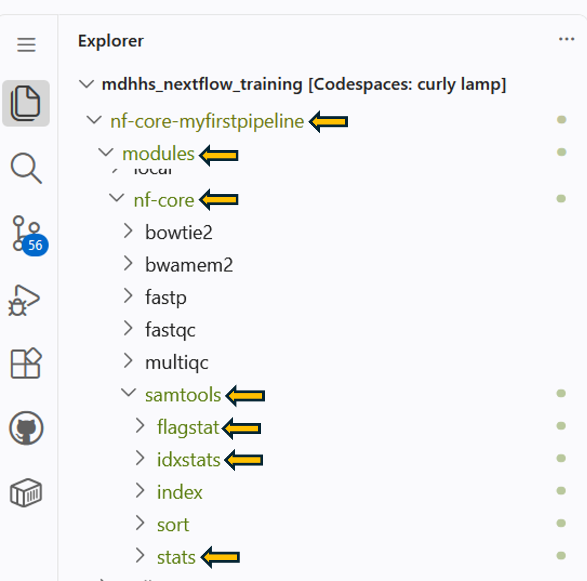


Okay, let's make sense of this (sub)workflow inception. The `main.nf` script of the original subworkflow we installed, `BAM_SORT_STATS_SAMTOOLS` is shown, below: 


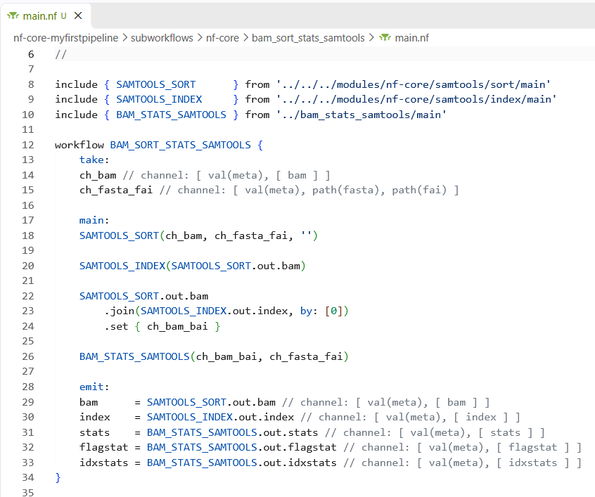

This subworkflow: <br>
- Imports two modules and a subworkflow
    - Again, imported via `../../../` and `../`, respectively. 
- Takes a BAM file and fasta file as input
    - Note: inputs and names will be edited for our pipeline
- Uses input channels from the `take:` block for `SAMTOOLS_SORT`
    - Contains an emit channel named `bam`
- Uses the `BAM` output from `SAMTOOLS_SORT` as input into `SAMTOOLS_INDEX`
    - The input it the output of `SAMTOOLS_SORT`, MODULE.out.emitChannel, `SAMTOOLS_SORT.out.bam`
- Uses the `.join` and `.set` operators to create a tuple
    - Note: both of these outputs take the form of `tuple val(meta), path(bam)` or `tuple val(meta), path(bai)`. Joining by the 0 index joins by the sample ID
    - `.set` { ch_bam_bai } sets the channel variable name. Equivalent to `ch_bam_bai = SAMTOOLS_SORT.out.bam.join(SAMTOOLS_INDEX.out.index, by: [0])`
    - This ultimately creates `tuple val(meta), path(bam), path(bai)`
- Uses the new sorted and indexed bam tuple, `ch_bam_bai` along with the reference from the `take:` block for the `BAM_STATS_SAMTOOLS` subworkflow
    - This subsequent subworkflow is elaborated, below.
- Emits various aspects of the subworkflow if we wanted to use any in downstream modules/subworkflows in our pipeline

<br>

The `main:` block of the `BAM_SORT_STATS_SAMTOOLS` subworkflow launches another subworkflow via `BAM_STATS_SAMTOOLS(ch_bam_bai, ch_fasta_fai)`, which looks as follows:

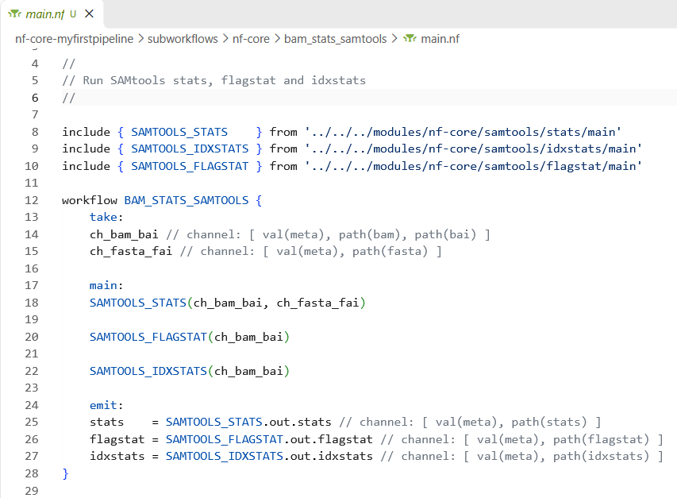

This subworkflow: <br> 
- Imports three modules
    - Again, imported via `../../../`
- Takes (`take:` block) the sorted and re-indexed BAM file combined in a tuple along with a reference file
- Launches the three samtools modules for alignment statistics
- Emits the results of these modules as `stats`, `flagstat`, `idxstats`
    - Note how the `BAM_SORT_STATS_SAMTOOLS` subworkflow emits these channels out as `BAM_STATS_SAMTOOLS.out.stats`, `BAM_STATS_SAMTOOLS.out.flagstat`, and `BAM_STATS_SAMTOOLS.out.idxstats`
    - It's like we're pulling the results from the individual modules to the `BAM_STATS_SAMTOOLS` subworkflow (e.g. `stats = SAMTOOLS_STATS.out.stats`) ...
    - to the `BAM_SORT_STATS_SAMTOOLS` subworkflow (e.g. `stats = BAM_STATS_SAMTOOLS.out.stats`) ...
    - and finally, if desired, to our workflow pipeline (e.g `ch_stats = BAM_SORT_STATS_SAMTOOLS.out.stats`).


### Edit the `BAM_SORT_STATS_SAMTOOLS` subworkflow and accompanying modules/subworkflow

Okay, let's begin to edit! 

Starting with the `main.nf` file from the `BAM_SORT_STATS_SAMTOOLS` subworkflow, `launchDir/nf-core-myfirstpipeline/subworkflows/nf-core/bam_sort_stats_samtools/main.nf`, here is a snapshot of the subworkflow `main.nf` file in its current state:


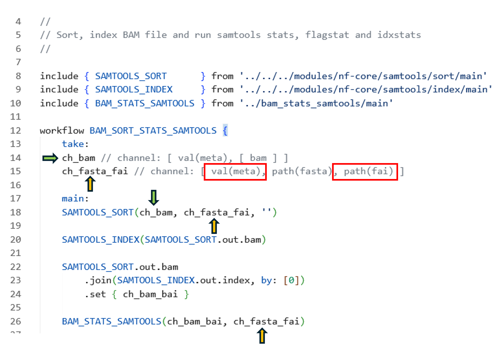

- Change the name of `ch_bam` to `ch_aligned_bam`
    - Occurs twice in the script
- Change the name of `ch_fasta_fai` to `ch_reference`
    - Occurs three times in the script
- Remove the text contained in red boxes
    - We're using one reference for this pipeline and the samtools tools function fine with just the original fasta as input. The `.fai` index is not needed

After editing:

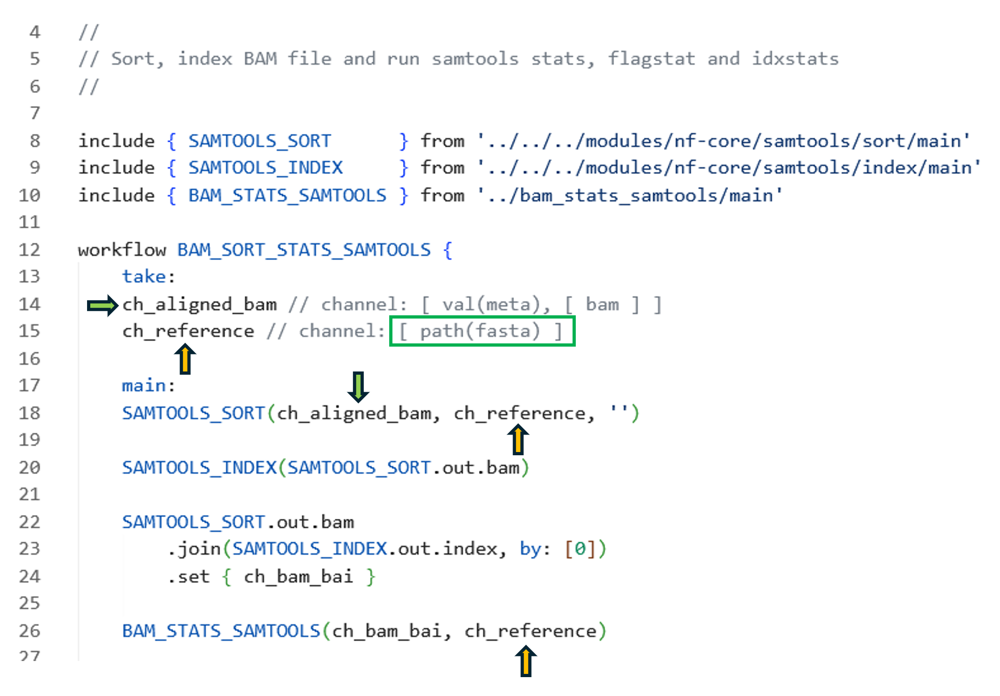

<br>

> [!Note]
> You may notice that I changed the channel names to reflect the channel names in our pipeline workflow script (`launchDir/nf-core-myfirstpipeline/workflows/myfirstpipeline.nf`) <br>
> This is purely aethestic and meant to keep consistency with our naming scheme. The matching channel name is not required for the subworkflow to function properly. <br>
> To demonstate this point, we will not edit the `BAM_STATS_SAMTOOLS` subworkflow. 

<br>

Save the file: 

```
Ctrl + s
```

Because we've removing the tuple nature of the prior named channel `ch_fasta_fai`, `tuple val(meta), path(fasta), path(fai)`, we need to locate modules that expected this tuple as input. These modules are `SAMTOOLS_SORT` and `SAMTOOLS_STATS`. 

Open the `main.nf` file for `SAMTOOLS_SORT` (`launchDir/nf-core-myfirstpipeline/modules/nf-core/samtools/sort/main.nf`). Here's the `SAMTOOLS_SORT` module in its default state:

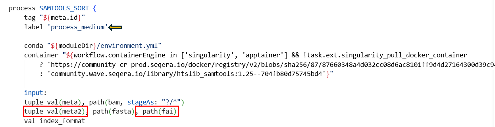

- Change `label process_medium` to `label process_low`
    - Because of the computational limits of the codespace
- Remove the text contained in red boxes
    - Removing the tuple and just keeping the reference fasta as input

<br>

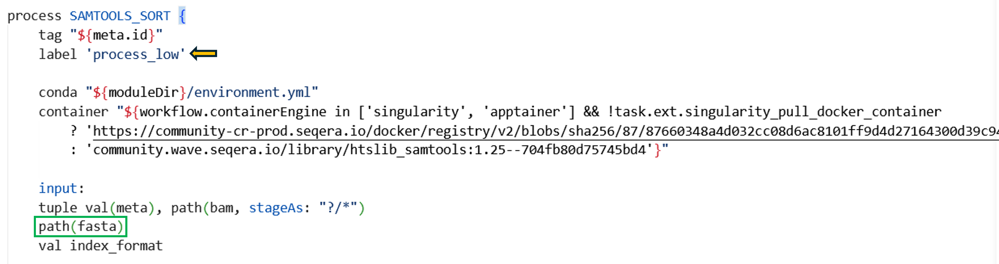

Save the file: 

```
Ctrl + s
```

<br>

Great! And now open the `main.nf` file for `SAMTOOLS_STATS` (`launchDir/nf-core-myfirstpipeline/modules/nf-core/samtools/stats/main.nf`). Here's the `SAMTOOLS_STATS` module in its default state:

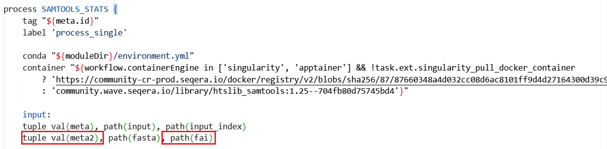

- Remove the text contained in red boxes
    - Removing the tuple and just keeping the reference fasta as input

<br>

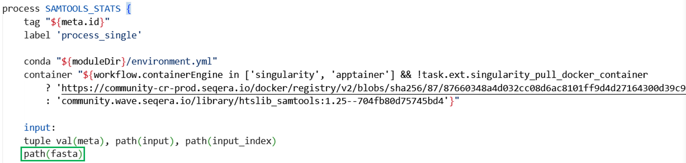

Save the file: 

```
Ctrl + s
```

<br>

Awesome! That's all we need to do for the `BAM_SORT_STATS_SAMTOOLS` subworkflow! Technically, we could edit the `BAM_STATS_SAMTOOLS` subworkflow `main.nf` script (`launchDir/f-core-myfirstpipeline/subworkflows/nf-core/bam_stats_samtools/main.nf`)

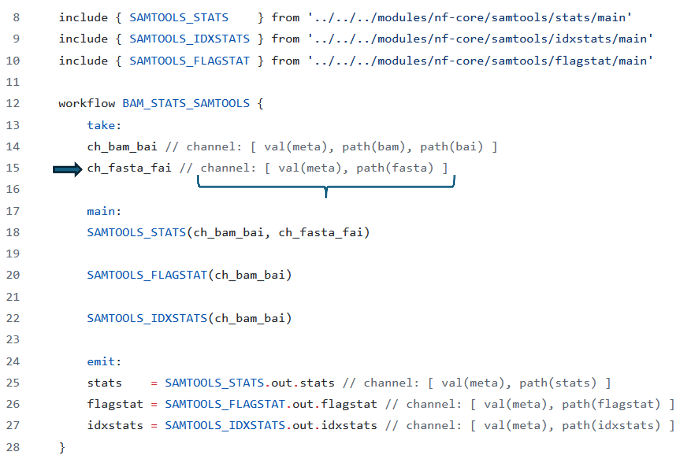

For example, in the image, we could edit `ch_fasta_fai // channel: [val(meta), path(fasta)` to `ch_reference // channel: path(fasta)`, but as mentioned in the previous `[!Note]` block, I want to demonstrate that the channel names do not matter. And the text after the `//` are just notes for yourself, not executable script. 

What really matters are the channel inputs and their underlying structure when the subworkflow gets explicitly declared. For the `BAM_STATS_SAMTOOLS` subworkflow, this occurs in the `BAM_SORT_STATS_SAMTOOLS` subworkflow now as: <br>
 
 `BAM_STATS_SAMTOOLS(ch_bam_bai, ch_reference)`

 And these channels are ultimately provided to modules within the `BAM_STATS_SAMTOOLS` subworkflow. The underlying structure of these channels must match what we declared within the `input:` block for our modules. 

<br>

# Part II: Installing and editing a module from nf-core CLI 

### Install the SAMTOOLS_DEPTH nf-core module

In preparation for the `tutorial 5 challenge`, we will install one additional samtools module. Recall, nf-core CLI commands are meant to function inside of your pipeline directory:

```
cd /workspaces/mdhhs_nextflow_training/nf-core-myfirstpipeline
```

And then enter the following:

```
nf-core modules install
```

Begin typing the following

`samtools/depth`

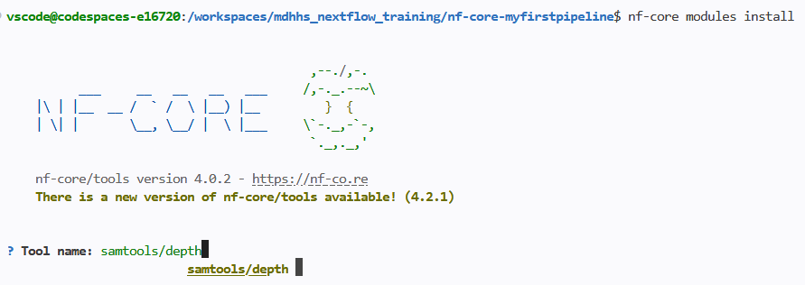

Navigate to the tool with your `down arrow key` and select it with the `Enter` key. If installed properly, you'll see:

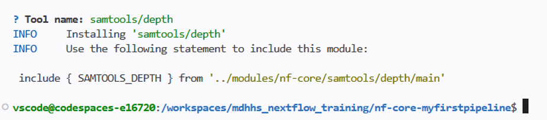


The `SAMTOOLS_DEPTH` module will be used to obtain coverage stats per each site in the reference genome. See more about this module, [here](https://nf-co.re/modules/samtools_depth). The output from the module will be used in the challenge to create a plot of the depth of coverage across the genome via a custom script. 

### Edit the main.nf script for the SAMTOOLS_DEPTH module

Now, open the `main.nf` file for the `SAMTOOLS_DEPTH` module (`launchDir/nf-core-myfirstpipeline/modules/nf-core/samtools/depth/main.nf`). 

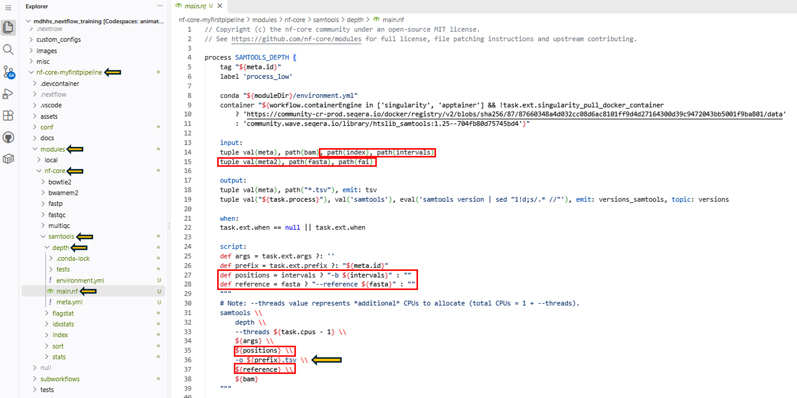

Make the following edits:
- Remove all text contained within the red boxes
- Within the `script:` block, change `-o ${prefix}.tsv` to `-o ${prefix}_coverage.tsv`  
    - Just personal preference as this is slightly more descriptive 

The `main.nf` process script for `SAMTOOLS_DEPTH` should now look as follows:

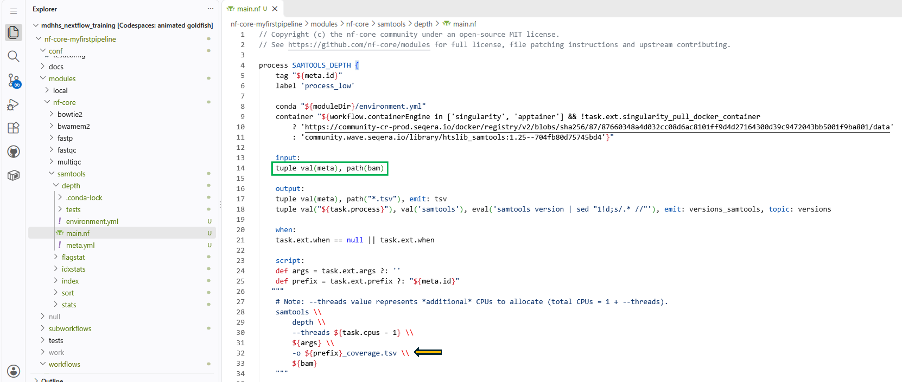

Save the file: 

```
Ctrl + s
```

### Edit the conf/modules.config file to add parameters for the SAMTOOLS_DEPTH module

Open the `modules.config` module located in `launchDir/nf-core-myfirstpipeline/conf/modules.config`:


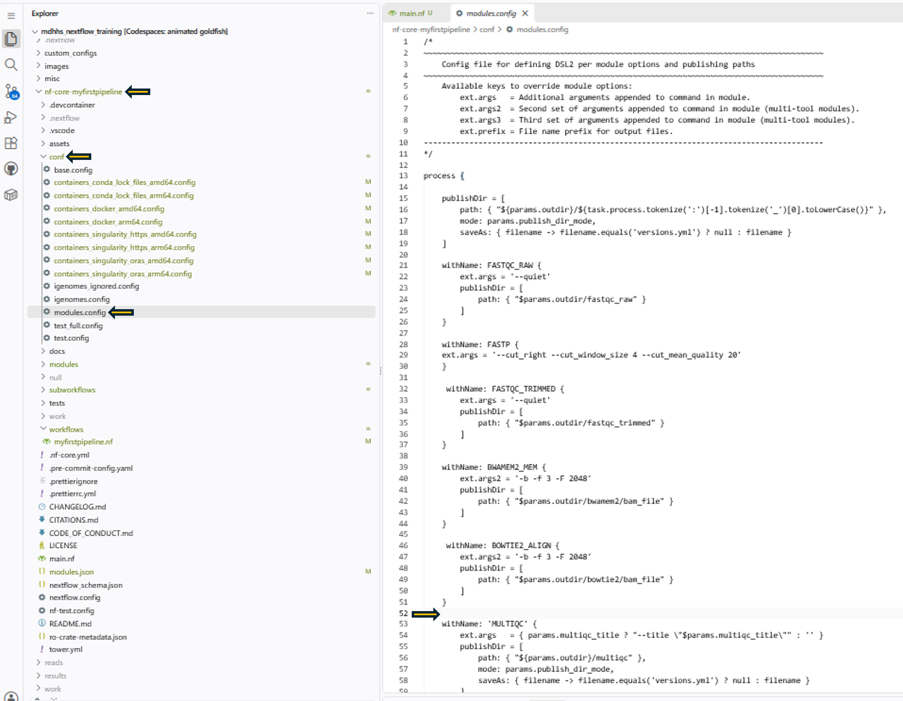

Add the following lines just after the `BOWTIE2_ALIGN` module configs: 

```
withName: SAMTOOLS_DEPTH {
    ext.args = '-a'
}
```

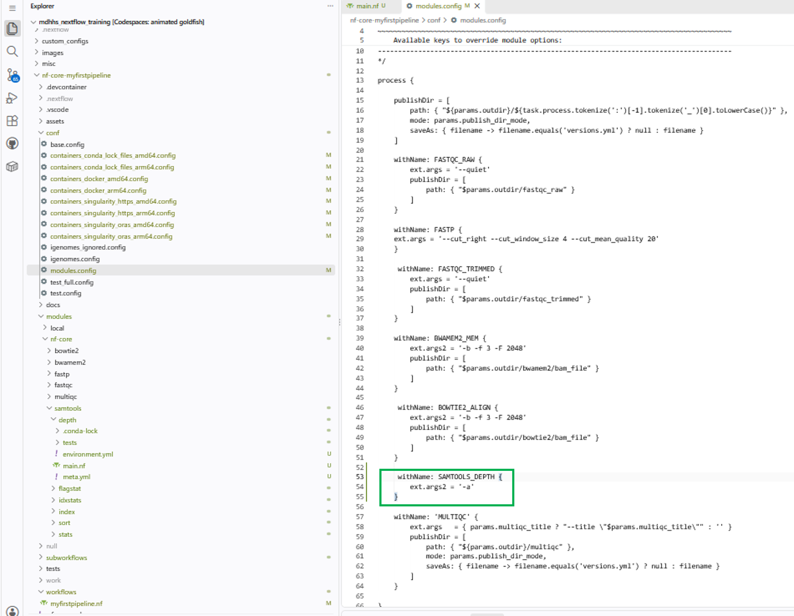

From the `samtools depth` [documentation](https://www.htslib.org/doc/samtools-depth.html), the `-a` flag will output coverage for all positions in the genome, including those with zero depth. 

Save the file: 

```
Ctrl + s
```

Great, we can now incorporate these modules and subworkflows into our pipeline workflow script!

# Part III: Incorporating new subworkflows and modules into the pipeline

Open the pipeline workflow script located in `launchDir/nf-core-myfirstpipeline/workflows/myfirstpipeline.nf`

### Import module(s) and subworkflow(s)

At the beginning of the script, we see the import lines for our modules/subworkflows:

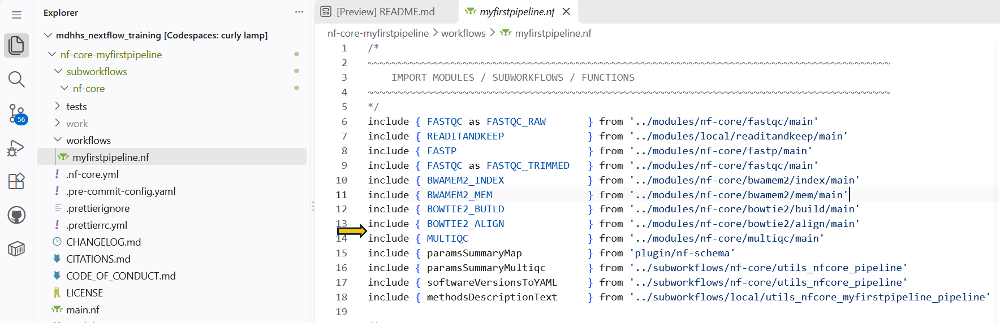

Add the following lines just after the import of `BOWTIE2_ALIGN`:

```
include { BAM_SORT_STATS_SAMTOOLS    } from '../subworkflows/nf-core/bam_sort_stats_samtools/main'
include { SAMTOOLS_DEPTH             } from '../modules/nf-core/samtools/depth/main'
```

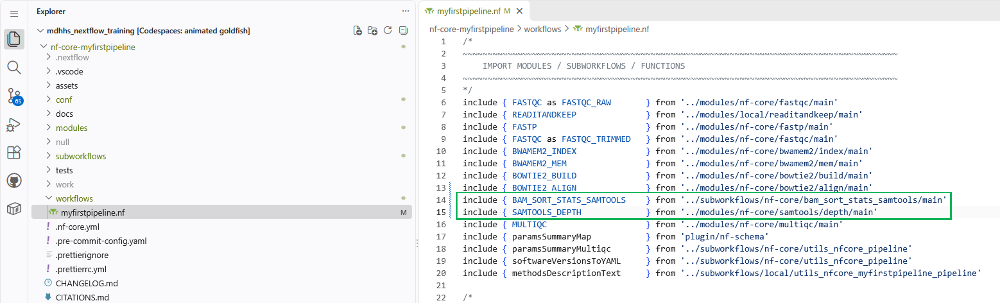

<br>

> [!Note]
> We only have to import the `BAM_SORT_STATS_SAMTOOLS` subworkflow. All other required module/subworkflow imports occur therein. <br>
> Also, as a reminder, import order is purely aesthetic. <br>

<br>

Now, we move into the script section of our workflow: 

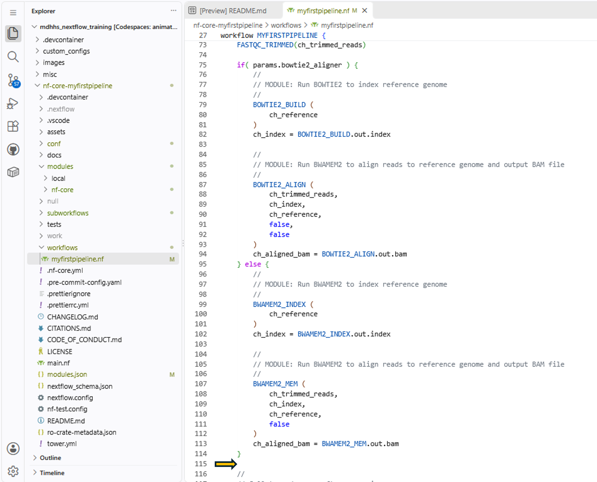

Add the following lines just after the `if-else` statement:

```
//
// SUBWORKFLOW: RUN SORT, REINDEX, AND RUN STATS ON BAM FILE
//
BAM_SORT_STATS_SAMTOOLS (
    ch_aligned_bam,
    ch_reference
)
ch_sorted_bam = BAM_SORT_STATS_SAMTOOLS.out.bam

//
// MODULE: RUN SAMTOOLS DEPTH TO OBTAIN COVERAGE PER SITE
//
SAMTOOLS_DEPTH (
    ch_sorted_bam
)
ch_coverage = SAMTOOLS_DEPTH.out.tsv

```

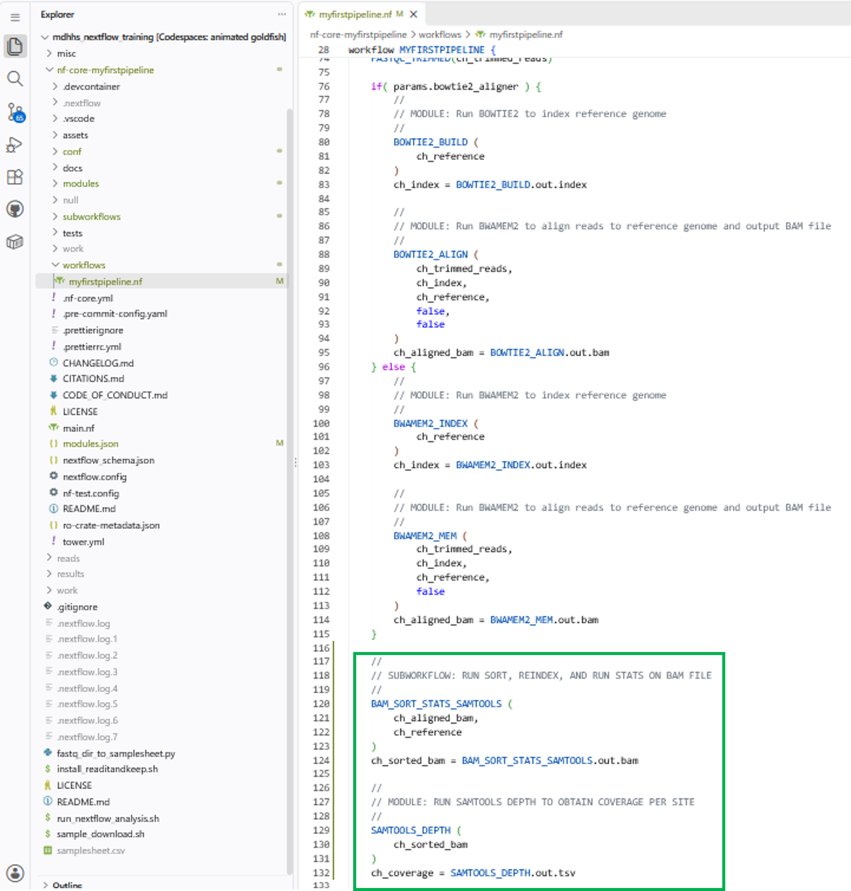


Notice how `ch_aligned_bam` is output from either `BOWTIE2_ALIGN` or `BWAMEM2_MEM`, depending on the `params.bowtie2_aligner` boolean (`true/false`) input now specified in our `launchDir/custom_configs/training.config` file. `ch_reference` is specified by the `ch_reference = channel.value(file(params.reference, checkIfExists: true))`, which also points to a parameter (`reference`) located in the `launchDir/custom_configs/training.config` file.

Then, the sorted `BAM` file is output from the `BAM_SORT_STATS_SAMTOOLS` subworkflow as a channel, `BAM_SORT_STATS_SAMTOOLS.out.bam`, which was emitted from the `SAMTOOLS_SORT` module:

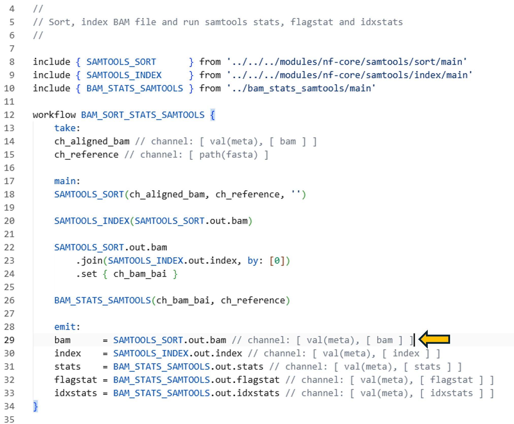

a module part of the `BAM_SORT_STATS_SAMTOOLS` subworkflow (snapshot of the `main.nf` file for the `BAM_SORT_STATS_SAMTOOLS` subworkflow is shown, above). This was renamed to `ch_sorted_bam` in our pipeline workflow script. 

This is then used as input into the `SAMTOOLS_DEPTH` module, which will ultimately output a `tsv` file containing coverage stats per nucleotide site in the measles reference genome. This ultimately represents the depth at each site, or how many reads aligned to a particular nucleotide position in the reference genome. 

The `SAMTOOLS_DEPTH` emit name was established in the module: 

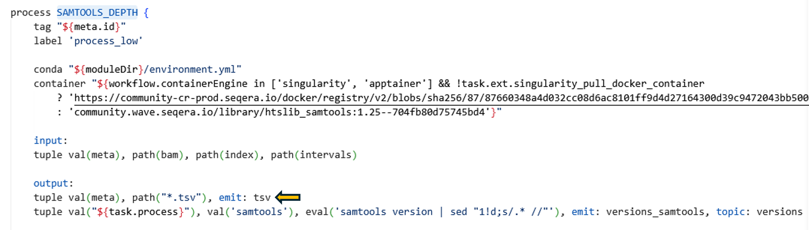

and used to create a new channel in our pipeline workflow script via `SAMTOOLS_DEPTH.out.tsv`. This channel was renamed to `ch_coverage`. 

> [!Note]
> This channel, `ch_coverage`, will be used as input for the challenge section

Save the file: 

```
Ctrl + s
```


# Part IV: Testing the pipeline

From the `launchDir`, `/workspaces/mdhhs_nextflow_training/`, download the sample:

```
bash sample_download.sh
```

Create the `samplesheet.csv` file

```
python3 fastq_dir_to_samplesheet.py reads/ samplesheet.csv
```

Run the pipeline:

```
bash run_nextflow_analysis.sh
```

You should see the new modules/subworkflows that we just incorporated into the pipeline launched as tasks:

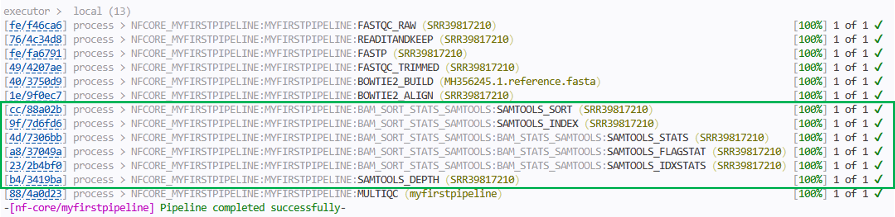

And once the pipeline successfully completes, you should see the following samtools output populated in the results directory:

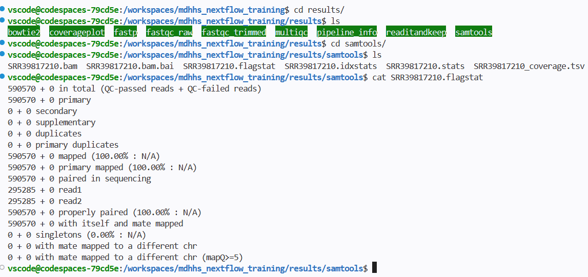

Which includes the 6 expected outputs, 5 from the `BAM_SORT_STATS_SAMTOOLS` subworkflow and the `SRR39817210_coverage.tsv` file from the `SAMTOOLS_DEPTH` module.

In the image, I also opened the `flagstats` file, which reveals 590570 reads were properly paired in the alignment. And if you open the `SRR39817210_coverage.tsv` file contained in the `launchDir/results/samtools/` directory, you should see the following format:

| Reference Genome | Nucleotide position | Depth of Coverage |
| ---------------- | ------------------- | ----------------- |
| MH356245.1       | 1                   | 2                 |

In this example, in our reference genome, which if you recall, is a reference fasta for measles genotype D8, at nucleotide position 1, we only have a depth of coverage of 2, meaning only two reads from our dataset covered this particular nucleotide site. Not great, but if you scroll through this file, you should notice that most other positions achieve much greater than 30X depth of coverage:

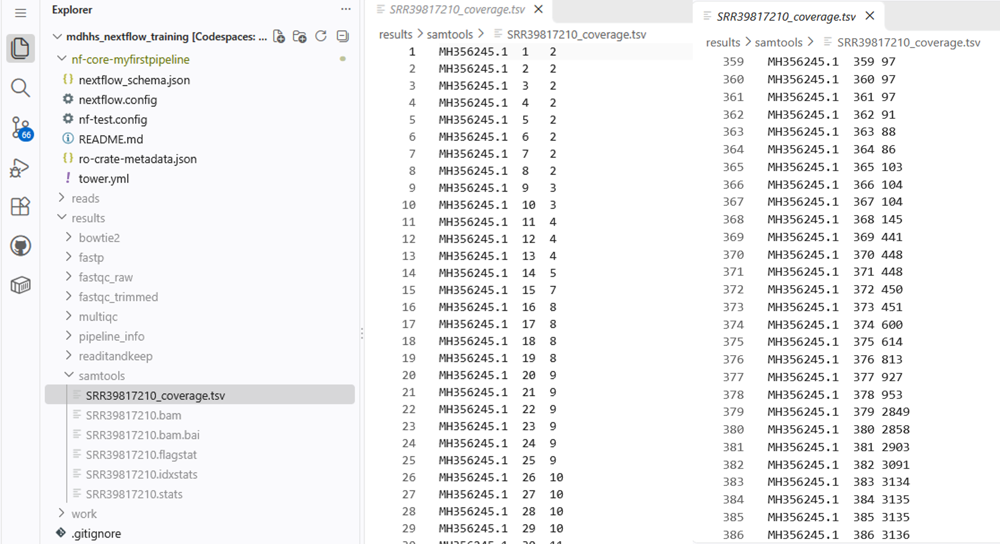

Awesome job! You have now successfully added a subworkflow into your pipeline and laid the groundwork for the `tutorial 5 challenge`. I encourage you to work on the challenge to learn more about the nextflow `bin/` directory and the incorporation of custom scripts within your nextflow pipeline. 

<br>

# Challenge: Add a custom module to incorporate a custom script via the bin directory

Navigate to the GitHub repo for the nextflow tutorial, [here](https://github.com/JLC2141/mdhhs_nextflow_training/tree/tutorial_5_challenge).

If you're relaunching your codespace, launch the `tutorial_5_challenge` branch to have all progress made prior in tutorial 5 so that you can jump directly into this challenge. 

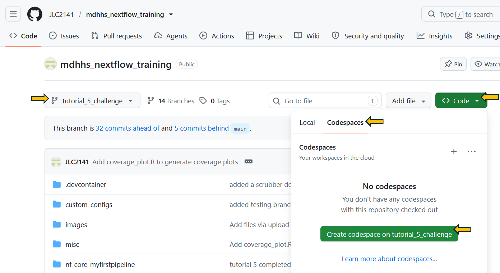


At the end of tutorial 5, we incorporated a subworkflow to output various samtools stats. We also incorporated the `SAMTOOLS_DEPTH` module to output the depth of coverage per nucleotide side in our reference genome. We will make use of the `.tsv` output from `SAMTOOLS_DEPTH` as input into a custom `R` script in order to create a coverage plot across the reference genome. 

### Create a custom module

Remember, nf-core CLI commands are meant to function inside of your pipeline directory. Change into your pipeline directory:

```
cd nf-core-myfirstpipeline
```

And run the following command:

```
nf-core modules create
```

Respond to the following prompts as follows:
Name of tool/subtool: `coverageplot` <br>
Do you want to enter a different Bioconda package name? [y/n]: `n` <br>
GitHub Username: (@author): `@YourGitHubUserName` <br>
? Process resource label: `process_single` <br>
Will the module require a meta map of sample information? [y/n] (y): `y` <br>


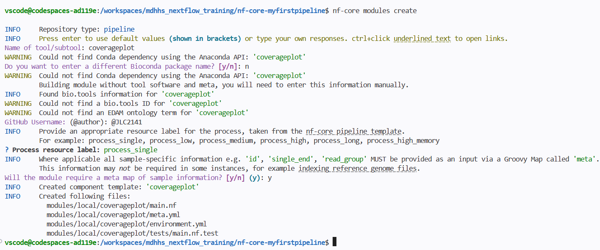

### Edit the COVERAGEPLOT custom module

Open the `main.nf` file for the `COVERAGEPLOT` module that we just created (`launchDir/nf-core-myfirstpipeline/modules/local/coverageplot/main.nf`):

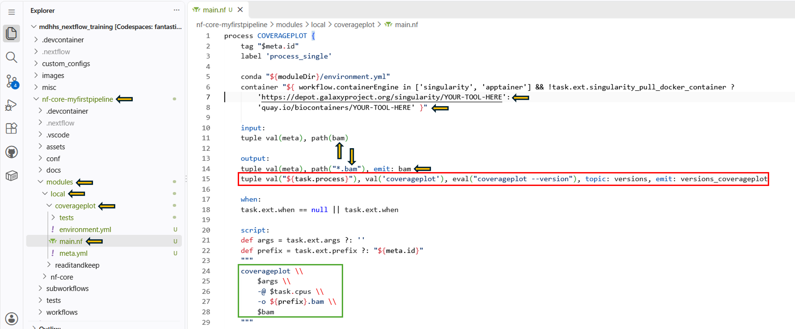


Make the following edits:

`Directives section`

- For the containers, replace `https://depot.galaxyproject.org/singularity/YOUR-TOOL-HERE` with:

```
https://depot.galaxyproject.org/singularity/r-tidyverse:1.2.1
```

- And replace `quay.io/biocontainers/YOUR-TOOL-HERE` with:

```
quay.io/biocontainers/r-tidyverse:1.2.1
```

This container is providing `R` and the accompanying `R` libraries required to run our custom `R` script. 

<br>

`input: block`

- Edit `tuple(meta), path(bam)` to the following: 

```
tuple val(meta), path(coverage_tsv)
```
<br>

`output: block`

- Edit `tuple val(meta), path("*.bam"), emit: bam` to the follwing:


```
tuple val(meta), path("*.pdf"), emit: pdf
```

And replace the second line within the `output:` block:

`tuple val("${task.process}"), val('coverageplot'), eval("coverageplot --version"), topic: versions, emit: versions_coverageplot`

with:

`tuple val("${task.process}"), val('R'), eval('R --version | sed -n "1s/.* version //p"'), emit: versions_coverageplot, topic: versions`


<br>

`script: block`


Alter: 
```
coverageplot \\
    $args \\
    -@ $task.cpus \\
    -o ${prefix}.bam \\
    $bam
```

to the following: 

```
coverage_plot.R $coverage_tsv $prefix
```

<br>

`optional`

Feel free to remove all of the `// TODO` notes.

Your `main.nf` script for the `COVERAGEPLOT` module should now look as follows:

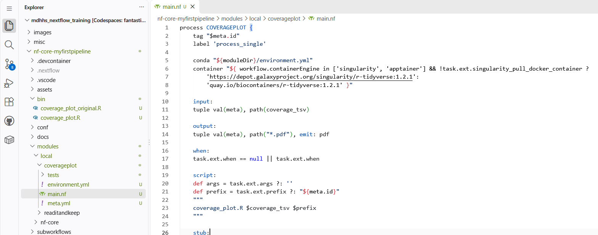

Save the file: 

```
Ctrl + s
```

### Create a bin script and place a custom R script therein

Within your nextflow pipeline `projectDir` (aka `/workspaces/mdhhs_nextflow_training/nf-core-myfirstpipeline/`):

```
cd /workspaces/mdhhs_nextflow_training/nf-core-myfirstpipeline/
```

Create a directory called bin:


```
mkdir bin
```

Now, a custom `R` script has already been prepared for you. Copy this script (`coverage_plot.R`) from the `launchDir/misc/` directory into your newly created `bin/` directory:

```
cp ../misc/coverage_plot.R bin/
```

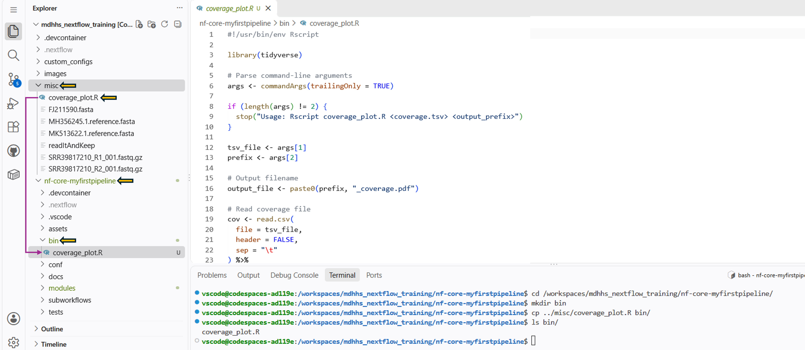


The `bin/` directory is a built-in feature in Nextflow for running custom script. The conveinence of the `bin/` directory is that scripts within his directory can be called from within Nextflow modules without specifying the full path. Nextflow will automatically scan the `bin/` directory. For example, in the module we just created, the `script:` block was edited as follows:

`coverage_plot.R $coverage_tsv $prefix`

This script, `coverage_plot.R`, will seamlessly execute in our `COVERAGEPLOT` module now that our script in contained with the `bin/` directory. You can add any custom script you want into the `bin/` directory and incorporate it into any custom module you create.


> [Note!]
> Notice the first line in the `Rscript` in the image above? <br>
> This is referred to as a shebang, or rather, an instruction to the kernel on which intepreter to use to execute the script code in the file. <br> 
> Here, we placed `#!/usr/bin/env Rscript`, to specify to interpret the rest of the script as `R` code. <br>
> `#!/usr/bin/env python3` or `#!/usr/bin/env bash` shebang lines would be required for `python` scripts or `bash` scripts, respectively. 
> The shebang line **must** be the very first line, no exceptions!

Let's ensure that the script is executable:

```
chmod +x bin/coverage_plot.R 
```

### Edit the workflow script to incorporate the newly created custom module, COVERAGEPLOT


Open the pipeline workflow script located in `launchDir/nf-core-myfirstpipeline/workflows/myfirstpipeline.nf`

Just after the `SAMTOOLS_DEPTH` module import:

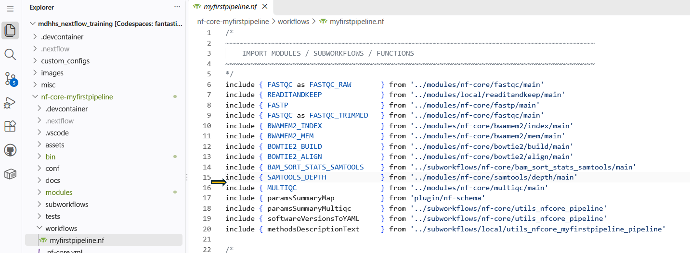

Add the following line to import the `COVERAGEPLOT` module:

```
include { COVERAGEPLOT               } from '../modules/local/coverageplot/main'
```

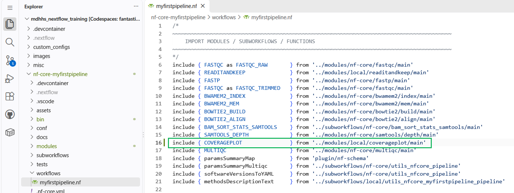

And within the script section of the `myfirstpipeline.nf` file:


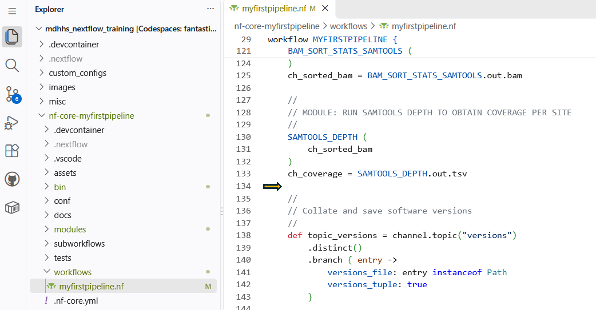

Add the following lines just after the `SAMTOOLS_DEPTH` module:

```
//
// MODULE: CREATE COVERAGE PLOT ACROSS GENOME
//
COVERAGEPLOT (
    ch_coverage
)
```

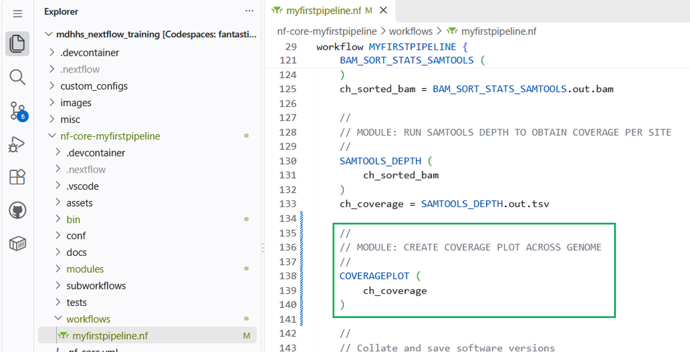

Notice how the output channel from `SAMTOOLS_DEPTH`, `ch_coverage` (aka the `.tsv` file), is the input channel for the `COVERAGEPLOT` module.

Save the file: 

```
Ctrl + s
```

### Launch the pipeline

From the `launchDir`, `/workspaces/mdhhs_nextflow_training/`, download the sample:

```
bash sample_download.sh
```

Create the `samplesheet.csv` file

```
python3 fastq_dir_to_samplesheet.py reads/ samplesheet.csv
```

Run the pipeline:

```
bash run_nextflow_analysis.sh
```

You should see the new modules/subworkflows that we just incorporated into the pipeline launched as tasks:

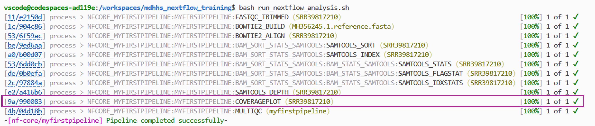

And once the pipeline successfully completes, you should see the following samtools output populated in the results directory:

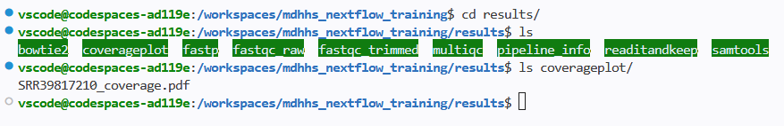

Unfortunately, the `.pdf` will not open in the Codespace environment. Instead, navigate to the `results/coverageplot/` directory on the file explorer panel, right click on the `SRR39817210_coverage.pdf` file, and download the file locally. You may need to toggle through the display windows once you right-click on the file via the `Esc` key.


And once you open the file locally, you should see the following plot:


# Recap 

In this tutorial, we have:
- Installed and implemented a nf-core module and nf-core subworkflow 
- Created a custom module
- Created a `bin/` directory and placed a custom script within
- Implemented the custom module into our pipeline to create a coverage depth plot


You're awesome! In the final tutorial of this series, `tutorial 6`, we will create a results report via `MULTIQC` and uncover some unique changes to recently updated versions of nextflow.
