# Table of contents
- [Overview](#-overview)
- [Tutorial 4](#-tutorial-4)
- [Part I](#part-i-installing-and-editing-two-nextflow-modules-from-nf-core-cli)
- [Part II](#part-ii-incorporating-new-modules-into-the-pipeline)
- [Part III](#part-iii-testing-the-pipeline)
- [Challenge](#challenge-add-bowtie2-and-a-parameter-to-choose-between-aligners)
- [Recap](#recap)

# 📖 Overview

Here is an overview of the pipeline we are going to build:


This simple pipeline starts with RAW FASTQ reads obtained from the SRA repository. Specifically, a [measles WGS sequencing sample](https://www.ncbi.nlm.nih.gov/sra?LinkName=biosample_sra&from_uid=61933769) obtained from a broader viral (non-SARS-CoV-2) surveillance effort at Wyoming PHL published under SRA project [PRJNA858824](https://www.ncbi.nlm.nih.gov/bioproject/PRJNA858824)

The pipeline then performs the following steps

1) Read QC on raw FASTQ reads with [FASTQC](https://www.bioinformatics.babraham.ac.uk/projects/fastqc/)
    - What is the quality of our reads off the sequencer?
2) Read trimming with [FASTP](https://github.com/opengene/fastp)
    - Removal of low quality reads and trimmming of low quality bases
3) **Challenge task**: Read QC on trimmed FASTQ reads with [FASTQC](https://www.bioinformatics.babraham.ac.uk/projects/fastqc/)
    - Does the quality of our reads improve post-trimming?
4) Read scrubbing on raw FASTQ reads with [read-it-and-keep](https://github.com/GlobalPathogenAnalysisService/read-it-and-keep)
    - If you anticipated submitting these sequences to a database and wanted to ensure removal of human reads
5) Read alignment with [bwa-mem2](https://github.com/bwa-mem2/bwa-mem2)
    - How well do our trimmed reads align to a reference genome?
6) Read alignment stats with [SAMtools](https://github.com/samtools/samtools)
    - Also converts SAM to BAM if you were to proceed with variant calling
7) Results report generation with [MultiQC](https://github.com/multiqc/multiqc)
    - Aggregates results from our pipeline into a final report

# 📖 Tutorial 4

The objectives of this tutorial are:
1) Use the nf-core command line interface (CLI) to create two new modules from a starter template
2) Incorporate reference indexing and read alignment into our pipeline
4) Understand required files to edit and nextflow syntax needed to incorporate the new modules into the pipeline workflow
5) Optional challenge: learn more about parameterization

<br> 

# Getting started

**Make sure that you are signed-in to your GitHub account.**

Navigate to the GitHub repo for the nextflow tutorial, [here](https://github.com/JLC2141/mdhhs_nextflow_training/tree/tutorial_4).

Select the `branch` icon and select the `tutorial_4` branch.

The webpage will reload. Confirm that the `tutorial_4` branch is loaded. Select the green <> Code icon, the Codespaces tab, and then select `Create codespace on tutorial_4`.


> [!NOTE]
> This will launch a codespace with 2 CPUs, 8 GB RAM, and 32 GB storage capacity <br>
> This is the default minimal virtual machine option for a GitHub codespace <br>

<br>

You will notice that we are at a checkpoint from our progress made up to the end of `tutorial 3`. Our nextflow pipeline is already downloaded along with the incorporation of the `FASTP` module, the `FASTQC` module aliases, `FASTQC_RAW` and `FASTQC_TRIMMED`, and the `READITANDKEEP` module. 

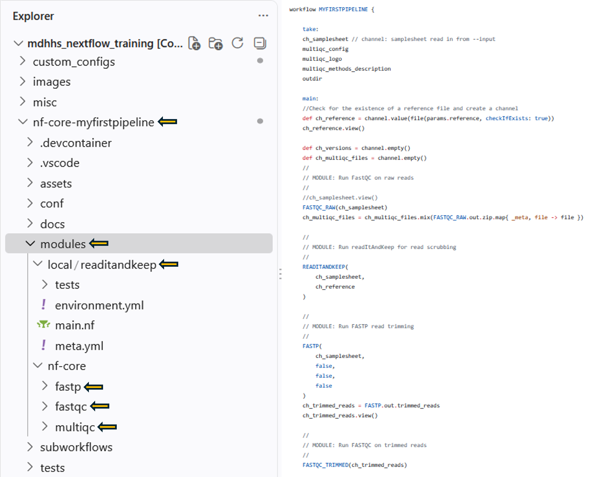

In addition, I've also added a component covered in the `tutorial 3 challenge`, which is a custom config file that specifies our `params.reference`. First, you may notice we used to have our `params.reference` specified in the `nextflow.config` file, as such: 

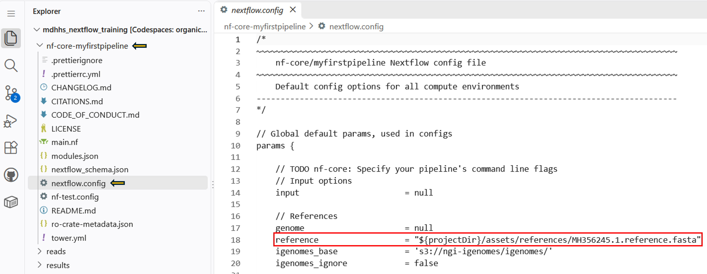

But in the current state of the pipeline, this line:

```
reference = "${projectDir}/assets/references/MH356245.1.reference.fasta"
```

has been removed from the `nextflow.config` file:


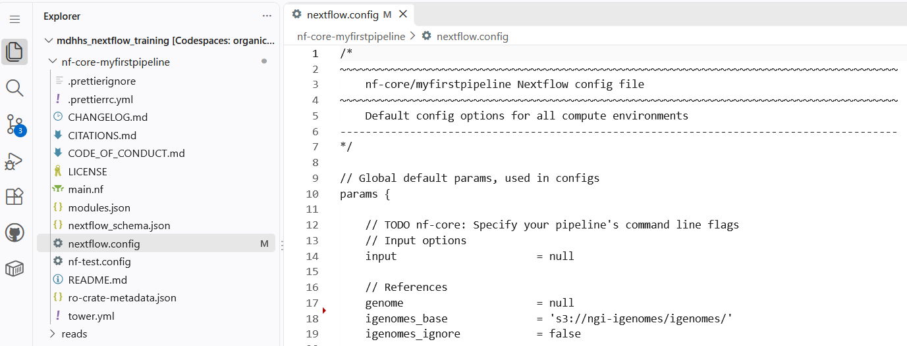


And instead, has been added to a custom config file called `training.config`, stored in `launchDir/custom_configs/training.config`:

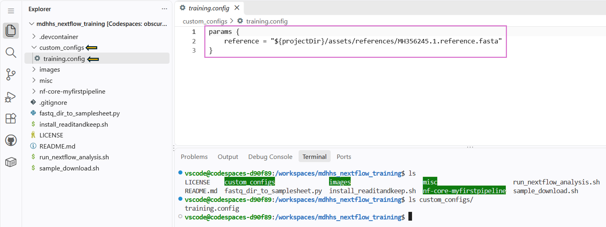


In addition, the `run_nextflow_analysis.sh` script has been updated with a `-c` flag to incorporate this custom config into our nextflow pipeline runs. Seem more, [here](https://docs.seqera.io/nextflow/config).

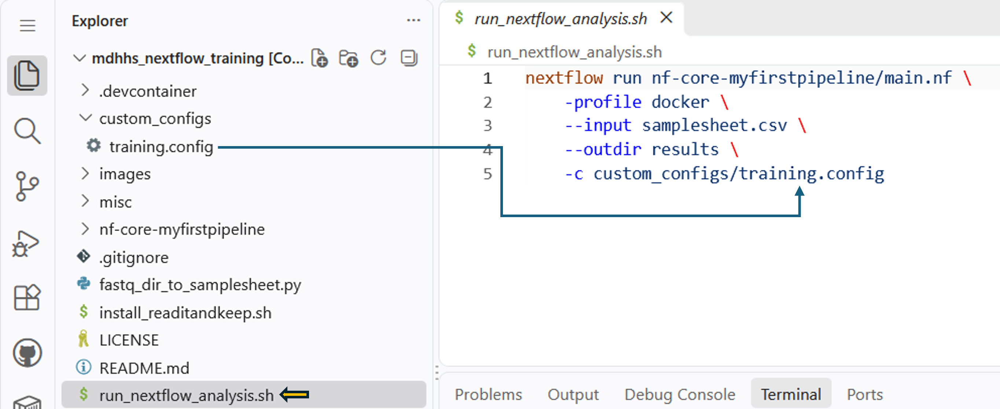

So that when we now launch our nextflow pipeline, we can see that this custom config file in detected, and the `params.reference` is now incorporated into the pipeline via the `training.config` file.  

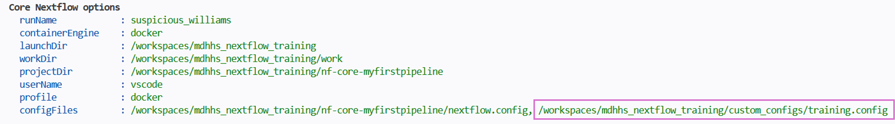

I encourage you to work through `tutorial_challenge_3` to learn more about the flexibility of config files and nextflow's built-in prioritization of these files. Access the branch for `tutorial_3_challenge`, [here](https://github.com/JLC2141/mdhhs_nextflow_training/tree/tutorial_3_challenge), and start the challenge, [here](https://github.com/JLC2141/mdhhs_nextflow_training/tree/tutorial_3_challenge#challenge-exploring-the-priority-of-nextflow-config-files).


# Part I: Installing and editing two nextflow modules from nf-core CLI 

### Install both `BWAMEM2_INDEX` and `BWAMEM2_MEM` modules 

Remember, nf-core CLI commands are meant to function inside of your pipeline directory. So change into your pipeline directory:

```
cd nf-core-myfirstpipeline
```


So that we are currently working in the `/workspaces/mdhhs_nextflow_training/nf-core-myfirstpipeline/` directory.

Run the following command:

```
nf-core modules install
```

Start by installing the `bwamem2/index` module:

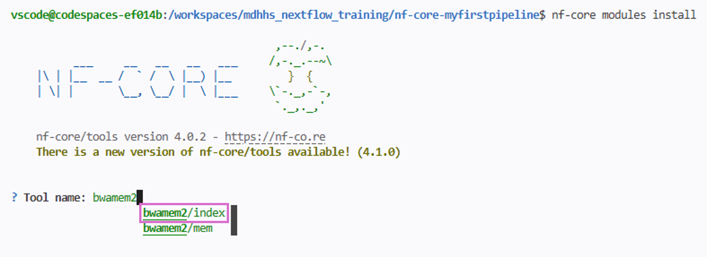

You'll see the following if successfully installed:

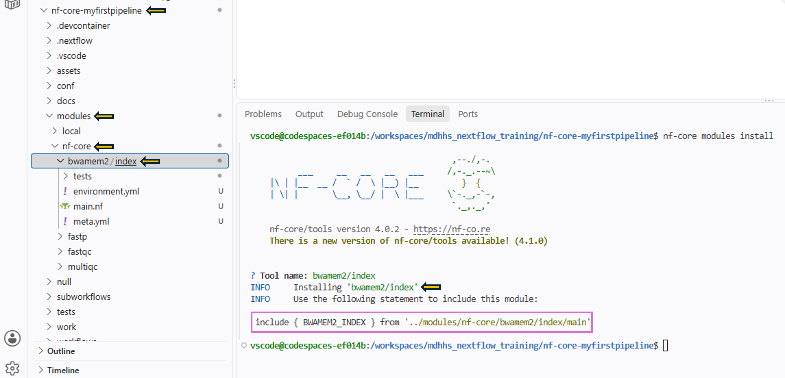

Repeat this process to install the `bwamem2/mem` module:

```
nf-core modules install
```

Select the `bwamem2/mem` module:

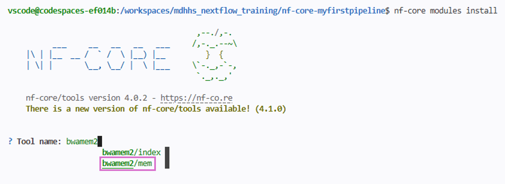

You'll see the following if successfully installed:

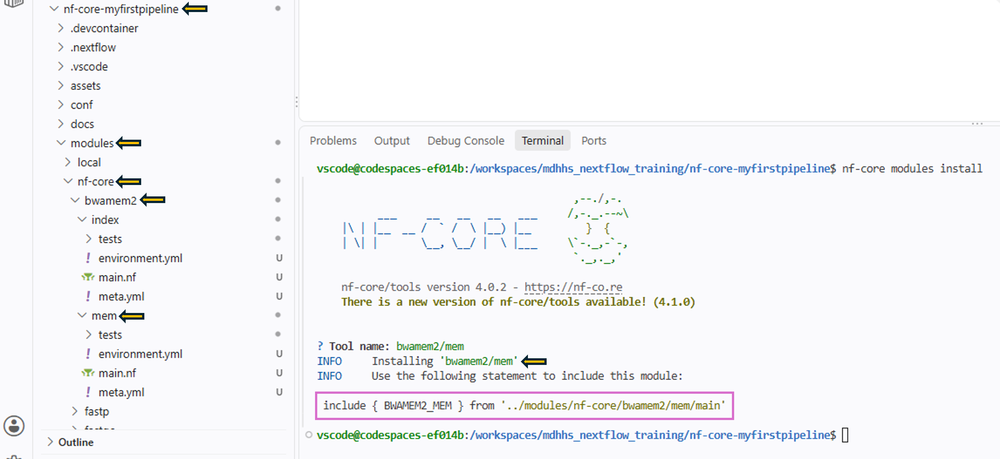

<br>

> [!Note]
> For both `bwamem2/index` and `bwamem2/mem`, take note of the `include` line after successful installation. <brb>
> Remember, we need to use these lines to import the modules into our `workflows/myfirstpipeline.nf` script. 

<br>

Recall, `bwa` is the [Burrow-Wheeler Aligner](https://github.com/lh3/BWA), an algorithm for aligning reads to a reference genome. This bioinformatics tool works in two steps.

1) Index the reference genome
    - It is computationally time consuming to scan the entire genome for every read in a sample in a linear fashion.
    - Indexing is a way to transform the genome into a readily searchable, navigational format, akin to a book index, vastly improving speed and efficiency of the alignment step.
2) Alignment of sample reads to the (indexed) reference genome 
    - Here, we are matching sequence reads to their location on the reference genome.
    - Remember, we have ~150 bp reads generated from Illumina sequencing and a ~16,000 bp measles reference genome
        - With alignment, we're basically asking: where did this read originate from within the genome?
    - You may see the term alignment used interchangeably with mapping. 


In addition, [`bwa-mem2`](https://github.com/bwa-mem2/bwa-mem2) is a more computationally efficient tool compared to `bwa-mem`

Remember this image from tutorial 3?


We will rinse and repeat these steps for both `BWAMEM2_INDEX` and `BWAMEM2_MEM`.

For the purposes of this tutorial, we will edit the following files:
- `main.nf`
    - the process scripts for both `BWAMEM2_INDEX` and `BWAMEM2_MEM` contained with `modules/nf-core/bwamem2/index` and `modules/nf-core/bwamem2/mem`, respectively. 
- `conf/modules.config`
    - for `BWAMEM2_MEM` only
- `workflows/myfirstpipeline.nf`
    - to implement the new modules into our pipeline workflow

<br>

### Edit the `BWAMEM2_INDEX` main.nf file

Let's start with editing the `main.nf` process script for `BWAMEM2_INDEX`(`modules/nf-core/bwamem2/index/main.nf`). See the nf-core documentation [here](https://nf-co.re/modules/bwamem2_index/):

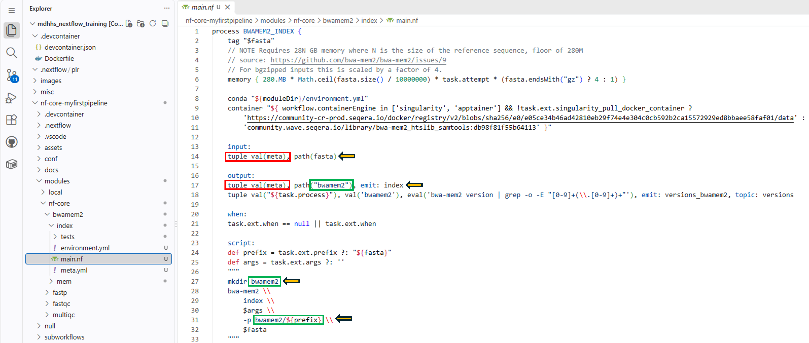

This is a relatively simple module that only needs the reference fasta file as input. 

Notice the [memory](https://docs.seqera.io/nextflow/reference/process/directives/memory) directive at the top of the file? This is a fancy way to scale computing resources to the size of the input reference file. 

<details>
<summary>If interested, reveal more information about this memory directive line</summary>

<br>

In contrast to `conf/base.config`, we can use this `memory` directive to explicitly state the resources we want within the process script. 

This can be set simply as `memory 200.MB`, for example. But here, there's additional components to the line: 

```
memory { 280.MB * Math.ceil(fasta.size() / 10000000) * task.attempt * (fasta.endsWith("gz") ? 4 : 1) }
```

in this nextflow template. Let's break this down. 

- First, a base memory of `280.MB` is set
    - Then this is multiplied by various factors to scale with the size of the reference file 
- The fasta file size is divided by 10 million and then `Math.ceil` rounds a floating-point number upward to the nearest integer
    - The measles genome is small, ~16,000 bps and genome size $\approx$ fasta file size. So 16,000/10,000,000 = 0.0016. Math.ceil(0.0016) = 1. No memory is scaled here because of small genome size
    - If this was a larger genome, like *Candida auris*, the scaling would be: Math.ceil(fasta.size(12,400,000) / 10000000) = Math.ceil(1.24) = 2.  
- If this module failed and you set parameters to retry the task, the memory would scale with retry attempt number. Indexing could fail because of a large genome size.
    - Retries can be set via `maxRetries` and `errorStrategy 'retry'` directives (see [here](https://docs.seqera.io/nextflow/reference/process/directives/max-retries)) that can be set within the process script or globally within the `nextflow.config` file.
- Finally, the memory can scale 4-fold with an `if-else` statement that looks for a gzipped file
    - `if` the reference fasta file is gzipped, multiply the memory by 4, `else` multiply by 1. 

<br>

</details>

<br>

Perform the following edits:

- Remove the `tuple (meta),` part from the `input:` section
    - We would need this if we were working with a more complicated pipeline with multiple references
- Remove the `tuple (meta),` part from the `output:` section and edit `path("bwamem2")` to `path("ref_index")`
    - Again, we would need this if we were working with a more complicated pipeline with multiple references
    - In addition, we need the output path name (`ref_index`) to match what we declare in the `script:` block
    - Note that the `emit` name is `index`
- Change `mkdir bwamem2` to `mkdir ref_index` in the `script:` block
    - By default, our results directory for this process is already named `results/bwamem2/` and this step is trying to make another directory within this out directory
    - So instead of `results/bwamem2/bwamem2`, it will be `results/bwamem2/ref_index`
- Change `-p bwamem2/${prefix}` to `-p ref_index/${prefix}`in the `script:` block
    - Needs to match the directory name that we created in the beginning of the `script:` block

<br>

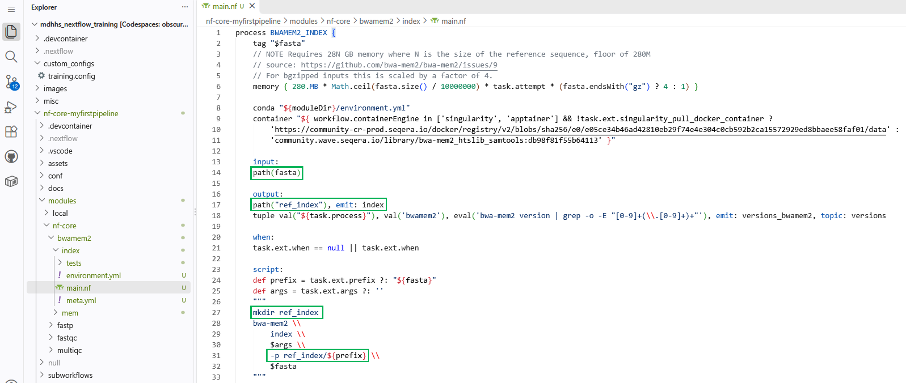

Save the file:

```
ctrl+s
```

Let's review a couple concepts before we continue.

I mentioned that the default directory for this process is already named `results/bwamem2/`. Can you recall where/how this was set as default?

<details>
<summary>Reveal solution, here</summary>

<br>

From `conf/modules.config` via:

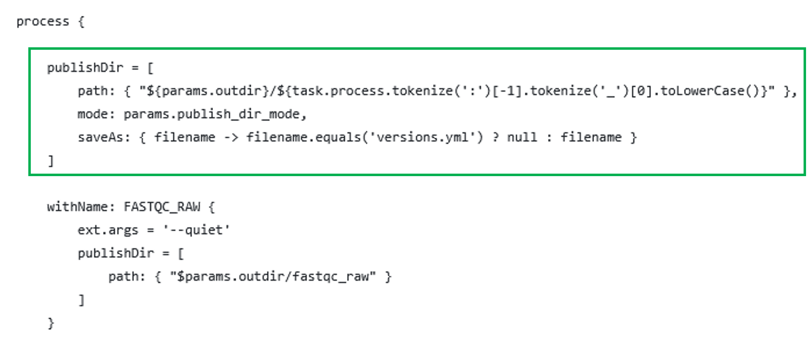

Specifically, this line:

```
path: { "${params.outdir}/${task.process.tokenize(':')[-1].tokenize('_')[0].toLowerCase()}" },
```

- `params.outdir` is the parameter that we set to `--outdir` in the `nextflow run` command line, which is `results`
- `process.tokenize(':')[-1]` find the process, `BWAMEM2_INDEX`, splits it by the `:` delimiter, and then selects the last element in the list (`-1`)
    - Take a look at the image, below. This is what it will look like when we eventually run our pipeline. The general format for each process once launched is:
    - `PIPELINE_NAME:WORKFLOW_NAME:MODULE_NAME` or in our case, `NFCORE_MYFIRSTPIPELINE:MYFIRSTPIPELINE:BWAMEM2_INDEX`
    - Splitting this line by the `:` delimiter, [`NFCORE_MYFIRSTPIPELINE`, `MYFIRSTPIPELINE`, `BWAMEM2_INDEX`] and selecting the last element gives us `BWAMEM2_INDEX`
- `.tokenize('_')[0]` splits the process, `BWAMEM2_INDEX`, by the `_` delimiter, and then selects the first element (`0`) in the list
    - In this case, [`BWAMEM2`, `INDEX`], and [`0`] selects `BWAMEM2 `
- Finally, `.toLowerCase()` coverts a string to lowercase
    - `BWAMEM2` > `bwamem2`
- Putting it all together, the default output directory path for `BWAMEM2_INDEX` is `launchDir/results/bwamem2`

<br>

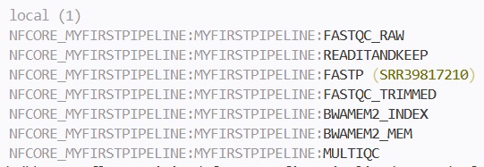


<br>

</details>

<br>

Second, we will need to use the `ref_index` output as input into the `BWAMEM2_MEM` module. Can you recall how we can capture this `ref_index` output channel from the `BWAMEM2_INDEX` module within the workflow script (`workflow/myfirstpipeline.nf`)?

<details>
<summary>Reveal solution, here</summary>

<br>

`MODULE.out.emitName`

In our case, a shortened form of our process script looks like:

```
process BWAMEM2_INDEX {

output:
path("ref_index"), emit: index

}
```

So the output channel would be: `BWAMEM2_INDEX.out.index`

<br>

We will need this in a bit when we edit out workflow script. 

</details>

<br>

### Edit the `BWAMEM2_MEM` main.nf file 


Alright, let's continue with edits to the `main.nf` process script for `BWAMEM2_MEM` (`modules/nf-core/bwamem2/mem/main.nf`). First, let's take a look at the nf-core documentation for [bwamem2_mem](https://nf-co.re/modules/bwamem2_mem/).


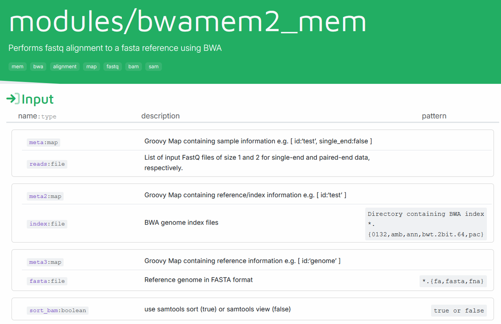

We see that we have four inputs:
- Our FASTQ files
    - These will be our trimmed reads
- The indexed reference genome
    - Created from the `BWAMEM2_INDEX` module
- The reference genome in fasta format
    - Already established in our pipeline as `ch_reference`
- A boolean input 
    - Runs either samtools `sort` (true) or `view` (false) post-alignment


The edits to the `main.nf` process script for `BWAMEM2_MEM` are as follows:

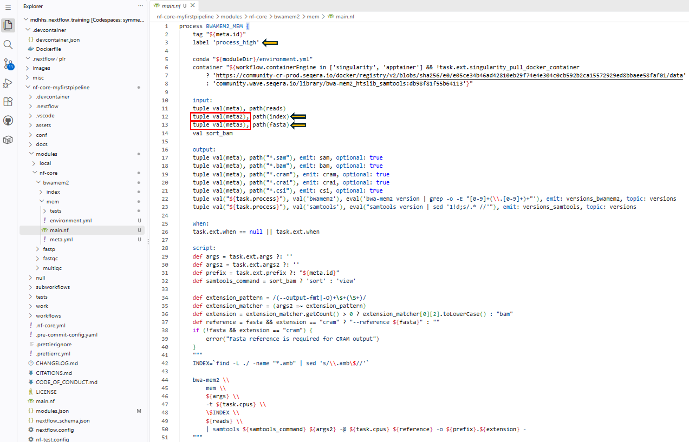

- Change the label directive from `process_high` to `process_low`
- Remove `tuple val(meta2),` from the `path(index)` input
- Remove `tuple val(meta3),` from the `path(fasta)` input

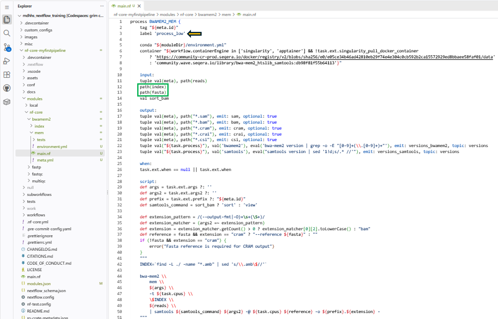

Save the file:

```
ctrl+s
```

Let's take a minute to discuss the contents in the `script:` block. Let's start with all the `definition` lines:

```
def args = task.ext.args ?: ''
def args2 = task.ext.args2 ?: ''
def prefix = task.ext.prefix ?: "${meta.id}"
def samtools_command = sort_bam ? 'sort' : 'view'

def extension_pattern = /(--output-fmt|-O)+\s+(\S+)/
def extension_matcher = (args2 =~ extension_pattern)
def extension = extension_matcher.getCount() > 0 ? extension_matcher[0][2].toLowerCase() : "bam"
def reference = fasta && extension == "cram" ? "--reference ${fasta}" : ""
if (!fasta && extension == "cram") {
    error("Fasta reference is required for CRAM output")
}
```

We start with two `def args` lines, `def args` and `def args2`. There are two because two tools are run within the shell script, `bwa-mem2` and `samtools`, and `${args}` and `${args2}` define tool parameters for  `bwa-mem2` and `samtools`, respectively. 

Next is the `def prefix` line, which we have seen before. We will keep this as default, which is `${meta.id}`, aka the sample ID. 

The `def samtools_command` line is connected to the 4th input within the `input:` block. Recall that the `val sort_bam` input will be boolean, `true or false`. So the following line:

```
def samtools_command = sort_bam ? 'sort' : 'view'
```

States the following: `if` sort_bam = `true`, then the samtools command will be `sort`, `else` sort_bam = `false`, then the samtools command will be `view`.

The next three lines are interconnected. Let's start with the first of these three lines: 

```
def extension_pattern = /(--output-fmt|-O)+\s+(\S+)/
```    

Here, we are defining a regular expression (regex) pattern and storing it in a variable named `extension_pattern`. The regex pattern will be `--output-fmt` or (`|`) `-O`, followed by whitespace `\s` and a non-whitespace value `\S`.

`--output-fmt` (or short form of the same option, `-O`) is an option shared by various samtools subcommands. It's a way to specify output format as `SAM` (human-readable alignment file), `BAM` (non-human-readable compressed version of `SAM`), or `CRAM` (non-human-readable highly compressed version of SAM. Requires reference fasta file). The `+\s+(\S+)` part of the expression pattern, `(--output-fmt|-O)+\s+(\S+)`, is a generic way to grab whatever text is contained after the `--output-fmt` or `-O` option.  

In the second line of this three line combination: 

```
def extension_matcher = (args2 =~ extension_pattern)
```

=~ creates a matcher object that can find matches in a string. It's looking for the `extension_pattern` in the `args2` section.

For example, if `args2 = '-@ 4 -O cram'`, then args2 =~ extension_pattern would find the matching pattern `-O cram`

<details>
<summary>Can you recall where we will define args2?</summary>

In the `conf/modules.config` file. We'll get to this in a second!

</details>

<br>

In the last line of this three line combination:

```
def extension = extension_matcher.getCount() > 0 ? extension_matcher[0][2].toLowerCase() : "bam"
```

`if` extension_matcher.getCount() > 0, a match exists
`then` access the first match `extension_matcher[0]` and then access the match at index 2 of that match, `extension_matcher[0][2]`. And then finally, `.toLowerCase()` would convert the match to lowercase.
`else`, default to `bam` if no match exists. 

So let's visualize this from the top. Let's say hypothetically that my `ext.args2` for the `BWAMEM2_MEM` module looks as follows:

```
ext.args2 = '-f 3 -O cram'
```

Then with `def extension_pattern` still set as `/(--output-fmt|-O)+\s+(\S+)/`, `def extension_matcher` = `(args2 =~ extension_pattern)` would output the following:

```
[-O cram, -O, cram]
```

The matcher produces a list-like result for each match. So let's break this down more:


```
[
    '-O cram',  // [0] Entire match
    '-O',       // [1] First capture group
    'cram'      // [2] Second capture group
]
```

So with ` def extension = extension_matcher.getCount() > 0 ? extension_matcher[0][2].toLowerCase() : "bam"`, a match would exist. 
`extension_matcher[0]` = `['-O cram', '-O', 'cram']` and then `extension_matcher[0][2]` = `cram`. 
`.toLowerCase()` would also result in `cram`, and this would utimately become the value of the `extension` variable. 


Again, if there is no match, the file format defaults to `bam`, which is exactly what we want for the purposes of our pipeline.

This `extension` variable is ultimately used as a nextflow variable in the shell script for samtools, where it defines the extension output name of the resulting file:

```
samtools ${samtools_command} ${args2} -@ ${task.cpus} ${reference} -o ${prefix}.${extension}
```

The last two parts prior to the shell script:

```
def reference = fasta && extension == "cram" ? "--reference ${fasta}" : ""
if (!fasta && extension == "cram") {
    error("Fasta reference is required for CRAM output")
}
```

Is ensuring a reference fasta is available if `cram` output format is specified because that compression requries the reference fasta file. If not present, the script will error out.  


We then make it to the shell script where our two tools are run: 

```
"""
INDEX=`find -L ./ -name "*.amb" | sed 's/\\.amb\$//'`

bwa-mem2 \\
    mem \\
    ${args} \\
    -t ${task.cpus} \\
    \$INDEX \\
    ${reads} \\
    | samtools ${samtools_command} ${args2} -@ ${task.cpus} ${reference} -o ${prefix}.${extension} -
"""
```

The first line is finding the index file with extension `.amb` created from our `BWAMEM2_INDEX` step and removing the `.amb` extension from that file. Then, alignment is performed and piped into the `samtools` command to output the `BAM`, `SAM`, or `CRAM` file. Notice how the output files in the `output:` block are all optional since we are only able to output one of these file formats. 

Notice the various variables that we defined in the `input:` block, and within the `script:` section. We have:
- `${reads}` from the `path(reads)` input part of the `tuple val(meta), path(reads)` input
- `${prefix}` from the `val(meta)` input part of the `tuple val(meta), path(reads)` input
    - Since we do not define a `task.ext.prefix` in `def prefix = task.ext.prefix ?: "${meta.id}"`, `prefix` defaults to `${meta.id}`
- `${args}` from `def args = task.ext.args ?: ''`
    - provides tool parameters for `bwam-mem2 mem`
- `${args2}` from `def args2 = task.ext.args ?: ''`
    - provides tool parameters for `samtools`
- `${task.cpus}` defined from the `label process_low` 
    - directive which references computing resources defined in `conf/base.config`
- `${samtools_command}` from the `def samtools_command = sort_bam ? 'sort' : 'view'`
    - which is the 4th input within the `input:` block, either `true` or `false`
- `${reference}` from `def reference = fasta && extension == "cram" ? "--reference ${fasta}" : ""`
- `${extension}` from `def extension = extension_matcher.getCount() > 0 ? extension_matcher[0][2].toLowerCase() : "bam"`
    - we will not define `--output-fmt` or `-O` in `${args2}` so this will default to `bam` extension
- `\$INDEX` defined in the first line of the shell script.

<br>

> [!Note]
> When a `script:` block is encapsulated in triple quotes (`"""`), then nextflow variables are specified with the dollar sign, `$`. <br>
> And backslash escaping allows us to define shell/bash variables as `\$`, like it is for `\$INDEX`. <br>
> `\$INDEX` is a shell variable because it was defined within the triple quote sandwich and not any time before within the process script. <br>

<br>

# Part II: Incorporating new modules into the pipeline

### Edit the conf/modules.config file

Open the `conf/modules.config` file:

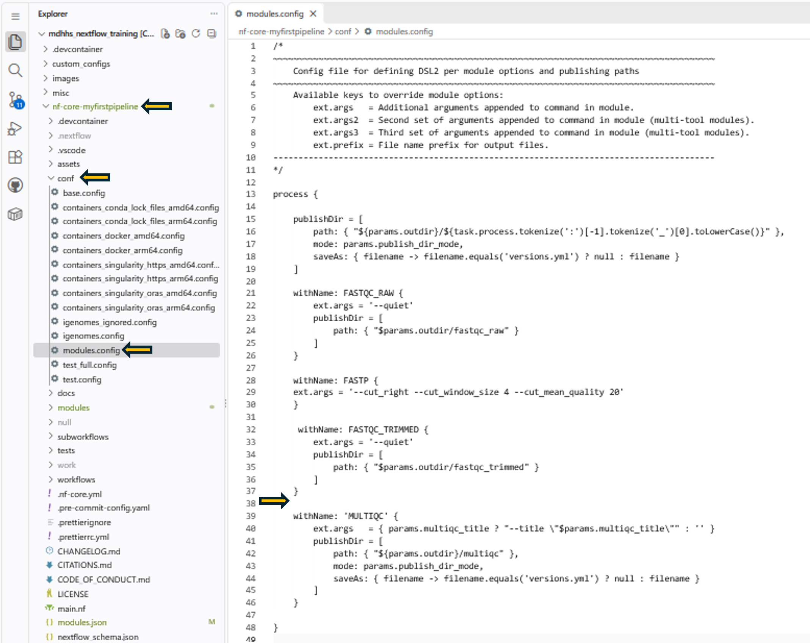

And just after the `withName: FASTQC_TRIMMED` block, add the following for `BWAMEM2_MEM`:

```
withName: BWAMEM2_MEM {
    ext.args2 = '-b -f 3 -F 2048'
    publishDir = [
        path: { "$params.outdir/bwamem2/bam_file" }
    ]
}
```

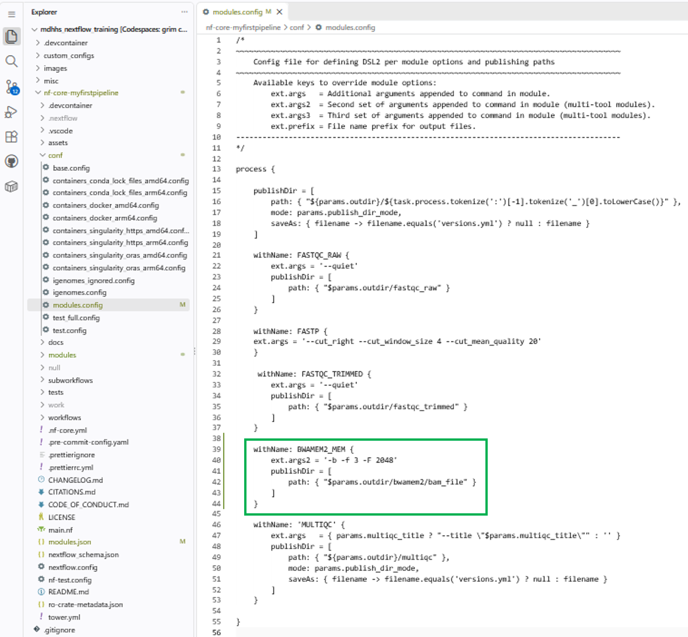


<details>
<summary>Can you recall what `ext.arg2` is for? </summary>

<br>

`ext.args2` is for samtools arguments. `ext.args` is for `bwa-mem2 mem` arguments, but we're leaving this blank and allowing default alignment options.

<br>

</details>

<br>

You can review all `samtools view` options, [here](https://www.htslib.org/doc/samtools-view.html). But briefly: 
- `-b` is for output in `BAM` format. 
- `-f` are required flags needed for output alignment. The decimal `3` represents the `0x1` and `0x2` flags seen [here](https://www.htslib.org/doc/samtools-flags.html)
    - Meaning, aligned reads need both properties of being paired-end (`0x1`) and properly aligned (`0x2`) in order to be output to the `BAM` file
- `-F` excludes alignments with the following flag. 
    - The decimal number, `2048`, represents the flag, `0x800`, which means we are excluding supplementary alignments in our `BAM` file. 
    - This represents additional parts of a read, split into parts, that align elsewhere in the reference

<br>

> [!Note]
> `3` and `2048` are decimal representations of the hexidecimals that represent the samtools [flags](https://www.htslib.org/doc/samtools-flags.html). <br>
> See additional discussion on this topic, [here](https://davetang.org/muse/2014/03/06/understanding-bam-flags/).

<br>

### Edit the workflows/myfirstpipeline.nf file

Open the `workflows/myfirstpipeline.nf` file.

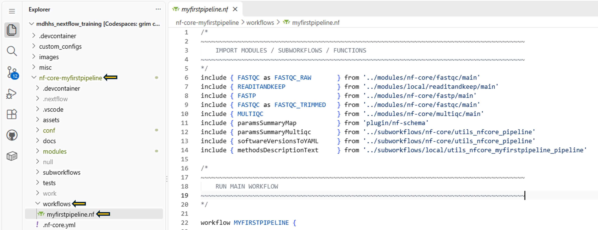

And add the following lines to import the modules we just installed: 

```
include { BWAMEM2_INDEX              } from '../modules/nf-core/bwamem2/index/main'
include { BWAMEM2_MEM                } from '../modules/nf-core/bwamem2/mem/main'
```

> [!Note]
> Recall that `nf-core modules install` installs modules to the `modules/nf-core` directory, not `modules/local`.

<br>

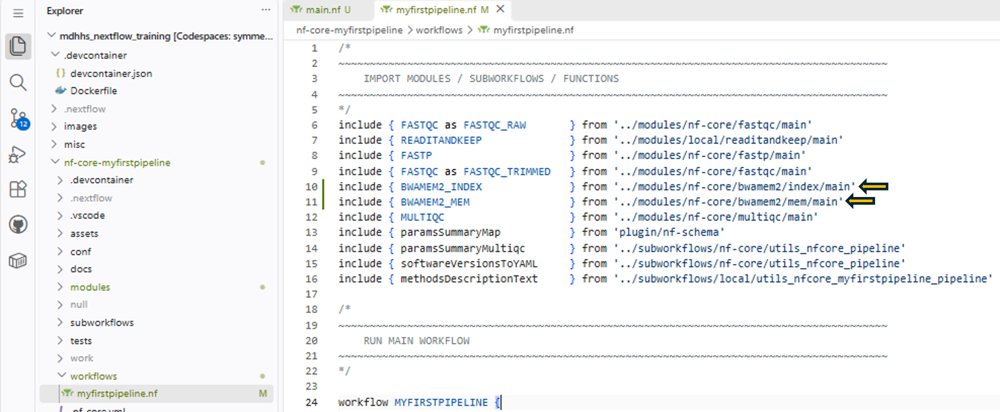

Then scroll down in the script until you reach the FASTQC_TRIMMED module:

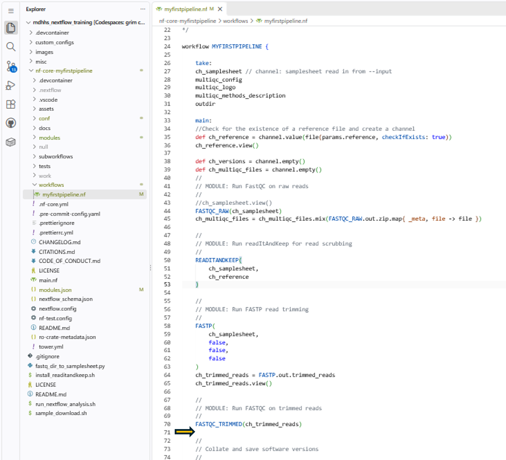

And add the follwing: 

```
//
// MODULE: Run BWAMEM2 to index reference genome
//
BWAMEM2_INDEX (
    ch_reference
)
ch_index = BWAMEM2_INDEX.out.index

//
// MODULE: Run BWAMEM2 to align reads to reference genome and output BAM file
//
BWAMEM2_MEM (
    ch_trimmed_reads,
    ch_index,
    ch_reference,
    false
)
ch_aligned_bam = BWAMEM2_MEM.out.bam
```

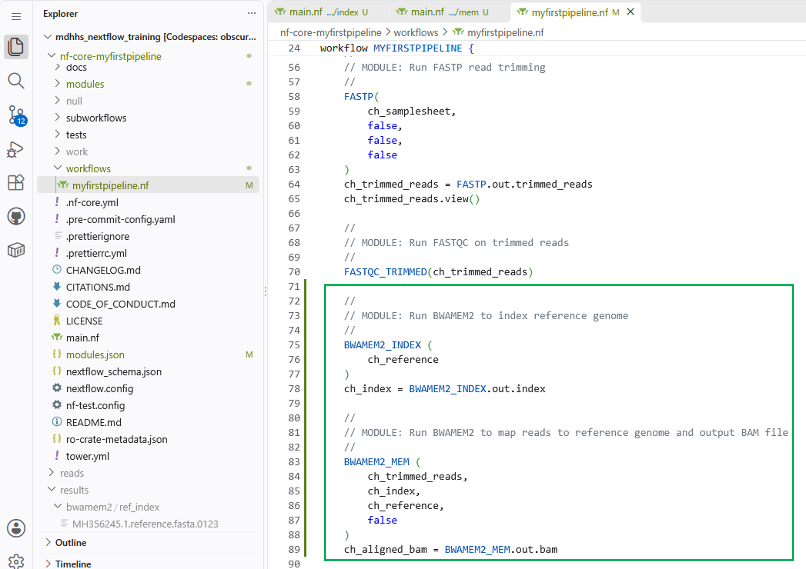

`BWAMEM2_INDEX` contains one input, which is the channel, `ch_reference`, that we created for our reference fasta file. Then, after this module completes, the reference fasta file is indexed. We capture the output channel from the `BWAMEM2_INDEX` module via `BWAMEM2_INDEX.out.index` and renamed it to a more intuitive channel name, `ch_index`. This serves as the second input into the `BWAMEM2_MEM` module.

The `BWAMEM2_MEM` module contains the 4 expected inputs
- Our `FASTP` trimmed reads with the meta map
- The indexed reference genome output from `BWAMEM2_INDEX`
- The original referecnce fasta file
- And boolean input `false`


<details>
<summary>Can you recall what the false value will do in the BWAMEM2_MEM script? </summary>

<br>

It will set the samtools subcommand to `view` instead of `sort`.

<br>

</details>

<br>

Finally, we prepare the `BAM` channel for our tutorial next week, which will be used as input into our subworkflow. We capture this output channel in our workflow in a similar fashion that we did for `BWAMEM2_INDEX`, with the format `MODULENAME.out.emitName`. So for our pipeline, this would be `BWAMEM2_MEM.out.bam`. To properly capture this output channel, the `emitName` needs to match the file format we output from `samtools`, which for us happens to be `bam`.

Recall all of the optional outputs for `BWAMEM2_MEM`:

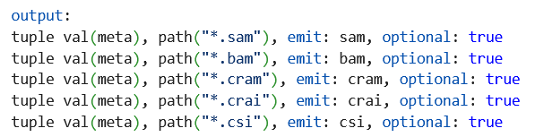

# Part III: Testing the pipeline

From the `launchDir`, `/workspaces/mdhhs_nextflow_training/`, download the sample:

```
bash sample_download.sh
```

Create the `samplesheet.csv` file

```
python3 fastq_dir_to_samplesheet.py reads/ samplesheet.csv
```

Run the pipeline:

```
bash run_nextflow_analysis.sh
```

Look at what I noticed when I launched my pipeline: 

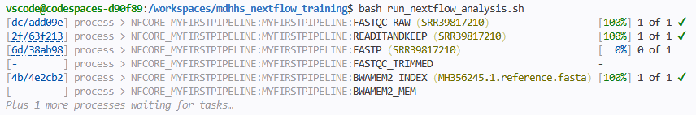

The `BWAMEM2_INDEX` module appeared to have started and completed before other modules outlined in the pipleine. 

<details>
<summary>How is this possible? Think for a moment and then reveal the solution. </summary>

<br>

Actual workflow organization in the `workflows/myfirstpipeline.nf` file doesn't matter. It's dependent on what the input channels are for a module and if those channels are currently available, independent of other modules running in the pipeline and where they are organized in the pipeline script.

`BWAMEM2_INDEX` only requires `ch_reference` and this channel is established at the start of the pipeline, so the `BWAMEM2_INDEX` module can launch right away. 

<br>

</details>

<br>

Awesome! We see that the pipeline completed:

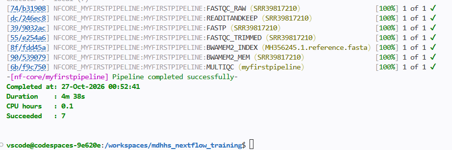

And if we navigate to the work directory for the `BWAMEM2_INDEX` module:

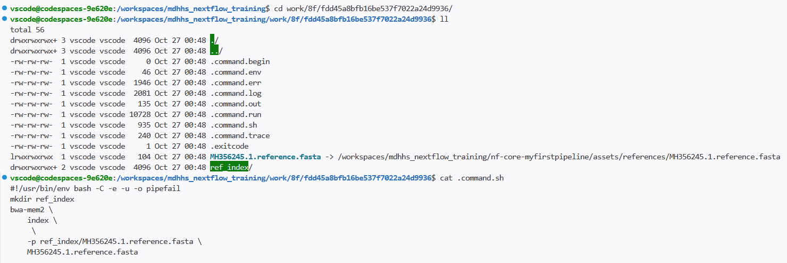

And run:

```
ll
cat .command.sh
```

We see that our reference fasta was sourced from the `assets/` directory and the `ref_index/` directory was created from our script that was run, which contains the index files output from `BWAMEM2_INDEX`. 

Likewise for the work directory for the `BWAMEM2_MEM` module:

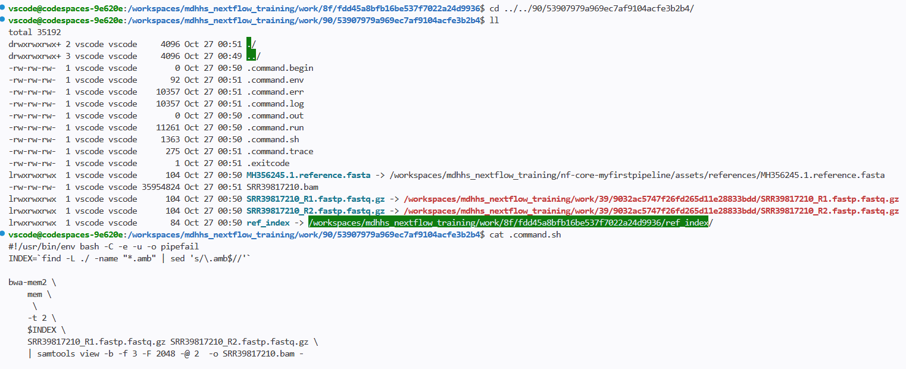

**Your `work/` directory hash to the BWAMEM2_INDEX and BWAMEM2_MEM modules will be different**

We see that our trimmed reads were sourced from the `FASTP` module output, the reference fasta is again sourced from the `assets/` directory, and our `ref_index/` directory created from `BWAMEM2_INDEX` is being referenced, as well. The `SRR39817210.bam` file is the resulting file from this module.

If you look at the shell script for the `BWAMEM2_MEM` module, you will notice the various inputs we defined in the `BWAMEM2_MEM` process main.nf script. Out of interest, I re-edited the `BWAMEM2_MEM` process main.nf script to echo the output of the `\$INDEX` shell variable:

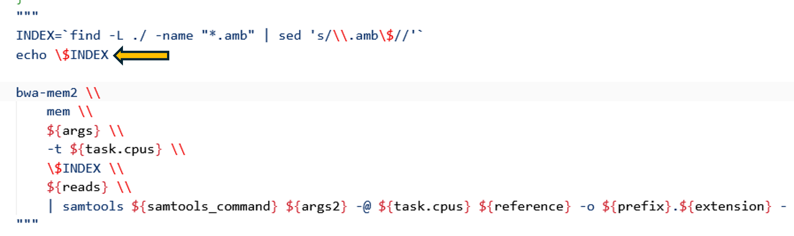

I re-ran the analysis, and after completion, I navigated to the work directory and looked at the output of the shell script via:

```
cat .command.out
```

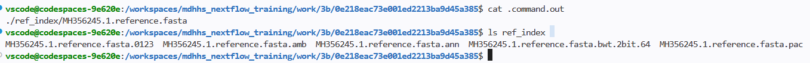

And we can see that `echo \$INDEX` = `./ref_index/MH356245.1.reference.fasta`, which essentially provides the base name to all index files contained within `ref_index`:
- `MH356245.1.reference.fasta`.0123
- `MH356245.1.reference.fasta`.amb
- `MH356245.1.reference.fasta`.ann
- `MH356245.1.reference.fasta`.bwt.2bit.64
- `MH356245.1.reference.fasta`.fasta.pac

And lastly, if you navigate to the `results/` directory:

```
cd /workspaces/mdhhs_nextflow_training/results/
```

You will notice that the resulting files from `BWAMEM2_INDEX` and `BWAMEM2_MEM` have also been copied to this directory:

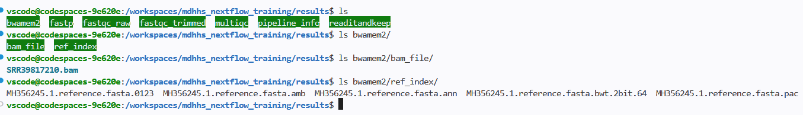


# Challenge: Add bowtie2 and a parameter to choose between aligners

Navigate to the GitHub repo for the nextflow tutorial, [here](https://github.com/JLC2141/mdhhs_nextflow_training/tree/tutorial_4_challenge).

If you're relaunching your codespace, launch the `tutorial_4_challenge` branch to have all progress made prior in tutorial 4 so that you can jump directly into this challenge. 


We just implemented `bwamem2` as our aligner but sometimes you may want multiple tool options, possibly to compare and contrast performance of each tool. 

Your challenge is to add another alignment tool, [bowtie2](https://github.com/benlangmead/bowtie2), to the pipeline and then provide an additional parameter, specified in our `custom_configs/training.config` file to select between `bwamem2` or `bowtie2` as the read alignment tool in our pipeline analysis.

You will need to repeat the same steps we just performed in this tutorial. 

- This includes:
    - Using the nf-core CLI to install two modules associated with `bowtie2
    - Edit the `main.nf` process script files for each module
    - Edit `conf/modules.config` file to add parameters
    - Edit the `workflows/myfirstpipeline.nf` script to import the modules, explicitly declare them in the workflow, and add an `if` statement for parameterization choice 
    - Edit the custom_configs/training.config 


I will post the solution on the `tutorial 5` branch in a week but I would like for you to really challenge yourself to implement this other tool with mimimal guidance.

### Install the modules

The modules are called `bowtie2/build` and `bowtie2/align`. 

### Edit the main.nf files for both bowtie2_build and bowtie2_align

Let's start with `BOWTIE2_BUILD`. `BOWTIE2_BUILD` is equivalent reference fasta indexing as performed in `BWAMEM2_INDEX`. Make similar edits that we did in `BWAMEM2_INDEX`.

Hints
- Change label to `process_low`
- Remove the tuple from the `input:` block and `output:` block and just keep the `path()` element
- Optional: change `bowtie2` output directory name to `ref_index`
    - Will need to be changed at three locations in the script

Next, edit `BOWTIE2_ALIGN`, which is equivalent to `BWAMEM2_MEM`. 

Hints
- Change label to `process_low`
- Remove tuple and `meta2` and `meta3` from the `input:` block on the second and third inputs, respectively. 


### Edit the conf/modules.config file 

Add the same lines as we did for parameters for `BWAMEM2_MEM`, but now for `BOWTIE2_ALIGN`. Only add arguments for samtools via `ext.args2` as we did for `BWAMEM2_MEM`. Keep `ext.args` blank for default parameters.


### Edit the workflows/myfirstpipeline.nf file

Hints
- Don't forget to import the new modules
- You will need to establish an `if-else` statement to create a parameter for aligner tool option.
    - Use the framework as shown below
    - Also note that `BOWTIE2_ALIGN` contains one additional input compared to `BWAMEM2_MEM`. 
        - This happens to be another boolean value that will keep (`true`) or discard (`false`) unaligned reads
        - See nf-core documentation for `BOWTIE2_ALIGN`, [here](https://nf-co.re/modules/bowtie2_align/)

```
if( params.bowtie2_aligner ) {
        //
        // MODULE: Run BOWTIE2 to index reference genome
        //
        BOWTIE2_BUILD (
            input_1
        )
        ch_index = BOWTIE2_BUILD.out.index
    
        //
        // MODULE: Run BWAMEM2 to align reads to reference genome and output BAM file
        //
        BOWTIE2_ALIGN (
            input_1,
            input_2,
            input_3,
            input_4,
            input_5
        )
        ch_aligned_bam = BOWTIE2_ALIGN.out.bam
    } else {
        //
        // MODULE: Run BWAMEM2 to index reference genome
        //
        BWAMEM2_INDEX (
            input_1
        )
        ch_index = BWAMEM2_INDEX.out.index
    
        //
        // MODULE: Run BWAMEM2 to align reads to reference genome and output BAM file
        //
        BWAMEM2_MEM (
            input_1,
            input_2,
            input_3,
            input_4
        )
        ch_aligned_bam = BWAMEM2_MEM.out.bam
    }
```


### Edit custom config

Lastly, we will need to edit the custom config file created from the challenge in `tutorial 3`. This file is located in: `/workspaces/mdhhs_nextflow_training/custom_configs/training.config`

Edit this file as follows:

```
params {
    reference = "${projectDir}/assets/references/MH356245.1.reference.fasta"
    bowtie2_aligner = true
}
```

### Re-run the analysis

If all is well, you will now notice that `BOWTIE2` launches during analysis. Once completed, try changing `bowtie2_aligner = true` to `bowtie2_aligner = false` in the custom config file to convince yourself that `BWAMEM2` is now the chosen aligner tool upon a pipelin re-run. 


# Recap 

In this tutorial, we have:
- Added two new modules to index our reference fasta file and align our reads 
- Navigated nextflow file/directory structure to implement our new modules into our pipeline
- Learned more about nextflow groovy syntax
- Added a second aligner tool along with the addition of a new parameter to select between aligner tools

So far, we have been building our pipeline with the addition of modules, only. In tutorial 5, we will continue building our pipeline with the implementation of a subworkflow. 

