# Table of contents
- [Overview](#-overview)
- [Tutorial 3](#-tutorial-3)
- [Part I](#part-i-creating-a-nextflow-module-from-an-nf-core-starter-template)
- [Part II](#part-ii-editing-a-new-module)
- [Part III](#part-iii-incorporating-a-new-module-into-the-pipeline)
- [Part IV](#part-iv-testing-the-pipeline)
- [Recap](#recap)
- [Challenge](#challenge-exploring-the-priority-of-nextflow-config-files)

# 📖 Overview

Here is an overview of the pipeline we are going to build:

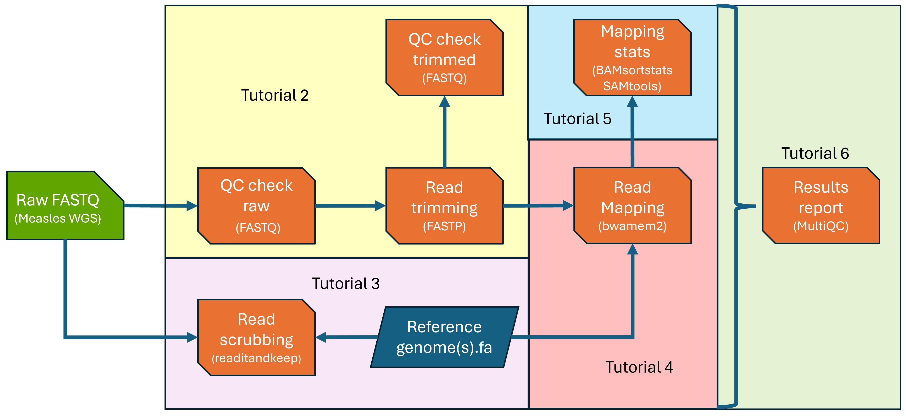

This simple pipeline starts with RAW FASTQ reads obtained from the SRA repository. Specifically, a [measles WGS sequencing sample](https://www.ncbi.nlm.nih.gov/sra?LinkName=biosample_sra&from_uid=61933769) obtained from a broader viral (non-SARS-CoV-2) surveillance effort at Wyoming PHL published under SRA project [PRJNA858824](https://www.ncbi.nlm.nih.gov/bioproject/PRJNA858824)

The pipeline then performs the following steps

1) Read QC on raw FASTQ reads with [FASTQC](https://www.bioinformatics.babraham.ac.uk/projects/fastqc/)
    - What is the quality of our reads off the sequencer?
2) Read trimming with [FASTP](https://github.com/opengene/fastp)
    - Removal of low quality reads and trimmming of low quality bases
3) **Challenge task**: Read QC on trimmed FASTQ reads with [FASTQC](https://www.bioinformatics.babraham.ac.uk/projects/fastqc/)
    - Does the quality of our reads improve post-trimming?
4) Read scrubbing on raw FASTQ reads with [read-it-and-keep](https://github.com/GlobalPathogenAnalysisService/read-it-and-keep)
    - If you anticipated submitting these sequences to a database and wanted to ensure removal of human reads
5) Read mapping with [bwa-mem2](https://github.com/bwa-mem2/bwa-mem2)
    - How well do our trimmed reads map to a reference genome?
6) Read mapping stats with [SAMtools](https://github.com/samtools/samtools)
    - Also converts SAM to BAM if you were to proceed with variant calling
7) Results report generation with [MultiQC](https://github.com/multiqc/multiqc)
    - Aggregates results from our pipeline into a final report

# 📖 Tutorial 3

The objectives of this tutorial are:
1) Use the nf-core command line interface (CLI) to create a new module from a starter template
2) Incorporate a read scrubbing step into our pipeline
3) Retrieve and incorporate a reference file
4) Understand required files to edit and nextflow syntax needed to incorporate the read scrubbing module into a pipeline workflow
5) Optional challenge: learn more about nextflow `config` files

<br> 

# Getting started

**Make sure that you are signed-in to your GitHub account.**

Navigate to the GitHub repo for the nextflow tutorial, [here](https://github.com/JLC2141/mdhhs_nextflow_training/tree/tutorial_3).

Select the `branch` icon and select the `tutorial_3` branch.

The webpage will reload. Confirm that the `tutorial_3` branch is loaded. Select the green <> Code icon, the Codespaces tab, and then select `Create codespace on tutorial_3`

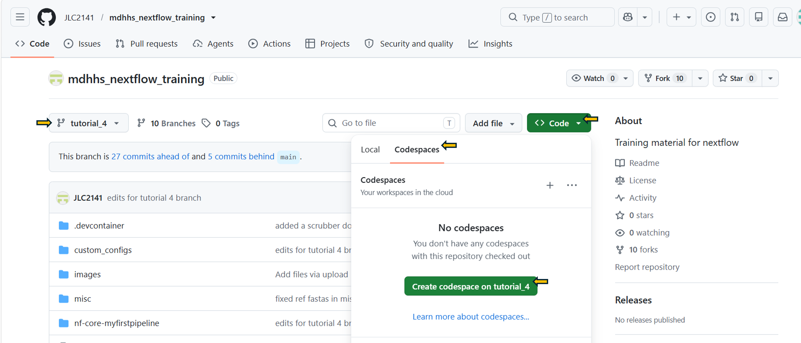

> [!NOTE]
> This will launch a codespace with 2 CPUs, 8 GB RAM, and 32 GB storage capacity <br>
> This is the default minimal virtual machine option for a GitHub codespace <br>

<br>

You will notice that we are at a checkpoint from our progress made in tutorial 2. Our nextflow pipeline is already downloaded along with the incorporation of our `FASTP` module. 

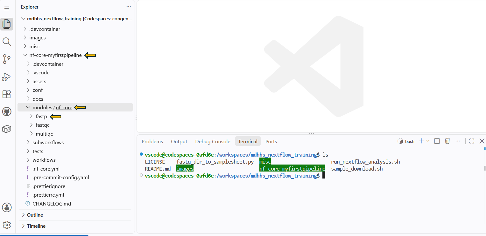

In addition, the tutorial 2 challenge has also been completed with the use of `module aliases` to use the `FASTQC` module twice, both on our raw and trimmed reads. 

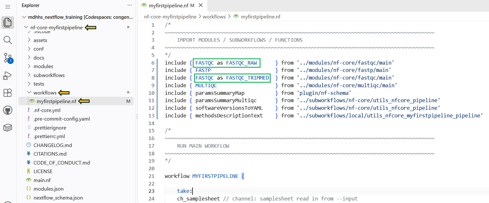

If you want to learn more about `module aliases`, work through the self-guided challenge, [here](https://github.com/JLC2141/mdhhs_nextflow_training/tree/tutorial_2_challenge#challenge-adding-a-module-alias), on branch `tutorial_2_challenge`. 


# Part I: Creating a nextflow module from an nf-core starter template

### Install the module 

Remember, nf-core CLI commands are meant to function inside of your pipeline directory. So change into your pipeline directory:

```
cd nf-core-myfirstpipeline
```

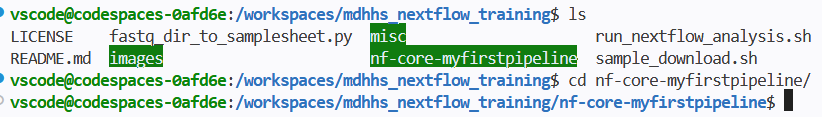

So that we are currently working in the `/workspaces/mdhhs_nextflow_training/nf-core-myfirstpipeline/` directory.

Run the following command:

```
nf-core modules
```

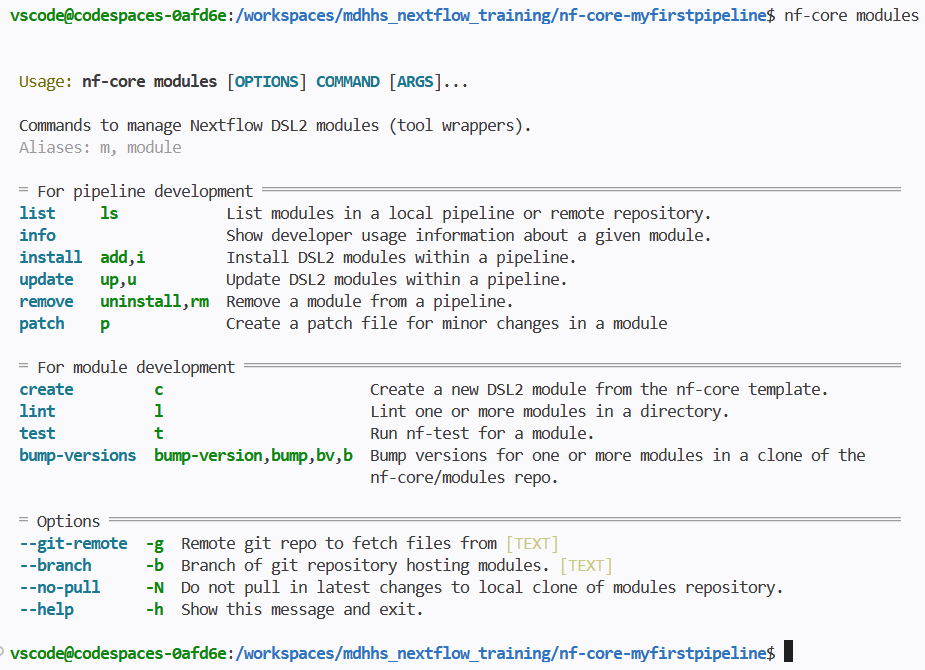

Recall in tutorial 2 that we ran the `nf-core modules install` command to retrieve an already-established module (`FASTP`). Here, we are going to use the `create` command to create a module from a starter template:

```
nf-core modules create
```

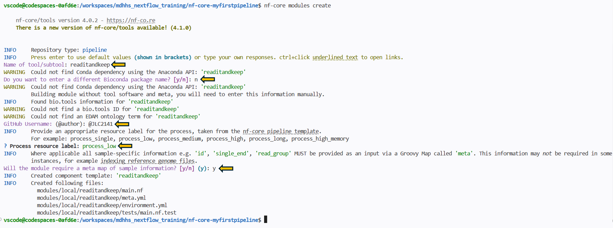

- You'll be prompted 5 times
    - Name of tool/subtool: `readitandkeep`
        - Keep it lowercase and no punctuation between words. It's an nf-core standard
    - Do you want to enter a different Bioconda package name? [y/n]: `n`
        - We are using containers, not Bioconda
    - GitHub Username: (@author): @`enter your GitHub username here`
        - You need the `@` symbol at the beginning
    - ? Process resource label: `process_low`
        - defining compute resources
    - Will the module require a meta map of sample information? [y/n] (y): `y`
        - linking our sample ID to our FASTQ read pair files


Some background- we will be "scrubbing" our reads. This refers to a process where we take raw reads and remove human reads from the FASTQ files. This allows us to upload our FASTQ files to a public repository while ensuring that PII/PHI is protected. To achieve this, we are making use a of a bioinformatics tool called [readItAndKeep](https://github.com/GlobalPathogenAnalysisService/read-it-and-keep). This tool works by mapping the raw reads to the viral genome, and keeping only what successfully maps. 

A more common strategy is to map raw reads to the human genome, and discard reads that map. See [here](https://pmc.ncbi.nlm.nih.gov/articles/PMC12664888/) for a benchmarking study on human read scrubbing tools. However, this method is much more computationally intensive and requires significant storage for the human reference genome. We'll stick with the readItAndKeep strategy since we're working in codespaces with limited compute power and storage.


### View the readItAndKeep main.nf file

Open the `main.nf` file for the readitandkeep module

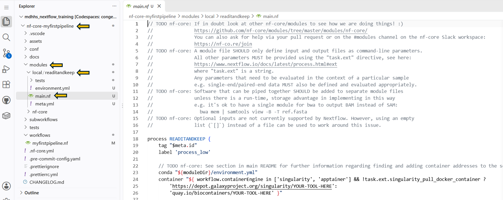

Notice how this module was installed into the `modules/local/` directory as opposed to the `modules/nf-core/` directory. However, we notice that this takes a similar structure as the `FASTP` module we looked at tutorial 2. 

- We see the:
    - `process READITANDKEEP` line which encapsulates our process script
    - Process `directives`
        - `meta.id` tag
        - `label` defining compute resources in `conf/base.config`
        - The `container` which will point to the actual source containing the software code to run our bioinformatic tool

<br>

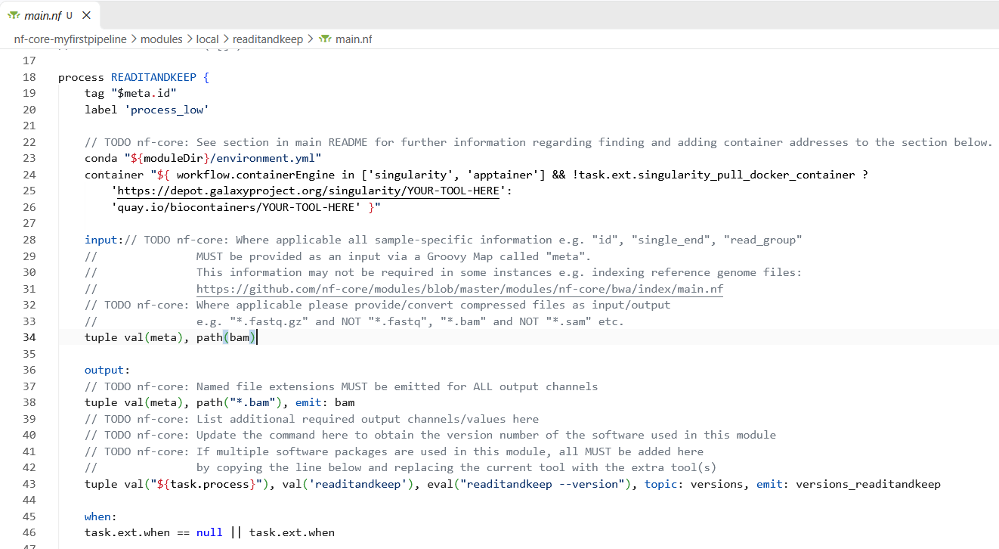


- Moving along we see:
    - `input:` section
        - This is where we will add our required inputs to run the `readItAndKeep` tool
    - `output:` section
        - This is where we will define our output files from the `readItAndKeep` tool
    - `when:` section
        - A conditional statement that can be used to define when we run the `readItAndKeep` tool
        - But we will not make use of this in this tutorial series

<br>

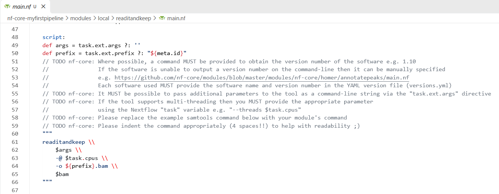


- Then we make it to the `script:` section:
    - `def` arguments are provided
        - recall that `args` can be defined as `ext.args` within the `conf/modules.config` file
        - `prefix` is defaulted to be defined from `meta.id`, aka sample ID
    - The script block
        - our """quote sandwich"""
        - defaults to being interpreted as a bash shell script
        - remember, `$` defines a nextflow variable
            - which is defined prior in the process script via `inputs` and `def` arguments

<br>

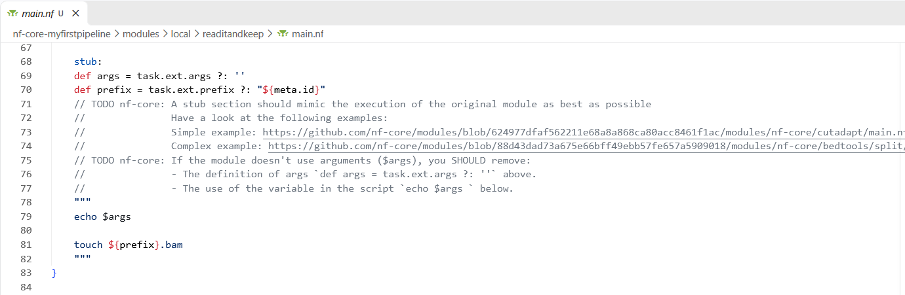


Finally, we make it to the `stub` section, which will ignore in this tutorial series, but see more [here](https://docs.seqera.io/nextflow/process#stub), if interested. 

<br>

> [!Note]
> The nf-core template also provides `TODO` list of instructions. <br>
> They help to guide you through process script edits <br>

<br>

# Part II: Editing a new module

Let's begin to incorporate the `READITANDKEEP` module into our overall pipeline. Recall this image from tutorial 2?:

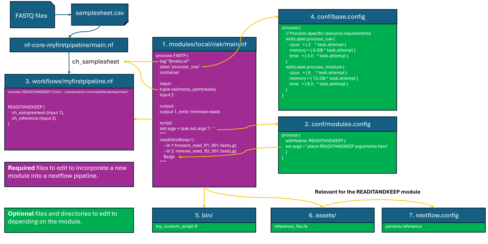

These are the steps, both required (purple) and optional (green), needed to successfully incorporate a new module/subworkflow. 


- We  will need to edit the following in this tutorial: 
    - `modules/local/readitandkeep/main.nf`
        - Note, `readitandkeep` was abbreviated to `riak` in the image, above
    - To incorporate a reference fasta file into our pipeline.
        - `assets/`
        - `nextflow.config`
    - `workflows/myfirstpipeline.nf`
    

### Editing the READITANDKEEP module process script: defining directives

We first start by editing the `main.nf` file part of the `READITANDKEEP` module. See all this extra help information at the beginning of the file? 

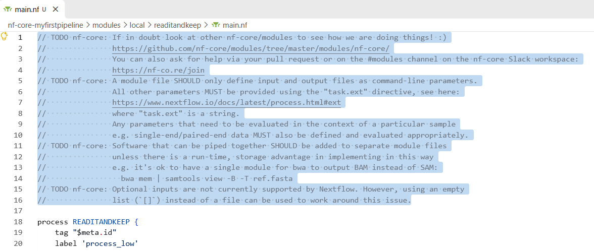

Feel free to read it on your own time for guidance but for now, let's get rid of it just to keep things tidy:

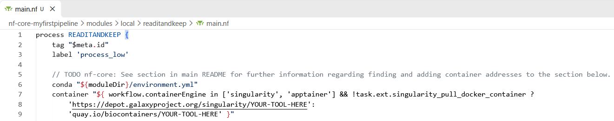

- Next, we see: 
    - The `process READITANDKEEP` line
        - This stays as is
    - The `meta.id` tag
        - We will also keep this as is because we want to label our sample ID to the process task in Nextflow execution reports and logs.
    - The `process_low` label
        - This was defined when we created the module

<br>

- Then we get to the container directive. Again, this template comes as a Groovy conditional `if-else` statement that basically says:
    - `if` our `-profile` parameter is defined as `apptainer` or `singularity`, then (defined in Groovy by the `?` character) use the singularity container found within the `https://depot.galaxyproject.org/singularity/` repository
    - `else` (defined in Groovy by the `:` character), use the docker container found within the `quay.io/biocontainers/` repository


[Apptainer](https://apptainer.org/) (formerly known as singularity) and [Docker](https://www.docker.com/) are the most commonly used container runtimes, and that's why it's built into the nf-core module template by default. However, nextflow supports various other [container runtimes](https://docs.seqera.io/nextflow/container#container-runtimes).

In addition, even though the nf-core template suggests to source containers from `https://depot.galaxyproject.org/singularity` and `quay.io/biocontainers/` for `apptainer/singularity` and `docker` containers, respectively, you can source your container from various container repositories ...

- Including:
    - [quay.io](https://quay.io/)
    - [docker hub](https://hub.docker.com/)
    - [GitHub container registry (ghcr.io)](https://docs.github.com/en/packages/working-with-a-github-packages-registry/working-with-the-container-registry)
    - [Singularity galaxy depot](https://depot.galaxyproject.org/singularity/)
    - [AWS Elastic Container Registry](https://aws.amazon.com/ecr/)
    - [Google Artifact Registry](https://docs.cloud.google.com/artifact-registry/docs)
    - [Azure Container Registry](https://azure.microsoft.com/en-us/products/container-registry)

A very useful Docker container registry for the public health community is the [StaPH-B docker hub](https://hub.docker.com/u/staphb). Here, members of the public health community keep commonly used tools in public health bioinformatics updated in freely available containers. 

Defining containers in the container directive is generally similar across container registries. So I will just focus on `quay.io` as an example.

- container specification for `quay.io` takes the form of:
    - `quay.io`/`username`/`tool`:`version`
        - and more generally, `URL`/`username`/`tool`:`version`


So, for example, click on this [link](https://quay.io/repository/biocontainers/read-it-and-keep?tab=tags) for the quay.io/biocontainer repository for `readItAndKeep`, the tool that we are trying to incorporate in this tutorial. 

> [!Note]
> I refer to it as `READITANDKEEP` when speaking about the nextflow module <br>
> I refer to it as `readItAndKeep` when speaking about the tool itself, as it's the executable command <br>
> But also notice that in the container repositories, it's written as `read-it-and-keep` <br>

Let's say I want to use the `0.3.0--h5ca1c30_3` tag in my `READITANDKEEP` module process script, how would I define this container from `quay.io`?

<br>

<details>
<summary>Reveal solution, here</summary>

<br>

`quay.io/biocontainers/read-it-and-keep:0.3.0--h5ca1c30_3`

<br>

</details>

<br>

Now, let's move to the `apptainer/singularity` container definition. See if you can find the `readItAndKeep` container within the singularity galaxy depot, [here](https://depot.galaxyproject.org/singularity/):


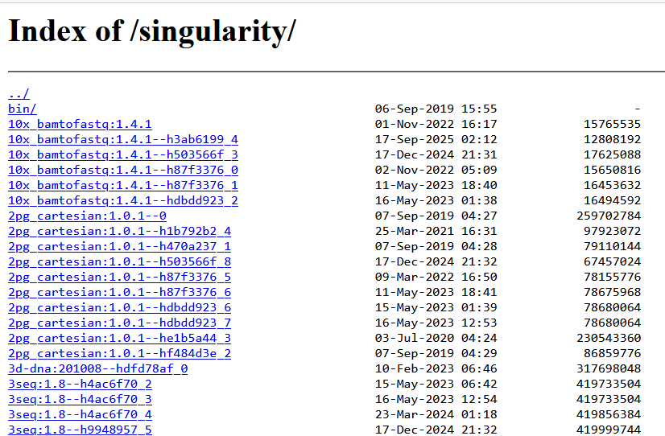


Here it is!

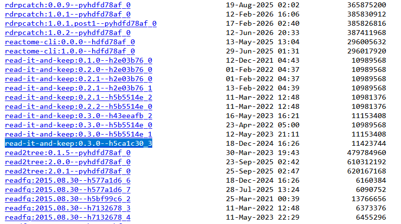


So via the nf-core template provided for defining `apptainer/singularity` containers, we can define our container for `readItAndKeep` like so: 
- `URL`/`username`/`tool`:`version`
- `https://depot.galaxyproject.org/singularity/read-it-and-keep:0.3.0--h5ca1c30_3`


Okay with this information, update your container section within the `READITANDKEEP` process script `main.nf` file:

```
container "${ workflow.containerEngine in ['singularity', 'apptainer'] && !task.ext.singularity_pull_docker_container ?
        'https://depot.galaxyproject.org/singularity/read-it-and-keep:0.3.0--h5ca1c30_3':
        'quay.io/biocontainers/read-it-and-keep:0.3.0--h5ca1c30_3' }"
```

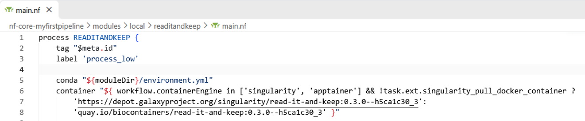


I do want to note that the [GitHub repo](https://github.com/GlobalPathogenAnalysisService/read-it-and-keep) for `readItAndKeep` provides instructions for using their Docker container from the GitHub container registry (`ghcr`):

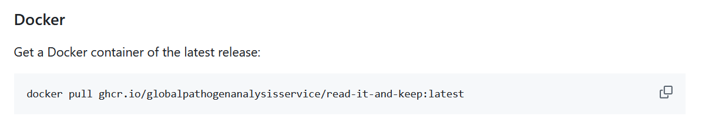

> [!Note]
> You may be tempted to try to use that container definition (`ghcr.io/globalpathogenanalysisservice/read-it-and-keep:latest`) in your `READITANDKEEP` process script for the docker container definition. <br>
> But, for reasons beyond the scope of this tutorial series, you would run into issues trying to execute the `readItAndKeep` script with this specific container. <br>
> The crux of it is that even though *you can* source from various container registries, some container registries are built specifically with workflow managers in mind, and others were not, which can cause extra complications in script execution. <br>
> That's why we typically stick with containers sourced from `quay.io/biocontainers` and `https://depot.galaxyproject.org/singularity/`, because these were built specifically to seamlessly incorporate with workflow managers, including nextflow. <br>
> Containers sourced from [StaPH-B docker hub](https://hub.docker.com/u/staphb) work fine as well.

<br>

### Editing the READITANDKEEP module process script: defining inputs

<br>


Now we make it to the `input:` section:

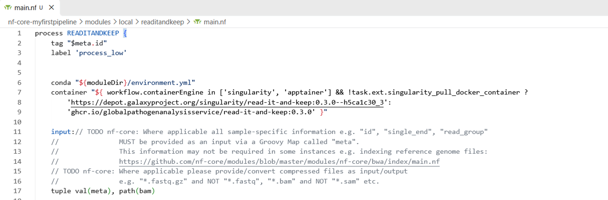

But before we update this section, let's play with the `readItAndKeep` tool outside of nextflow to get a better understanding of how it functions. 

From your `/workspaces/mdhhs_nextflow_training` directory, run the following script that has been provided for you: 


```
source install_readitandkeep.sh  
```

> [!Note]
> We need to use `source` instead of `bash` in order to modify our current shell. <br>
> The script has a `export PATH="$PATH:$HOME/.local/bin"` command therein. <br>
> If we ran `bash install_readitandkeep.sh`, it runs in a new shell and therefore, <br>
> we would not update our `$PATH` variable in our current running shell. <br>

- Feel free to look at this script in more detail. This script does 4 things:
    - Creates a new directory called `scrubber_test`
    - Downloads, installs, and makes `readItAndKeep` an executable command
    - Obtains 3 reference files for measles: Genotypes A, B3, and D8
        - From [measeq](https://github.com/phac-nml/measeq), a nextflow pipeline for analyzing measles samples created by the Public Health Agency of Canada - National Microbiology Branch.
    - Copies FASTQ files from a measles sample (stored as backup in the `misc/` directory) into the `scrubber_test/` directory

All relevant files have now been placed in the `scrubber_test/` directory


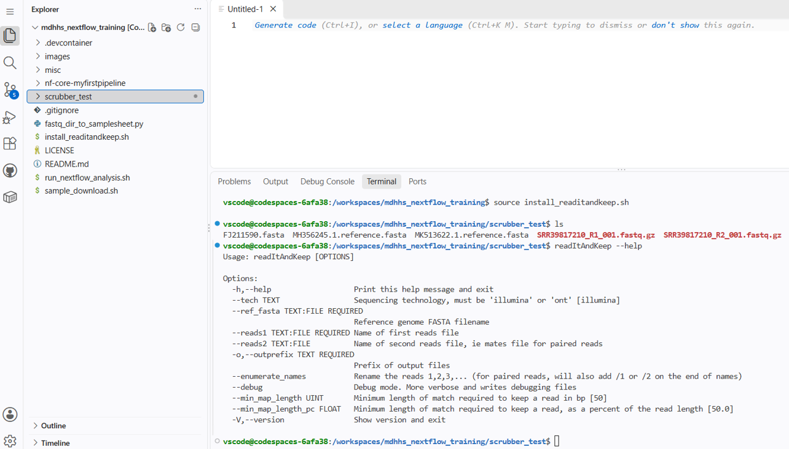

Once the script completes, you should now be within the `scrubber_test/` directory. Take a moment to review the [README.md](https://github.com/GlobalPathogenAnalysisService/read-it-and-keep#read-it-and-keep) section for `readItAndKeep` to locate the basic usage for this tool.

<details>
<summary>Reveal solution, here</summary>

<br>

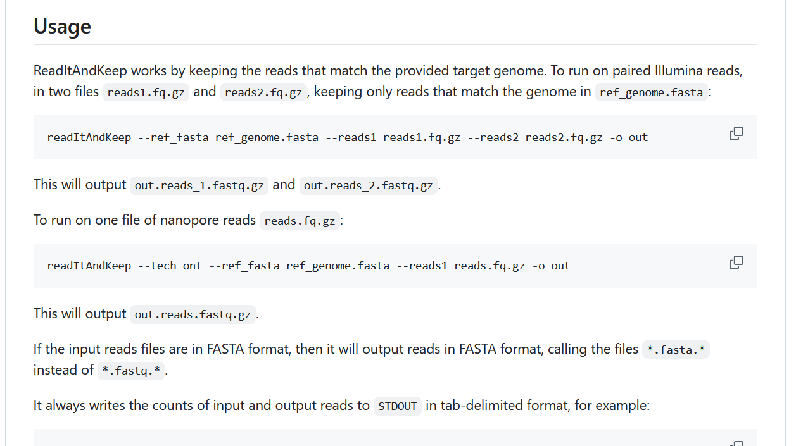


- For illumina reads, We see that basic usage requires 5 components:
    - the `readItAndKeep` executable
    - a `reference fasta` file
    - your forward read `FASTQ` file
    - your reverse read `FASTQ` file
    - and an `output prefix`

<br>

```
readItAndKeep --ref_fasta ref_genome.fasta --reads1 reads1.fq.gz --reads2 reads2.fq.gz -o out
```

<br>

</details>

<br>

To view this in our VS code terminal, run the following:


```
readItAndKeep --help
```

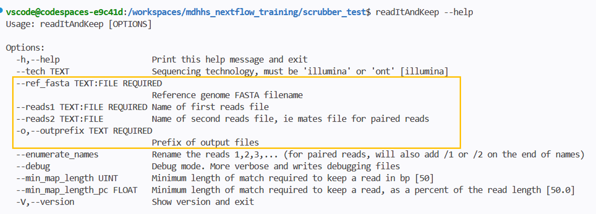

Again, we see the `readItAndKeep` executable along with the 4 required inputs. 

Now, a quick background on measles. There are 8 measles virus clades (A–H) and 24 subclades, referred to as [genotypes](https://iris.who.int/bitstream/handle/10665/241889/WER8709_73-80.PDF?sequence=1). Only two of these genotypes, B3 and D8, have been detected since [2021](https://nextstrain.org/measles/genome/global). And every measles vaccine is derived from [genotype A](https://journals.asm.org/doi/10.1128/jcm.01879-16).

These three reference fastas for genotypes A (`FJ211590.fasta`), B3 (`MK513622.1.reference.fasta`), and D8 (`MH356245.1.reference.fasta`) have been provided because there may be times where we do not know the genotype of our measles sample. So how do we choose the best reference fasta file for our mapping step? Well, we can try to run the script using all possible reference files to deduce the best reference match by most reads mapped, which would then be the most likely genotype for our sample. 

Let's go ahead and run the `readItAndKeep` script, first using the genotype A reference file:


```
readItAndKeep --ref_fasta FJ211590.fasta --reads1 SRR39817210_R1_001.fastq.gz --reads2 SRR39817210_R2_001.fastq.gz --outprefix SRR39817210 > genotype_A_results.txt
```

We added one additional component to our tool run command, the `> genotype_A_results.txt` to redirect our results to a `txt` file. 

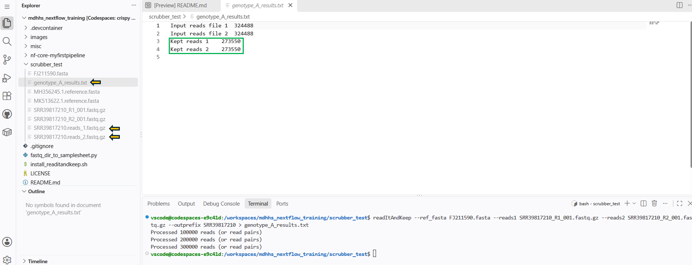


- You will notice two main outputs
    - Our "scrubbed" reads as FASTQ files, `SRR39817210.reads_1.fastq.gz` and `SRR39817210.reads_2.fastq.gz`
        - named by sample ID via the `--outprefix` parameter
    - A `txt` file containing the scrubbed reads results
        - In this run, we see that the original FASTQ files had 324,488 reads
        - Of those, 273,550 were kept, aka mapped to the genotype A reference fasta


Go ahead and run the following commands to rerun `readItAndKeep` with the genotype B3 reference fasta file: 

```
readItAndKeep --ref_fasta MK513622.1.reference.fasta --reads1 SRR39817210_R1_001.fastq.gz --reads2 SRR39817210_R2_001.fastq.gz --outprefix SRR39817210 > genotype_B3_results.txt
```

And with the genotype D8 reference fasta file: 


```
readItAndKeep --ref_fasta MH356245.1.reference.fasta --reads1 SRR39817210_R1_001.fastq.gz --reads2 SRR39817210_R2_001.fastq.gz --outprefix SRR39817210 > genotype_D8_results.txt
```

Determine the most likely genotype for our measles sample.

<br>

<details>
<summary>Reveal solution, here</summary>

<br>

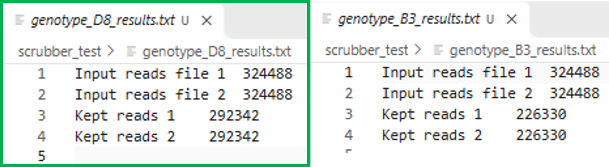

It seems to be genotype D8, since it has the most mapped reads. We will use this knowledge to incorporate the D8 genotype reference fasta file into our nextflow pipeline. 

<br>

</details>

<br>


Okay great! You just successfully ran `readItAndKeep`. But remember, we're here to nextflowify! Let's translate what we just did to complete the rest of the our `READITANDKEEP` process script `main.nf` file: 

Return to the `main.nf` file for the `READITANDKEEP` module and place this in the `input:` section:

```
tuple val(meta), path(reads)
path(reference)
```

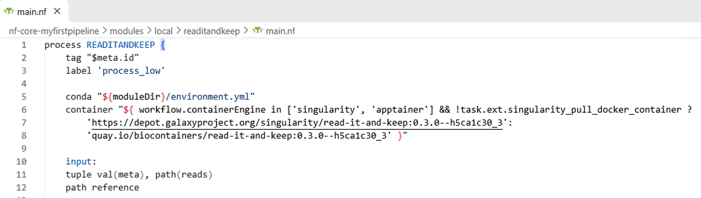

- Here you see:
    - We have our `tuple` defining a couple of qualifiers
        - `val` defining our `meta` map
        - `path` defining our read pair files
        - the input for this in our pipleine script (`workflows/myfirstpipeline.nf`) will be `ch_samplesheet`
    - We have our reference file now included as input
        - `path` defining our reference
        - as you'll see later in this tutorial, this reference file (the D8 genotype) will be placed within the `assets` directory and its path defined in the `nextflow.config` file

<br>

I hope the `meta` concept is clicking now but I want to briefly review it again.

Recall in tutorial 2 when we used the `view()` operator to view the `ch_samplesheet` created from our samplesheet input file. `ch_samplesheet.view()` output:

```
[[id:SRR39817210, single_end:false], [/workspaces/mdhhs_nextflow_training/reads/SRR39817210_R1_001.fastq.gz, /workspaces/mdhhs_nextflow_training/reads/SRR39817210_R2_001.fastq.gz]]
```

This is the tuple that is in the first line of our input (`tuple val(meta) path (reads)`) and is equivalent in conceptual assignment as follows:

```
meta  = [id: 'SRR39817210', single_end: false]
reads = [
    file('SRR39817210_R1_001.fastq.gz'),
    file('SRR39817210_R2_001.fastq.gz')
]
```

- `ch_samplesheet` is a tuple. So when used as input into a process script
    - We can access the elements of the `meta` map as follows:
        - `meta.id`: retrieves the sample ID from the map
        - `meta.single_end`: retrieves the single-end flag, `false` in our case
    - We can access the elements of `reads` containing the FASTQ file paths as follows:
        - `{reads[0]}` can access the forward read file
        - `{reads[1]}` can access the reverse read file

<br>


Okay, inputs are all set! 

> [!NOTE]
> The names in the `input:` block is just intuitive. `meta` for metadata, `reads` for FASTQ reads, and `reference` for the reference fasta file. <br>
> But, we could name these whatever we want. We're just creating the variables that we can then reference in the `script:` block section. <br>

### Editing the READITANDKEEP module process script: defining outputs

<br>

The template for the `output:` section looks as follows:

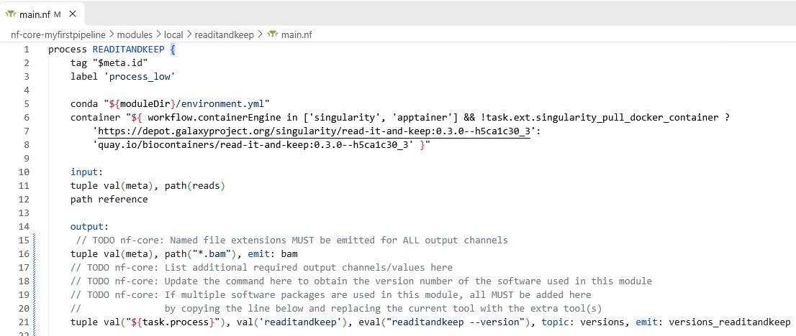

Let's recall what the outputs were when we just ran `readItAndKeep`:
- Two scrubbed `FASTQ` files (`SAMPLEID.reads_1.fastq.gz` and `SAMPLEID.reads_2.fastq.gz`)
- The `txt` file with the read scrubbing summary

We need to define these two outputs in order for them to populate in our results directory. 

```
tuple val(meta), path('*.fastq.gz')
path('*_scrubbed_results.txt')
```
    
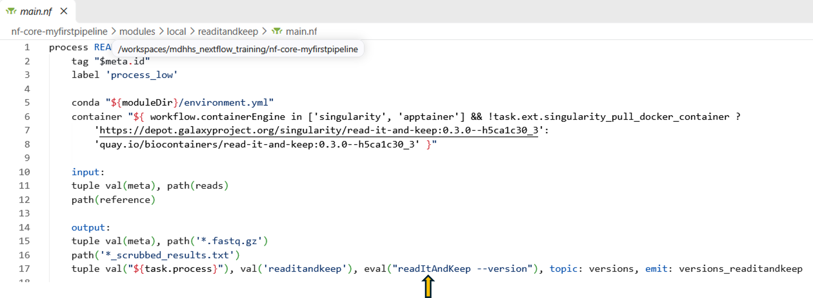


- The tuple output for the reads maintains our `meta` map to `reads` connection in the event that we wanted to use these reads in a downstream process
- The path qualifier for the `txt` summary file tells Nextflow this should be handled as a path (includes both directory paths and files)
    - This ensures that our results directory in populated with both the scrubbed reads `FASTQ` files and the `SAMPLEID_scrubbed_results.txt` file

 
Also note that the `readitandkeep` within the `eval("readitandkeep --version")` block of the following line:

```    
tuple val("${task.process}"), val('readitandkeep'), eval("readitandkeep --version"), topic: versions, emit: versions_readitandkeep
```

Needs to be changed to `eval("readItAndKeep --version")`. This is because the executable for this bioinformatic tool is `readItAndKeep`, not `readitandkeep`. And this section of the script is trying to obtain the version of the tool. 

There is a file in our `results/pipeline_info/` directory named `nf_core_myfirstpipeline_software_mqc_versions.yml` that stores all of our tools and tool versions.   


<br>

### Editing the READITANDKEEP module process script: defining the script block

<br>

We've made it to the script block:


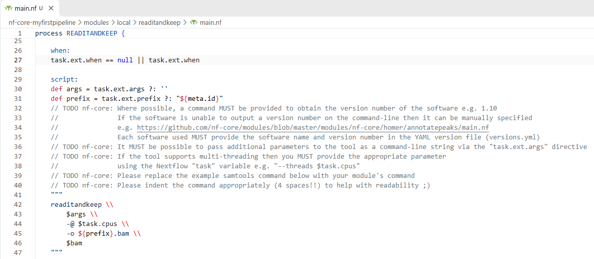


We're going to keep the first two lines as is: 

```
def args = task.ext.args ?: ''
def prefix = task.ext.prefix ?: "${meta.id}"
```

Recall that `args` can be set via the `ext.args` within the `conf/modules.config` file, as we did in tutorial 2.
- The `readItAndKeep` [GitHub repo](https://github.com/GlobalPathogenAnalysisService/read-it-and-keep#usage) does have optional arguments that you can add
- But we will not be adding arguments to the `conf/modules.config` file in this tutorial

And `prefix`, by default, is being defined as our `meta.id`, which is accessing one element within our `meta` map.
- This element is the sample ID


Replace what's currently within the """quote sandwich""" with the following:

```
readItAndKeep \\
    --ref_fasta $reference \\
    --reads1 ${reads[0]} \\
    --reads2 ${reads[1]} \\
    --outprefix $prefix \\
    $args \\
    > ${prefix}_scrubbed_results.txt
```

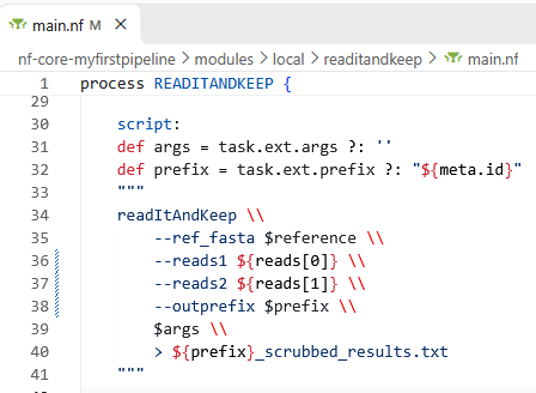


Notice how this is basically what we just did before to run the `readItAndKeep` tool. We have all the same required inputs defined in our script block. 

- We have: 
    - `--ref_fasta` with `$reference` as the input
        - `$reference` is a nextflow variable that we created within the `input:` section 
    - `--reads1` with `${reads[0]}` as the input
        - `$reads` is a nextflow variable that we created within the `input:` section
        - and the `[0]` index captures the forward read
    - `--reads2` with `${reads[1]}` as the input
        - `$reads` is a nextflow variable that we created within the `input:` section 
        - and the `[1]` index captures the reverse read
    - `--outprefix` with `${prefix}` as the input
        - `${prefix}` by default is defined as `${meta.id}` from the `def` line:   
        - `def prefix = task.ext.prefix ?: "${meta.id}"`
    - `$args` 
        - references addtional optional arguments we may want to define in `conf/modules.config` and is defined from the `def` line:   
        - `def args = task.ext.args ?: ''`
    - And finally, here we redirect the output to a `txt` file: `> ${prefix}_scrubbed_results.txt`
        - `${prefix}` captures different sample IDs and thus multiple `txt` file outputs if we had multiple samples
        - Notice how the `_scrubbed_results.txt` is exactly what we defined in the `output:` section to capture this file output properly in our results directory
        - Just `path('*.txt')` in the `output:` section would have been *fine*, but what if you had multiple `txt` file outputs from a tool and wanted to differentiate them for dowmstream processes?
 

<br>

> [!Note]
> `reads[0]` (and `reads[1]`) need to be in curly brackets `${reads[0]}` (`${reads[1]}`) <br>
> For example, if `$reads[0]` was used as input into the `--reads1` parameter, the script would read this as <br>
> `--reads1 SRR39817210_R1_001.fastq.gz SRR39817210_R2_001.fastq.gz[0]` <br>
> Without the curly brackets, the `[0]` is being treated as literal text, rather than as an index operation. The curly brackets are needed to capture the index.

In general, curly brackets are needed to distinguish nextflow variables from general text. For example, when we define our `txt` file output, `${prefix}_scrubbed_results.txt`, the curly brackets are needed to maintain our nextflow variable `${prefix}` to incorporate unique sample IDs into the file name.

Curly brackets are not needed with standalone variables, like `$reference`, `$prefix` (specified in the `--outprefix` parameter), and `$args`. But they also don't hurt to have them, if you want consistency. This is totally fine, too:

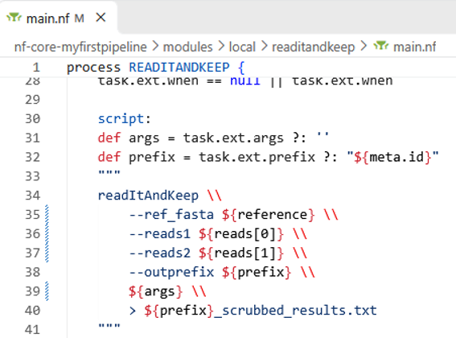


Save the file:

```
ctrl + s
```

Righteous! We've completed the edits to the `modules/local/readitandkeep/main.nf` file. Next, we need to edit the remaining files to properly incorporate the `READITANDKEEP` module into our pipeline.

# Part III: Incorporating a new module into the pipeline

### Incorporate reference fasta in assets directory

From our `projectDir`, `/workspaces/mdhhs_nextflow_training/nf-core-myfirstpipeline`, make a directory within the `assets/` directory called `references/` and then change into the `references/` directory.

```
cd /workspaces/mdhhs_nextflow_training/nf-core-myfirstpipeline
mkdir -p assets/references
cd assets/references
```

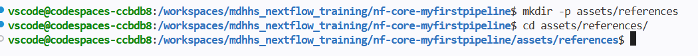

Retrieve the measles D8 genotype reference fasta file (`MH356245`) from the [phac-nml/measeq pipeline](https://github.com/phac-nml/measeq):

```
wget https://raw.githubusercontent.com/phac-nml/measeq/refs/heads/main/assets/reference/D8/MH356245.1.reference.fasta
```

Great, our reference file for mapping has been obtained. 

> [!Note]
> In theory, we can add our reference file within a different directory.
> But best standard practice in nextflow (and nf-core) is to place reference files and databases within the `assets/` directory.

### Create a new parameter for the reference file in nextflow.config

Open the `nexflow.config` file present in the `projectDir`.

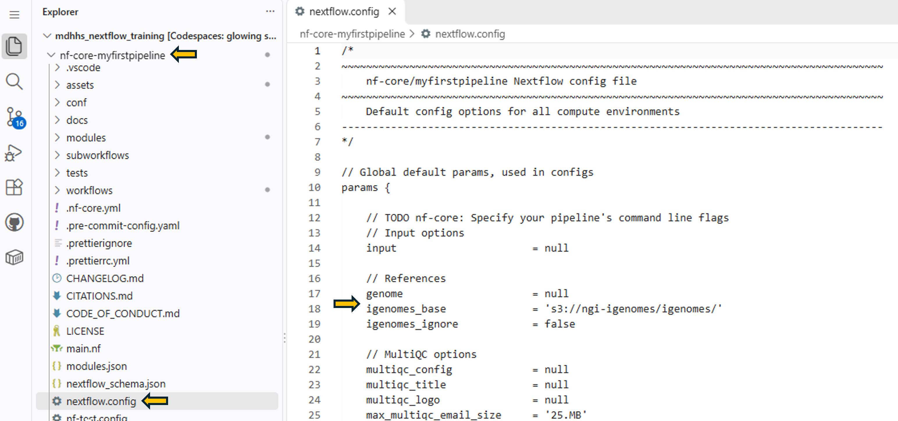

Again, `nextflow.config` can be viewed as a global configuration file, setting configs for nextflow behavior and configs meant to be set for all pipelines. Imagine we were creating a measles nextflow pipeline with two workflows, one for Illumina reads and one for ONT reads, placing a reference file here makes this reference fasta easily accessible to all workflows. 
- And we will place the path to our reference file with a new parameter called `reference` just below the `genome` parameter.

> [!Note]
> We are not making use of the `genome` parameter to provide our path to our reference file. <br>
> nf-core has built-in support for reference genomes in `conf/igenomes.config` that crosschecks with the `genome` parameter during pipeline initialization. <br>
> Our script would break trying to define our measles reference file path as the `genome` parameter so instead, we make a new parameter called `reference`. <br>

<br>

```
reference = "${projectDir}/assets/references/MH356245.1.reference.fasta"
```


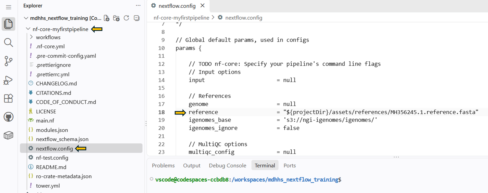


Again, `projectDir` is a nextflow varible that provides the path to where our pipeline code is. In our case, that's `/workspaces/mdhhs_nextflow_training/nf-core-myfirstpipeline`. From there, we completed the path to the reference file that we just downloaded via `assets/references/MH356245.1.reference.fasta`.
- `projectDir` makes it so that this variable becomes general use for anyone trying to run this pipeline on their computer. 
- `projectDir` captures the full path from root, and that is different for people working on different computing systems.
- Defining our `reference` parameter as `reference = "/workspaces/mdhhs_nextflow_training/nf-core-myfirstpipeline/assets/references/MH356245.1.reference.fasta"` is not broadly applicable 
- `reference = "${projectDir}/assets/references/MH356245.1.reference.fasta"` is broadly applicable. 


Now take a moment to look through the `nextflow.config` file. There's a lot discover here but I would like to cover two things:

First point, take notice of the `params` block:


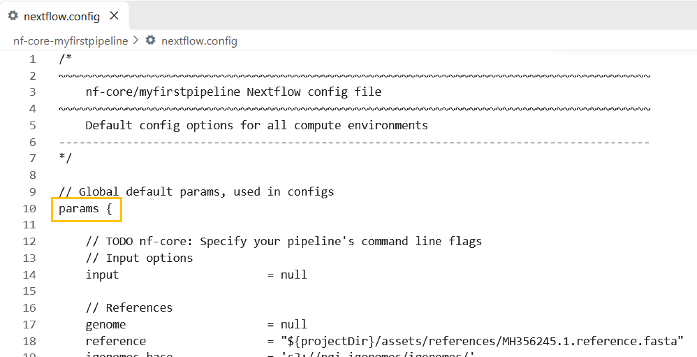


All parameters within this block can be accessed via declaration of `params.parameter_defined_in_block`.

So for example, for our `reference` parameter that we just made, we can access it via:
- `params.reference`
- We will see this in a second when we edit our workflow script.

<br>

Sedcond, take a look near line 60:

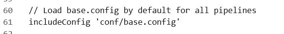

And near line 272:

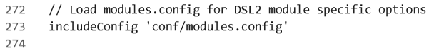

You can see that this `nextflow.config` file is pulling in various other config files, including `base.config` and `modules.config`. This is just part of the organizational style of nextflow. In theory, you could define all these components within the `nextflow.config` file, but breaking out these config files into specified files makes pipeline organization better. We're only working with one reference file for this tutorial but you could even make a [conf/reference.config](https://github.com/phac-nml/measeq/blob/main/conf/reference.config) file if you wanted to reference multiple measles genomes and then you would add the following line to your `nextflow.config` file:
- `includeConfig 'conf/reference.config'`  

Save the file:

```
ctrl + s
```

### Edit the workflow script to incorporate the READITANDKEEP module into our pipeline

Open the `workflows/myfirstpipeline.nf` script:


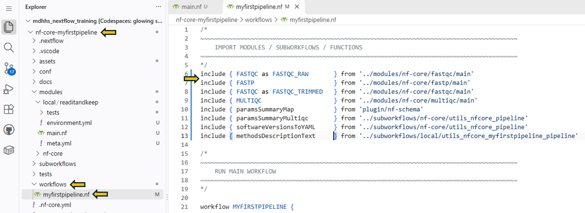


Remember, our first step in this is to import the module. I'm going to import it after `FASTQC_RAW` because we are scrubbing our raw reads. Import order doesn't matter in terms of script functioning, it's purely organizational:

```
include { READITANDKEEP              } from '../modules/local/readitandkeep/main'
```

<br>

> [!Note]
> All previous imports used the `../modules/nf-core/` path.
> Here, we need to use the `../modules/local` path

<br>

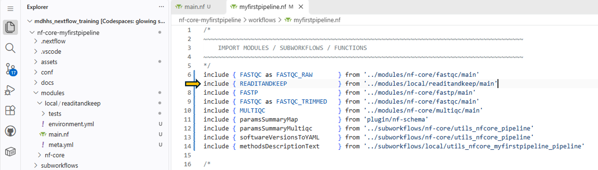

Our current workflow script looks as follows:

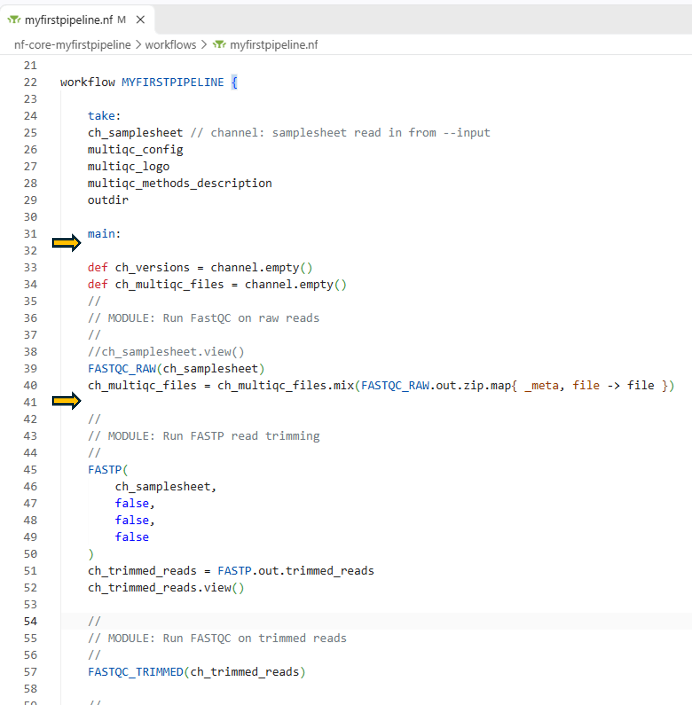

We're going to add the following lines in the area indicated in the first arrow:

```
//Check for the existence of a reference file and create a channel
def ch_reference = channel.value(file(params.reference, checkIfExists: true))
ch_reference.view()
```

**Note that `ch_trimmed_reads.view()` is also present so we'll be able to view the output channel from `FASTP`, as well.** 

And place this code in the space of the second arrow:

```
//
// MODULE: Run readItAndKeep for read scrubbing
//
READITANDKEEP(
    ch_samplesheet
    ch_reference
)
```

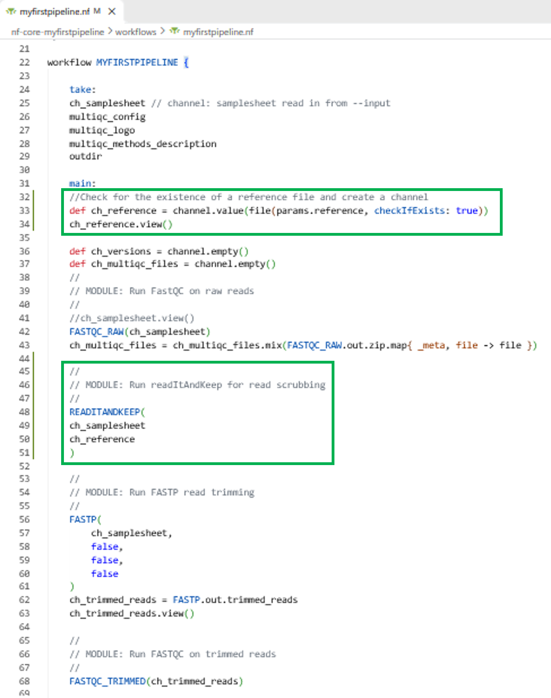

In the first code block, we are defining our `ch_reference`. Because we're pulling it directly from a directory within the pipeline and not capturing it as an out channel of a module (`MODULE.out.emit`), we have to define (`def`) it explicitly in the workflow. 

- The first part of the definition is defining this as a [value channel](https://docs.seqera.io/nextflow/reference/stdlib-namespaces/channel#value), `channel.value`
- The second part, `file()` is a function to obtain a reference file by name.
    - This is where the `/path/to/the/reference/file.fa` is defined
    - See [here](https://docs.seqera.io/nextflow/working-with-files) for more
- The third part (and first input to the `file()` function), `params.reference` is referencing the `reference` parameter we created just before in `nextflow.config`
    - In our current set up `params.reference` = `"${projectDir}/assets/references/MH356245.1.reference.fasta"`
    - In reality, `params.reference` can be defined in various config files and this will be explored in the challenge section. 
- The last part (and second input to the `file()` function), `checkIfExists: true` is a built-in [function](https://docs.seqera.io/nextflow/reference/stdlib-namespaces/channel#checkifexists) that will error out the pipeline if the reference file is not found
    - Because we set it to `true`

We will view this channel we created with `ch_reference_view()` when the script runs.

The second code block is explicitly invoking the `READITANDKEEP` module
- Remember, the number of inputs here need to equal the number of inputs we defined in the `input:` section within the `modules/local/readitandkeep/main.nf` file
- The first input is `ch_samplesheet`, a channel created from the `samplesheet.csv` input containing paths to our raw reads. The channel itself is a tuple in the form of: <br>
`[[id:SRR39817210, single_end:false], [/workspaces/mdhhs_nextflow_training/reads/SRR39817210_R1_001.fastq.gz, /workspaces/mdhhs_nextflow_training/reads/SRR39817210_R2_001.fastq.gz]]`
    - This is the `tuple val(meta),path(reads)` defined in the `input:` section within the `modules/local/readitandkeep/main.nf` file 
- The second input is the `ch_reference` we just defined in the first code block
    - This is the `path reference` defined in the `input:` section within the `modules/local/readitandkeep/main.nf` file 

> [!Note]
> In contrast to the `FASTP` module in tutorial 2, we are not defining any output channels post `READITANDKEEP`.
> The outputs from the `READITANDKEEP` module are not needed for any downstream process.
> And so we do not need to emit any output channels in our workflow script. 

Save the file:

```
ctrl + s
```

Okay, we have everything we need now. Let's test the pipeline!

# Part IV: Testing the pipeline

From the `launchDir`, `/workspaces/mdhhs_nextflow_training/`, download the sample:

```
bash sample_download.sh
```

Create the `samplesheet.csv` file

```
python3 fastq_dir_to_samplesheet.py reads/ samplesheet.csv
```

Run the pipeline:

```
bash run_nextflow_analysis.sh
```

Nooooooooo, not another error! This one is stating that script compilation failed:

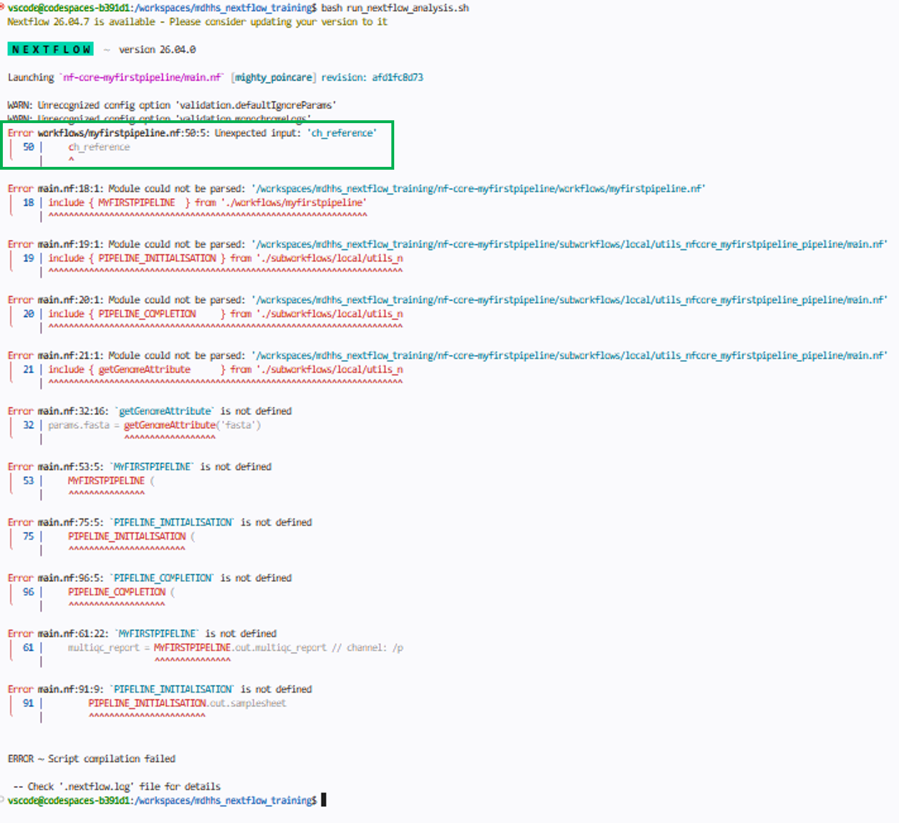

This error output is suggesting that this error is on line 50 of our `workflows/myfirstpipe.sh` script where `ch_reference` was input. 

The error is so subtle. Try to figure out what we left out. Take a look at the `FASTP` module in this script for a hint! 

<details>
<summary>Reveal solution, here</summary>

<br>

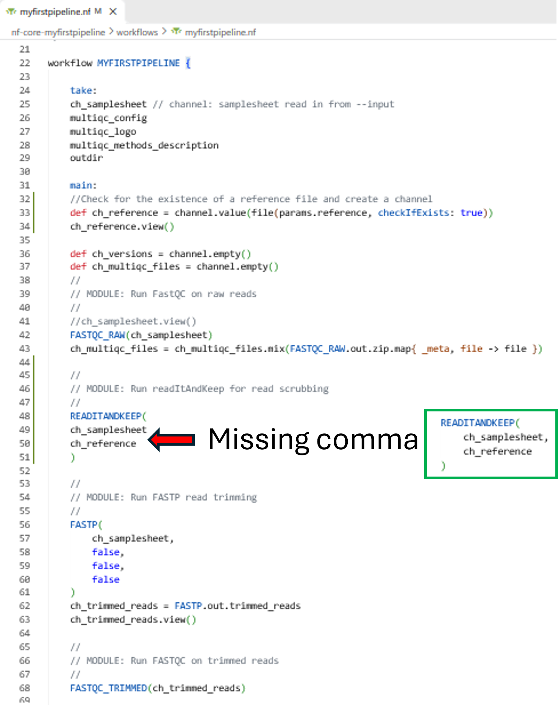

So small, yet so important!

Edit: 

```
READITANDKEEP(
    ch_samplesheet
    ch_reference
)
```

to 

```
READITANDKEEP(
    ch_samplesheet,
    ch_reference
)
```

Then re-save the file:

```
ctrl + s
```


<br>

</details>

<br>

Okay, now rerun the pipeline:

```
bash run_nextflow_analysis.sh
```

Awesome, it looks like the pipeline completed!

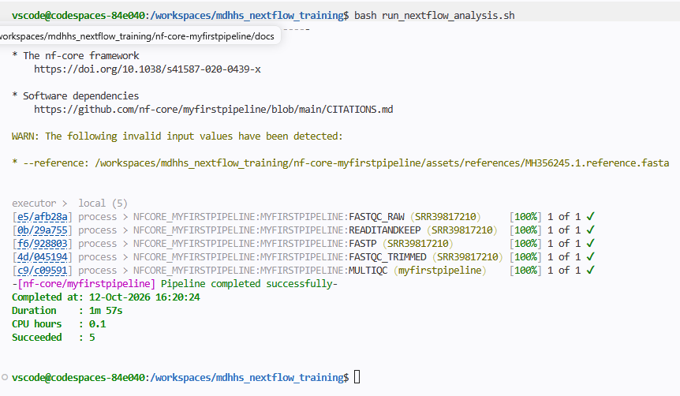


And if we navigate to the work directory for the `READITANDKEEP` process and view the `.command.sh` file:

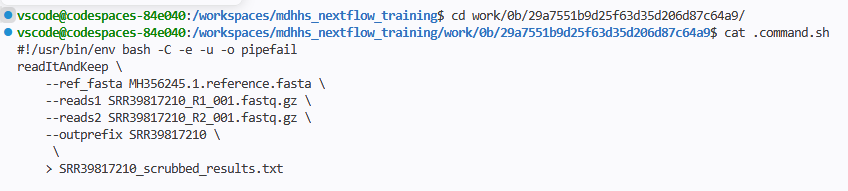

We see that the command for `readItAndKeep` is as expected, and is the same way we ran `readItAndKeep` outside of nextflow earlier in the tutorial.

**Your `work/` directory hash to the READITANDKEEP process will be different**

In addition, did you catch the two outputs from `ch_reference.view()` and `ch_trimmed_reads_view()`?

`ch_reference.view()` output:

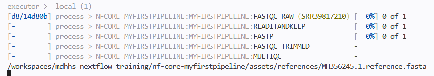

And is as expected because it's the path to the reference fasta file. 

`ch_trimmed_reads_view()` output:

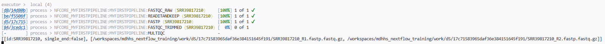

Maintains the `tuple val(meta) path (reads)` structure. We will use `ch_trimmed_reads` in tutorial 4 for the next module. 

# Recap

- Congratulations! You just successfully created and implemented a new module to your pipeline. In doing so, we learned:
    - How to use the nf-core CLI to create a new module
    - The layout of a template module file, specifically `modules/local/readitandkeep/main.nf`and editing it to:
        - define process directives, including sourcing the correct containers
        - defining the expected inputs and outputs
        - editing the script block, similar to how we used `readItAndKeep` outside of nextflow 
    - How to incorporate the module into our workflow through editing of:
        - the `assets/` directory: `assets/references/MH356245.1.reference.fasta` 
        - the `nextflow.config` file to define our new `reference` parameter: `reference = "${projectDir}/assets/references/MH356245.1.reference.fasta"`
        - the workflow script, `workflows/myfirstpipeline.nf`, to create our reference channel, `ch_reference` and implement our `READITANDKEEP` module.


I encourage you to go through the challenge section to learn more about nextflow `config` files. 


# Challenge: Exploring the priority of nextflow config files

Navigate to the GitHub repo for the nextflow tutorial, [here](https://github.com/JLC2141/mdhhs_nextflow_training/tree/tutorial_3_challenge).

If you're relaunching your codespace, launch the `tutorial_3_challenge` branch to have all progress made prior in tutorial 3 so that you can jump directly into this challenge. 

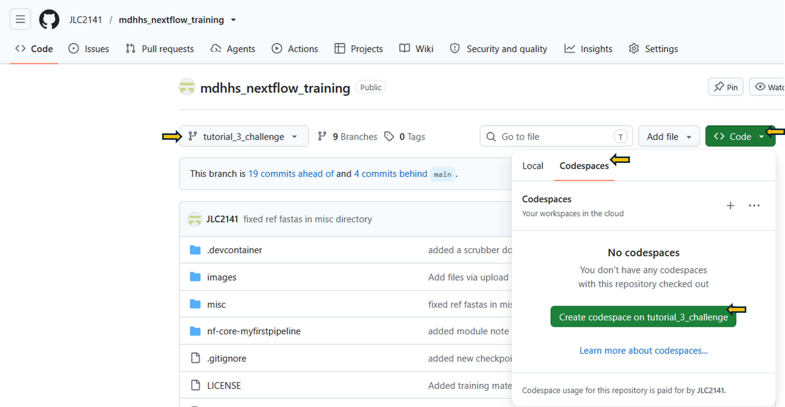

In this challenge, we will dive deeper into nextflow `config` files and see how we can override default parameters via `config` file priority. 

Recall the edits we made to the `nextflow.config` file:


We specified the path to our reference file as such: 

```
params {
    reference = "${projectDir}/assets/references/MH356245.1.reference.fasta"
}
```

So at the moment, when we run our pipeline in its current form, params.reference is pointing to `MH356245.1.reference.fasta`, which is the measles genotype D8 reference file.

Let's go ahead and download the other two genotype reference fasta files to the `assets/reference/` directory. From our `launchDir`, navigate to `nf-core-myfirstpipeline/assets/reference/`

```
cd nf-core-myfirstpipeline/assets/references/
```

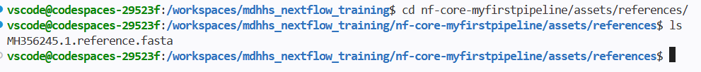

Obtain the genotype A reference file:

```
wget https://raw.githubusercontent.com/phac-nml/measeq/refs/heads/main/assets/reference/A/FJ211590.fasta
```

And the genotype B3 reference fasta file:

```
wget https://raw.githubusercontent.com/phac-nml/measeq/refs/heads/main/assets/reference/B3/MK513622.1.reference.fasta
```

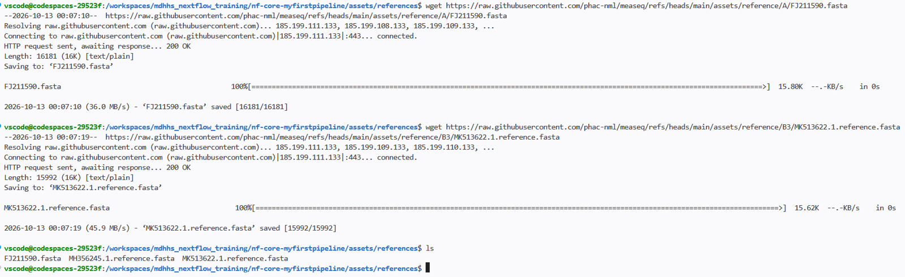

Now navigate back to the `launchDir` and make a file called `tutorial.config`

```
cd /workspaces/mdhhs_nextflow_training/
touch training.config
```

Select the `tutorial.config` file in the file explorer panel to open the editor and place the following code in the file:

```
params {
    reference = "${projectDir}/assets/references/MK513622.1.reference.fasta"
}
```

Note how we are now providing the path to the B3 genotype reference fasta file and creating the parameter `reference` again via the `params {}` encapsulation. 

Save the file:

```
ctrl + s
```

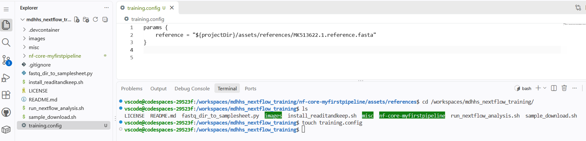

Now, select the `run_nextflow_analysis.sh` file in the file explorer panel to open the editor and edit the file as follows:

```
nextflow run nf-core-myfirstpipeline/main.nf \
    -profile docker \
    --input samplesheet.csv \
    --outdir results \
    -c training.config
```

> [!Note]
> Make sure that you only use one dash for the `-c` in `-c training.config`


We are adding a break line (`\`) to the `--outdir results` line and adding the `-c training.config` line just below it. 

Save the file:

```
ctrl + s
```

From the `launchDir`, `/workspaces/mdhhs_nextflow_training/`, download the sample:

```
bash sample_download.sh
```

Create the `samplesheet.csv` file

```
python3 fastq_dir_to_samplesheet.py reads/ samplesheet.csv
```

Run the pipeline:

```
bash run_nextflow_analysis.sh
```

Upon pipeline launch, you'll notice a couple things. First, our config file is listed in the `Core Nextflow options` section


And second, because we still have the `ch_reference.view()` operator in our workflow script, we see the reference that is used in our pipeline:


Whoa! It changed! The reference used to be genotype D8 (`MH356245.1.reference.fasta`) but now it's genotype B3 (`MK513622.1.reference.fasta`), the one we specified in the `training.config` file, **even though reference genotype D8 (`MH356245.1.reference.fasta`) is still specified as a `reference` parameter in `nextflow.config`**.

And if you really want to convince yourself of this, navigate to the `READITANDKEEP` task in your `work` directory and view the `.command.sh` file.


**Your `work/` directory hash to the READITANDKEEP process will be different**

Okay, let's have some fun and try something else. From our `launchDir`, `/workspaces/mdhhs_nextflow_training/`, make a new file called `params.yml`:

```
touch params.yml
```

Now, select the `params.yml` file in the file explorer panel to open the editor and add the following code:


```
reference: "${projectDir}/assets/references/FJ211590.fasta"
```

Note how we are now providing the path to the genotype A reference fasta file and creating the parameter `reference`, though slightly different than the way we just did it in the `training.config` file. But this is just expected formatting for these two different file types. Both achieve the same end goal of making a `reference` parameter. 


Save the file:

```
ctrl + s
```

Reopen the `run_nextflow_analysis.sh` file in the file explorer panel to open the editor and edit the file as follows:


```
nextflow run nf-core-myfirstpipeline/main.nf \
    -profile docker \
    --input samplesheet.csv \
    --outdir results \
    -c training.config \
    -params-file params.yml
```
> [!Note]
> Make sure that you only use one dash at the front of `params-file` in `-params-file params.yml`


We are adding a break line (`\`) to the `-c training.config` line and adding the `--params-file params.yml` line just below it. 

Save the file:

```
ctrl + s
```

Restart the nextflow pipeline: 

```
bash run_nextflow_analysis.sh
```

What is this magic? Now we see that the reference file for `params.reference` points to the genotype A reference file, **even though reference genotype D8 (`MH356245.1.reference.fasta`) is still specified as a `reference` parameter in `nextflow.config` and, reference genotype B3 (`MK513622.1.reference.fasta`) is still specified as a `reference` parameter in the `training.config` file.**


And if you really want to convince yourself of this, navigate to the `READITANDKEEP` task in your `work` directory and view the `.command.sh` file.


**Your `work/` directory hash to the READITANDKEEP process will be different**

Well, I'm sorry to break it to you, but this isn't magic. This is how nextflow was built to prioritize various configuration files. The priority, from highest to lowest is as follows:


Focusing on the top four configuration types:

command line `--specified_parameter` > `-params-file params.yml` > `-c custom.config` > `nextflow.config`

Meaning, these are ways to override exisiting parameters in our pipeline by placing these parameters in one of these configuration formats that have higher priority. That is why the `reference` parameter for specifying the reference file for genotype B3 took priority in the `training.config` file over the `reference` parameter for specifying the reference file for genotype D8 in the `nextflow.config` file. And then the `reference` parameter for specifying the reference file for genotype A took priority in the `params.yml` file over both `training.config` and `nextflow.config`.

Find more information on this prioritization [here](https://docs.seqera.io/nextflow/config) and [here](https://ggrimes.github.io/workflows-nextflow/08-configuration/index.html#how-configuration-files-are-combined)

A variety, and prioritization, of config files allows you to tailor your workflow toward your needs. The highest priority is specifying a parameter directory on the command link invocation of the nextflow pipeline via `nextflow run`. 

For example, let's try to get our D8 genotype back as our `reference` parameter. Reopen the `run_nextflow_analysis.sh` file in the file explorer panel to open the editor and edit the file as follows:


```
nextflow run nf-core-myfirstpipeline/main.nf \
    -profile docker \
    --input samplesheet.csv \
    --outdir results \
    -c training.config \
    -params-file params.yml \
    --reference '/workspaces/mdhhs_nextflow_training/nf-core-myfirstpipeline/assets/references/MH356245.1.reference.fasta'
```


We are adding a break line (`\`) to the `-params-file params.yml` line and adding the `--reference '/workspaces/mdhhs_nextflow_training/nf-core-myfirstpipeline/assets/references/MH356245.1.reference.fasta'` line just below it. 

Save the file:

```
ctrl + s
```

Restart the nextflow pipeline: 

```
bash run_nextflow_analysis.sh
```

And voila, our genotype D8 reference file returns as the `reference` parameter.


But do you notice the big drawback to this method of defining the `--reference` parameter via the command line? We need to define the whole path for the reference file. In this case, `${projectDir}/assets/references/MH356245.1.reference.fasta'` doesn't work. Other built in nextflow features, like `-params-file params.yml` and a custom config file `-c training.config` are meant to function inside of nextflow so nextflow core options, like `projectDir` are useable inside of those config files. 

Parameters requiring a path are not ideal as a parameter specified within the `nextflow run` command line. But for the purpose of this challenge, I just wanted to demonstrate how nextflow prioritizes config files and parameter overrides. 

So in summary, we learned two major things about configuration files from this tutorial. 

1) You can make as many `config` files as you want to be imported into `nextflow.config`
    - `base.config`
    - `modules.config`
    - `references.config`

It's just an organizational preference. 

2) Nextflow prioritizes config files such that it can be used to override parameters in your pipeline.
